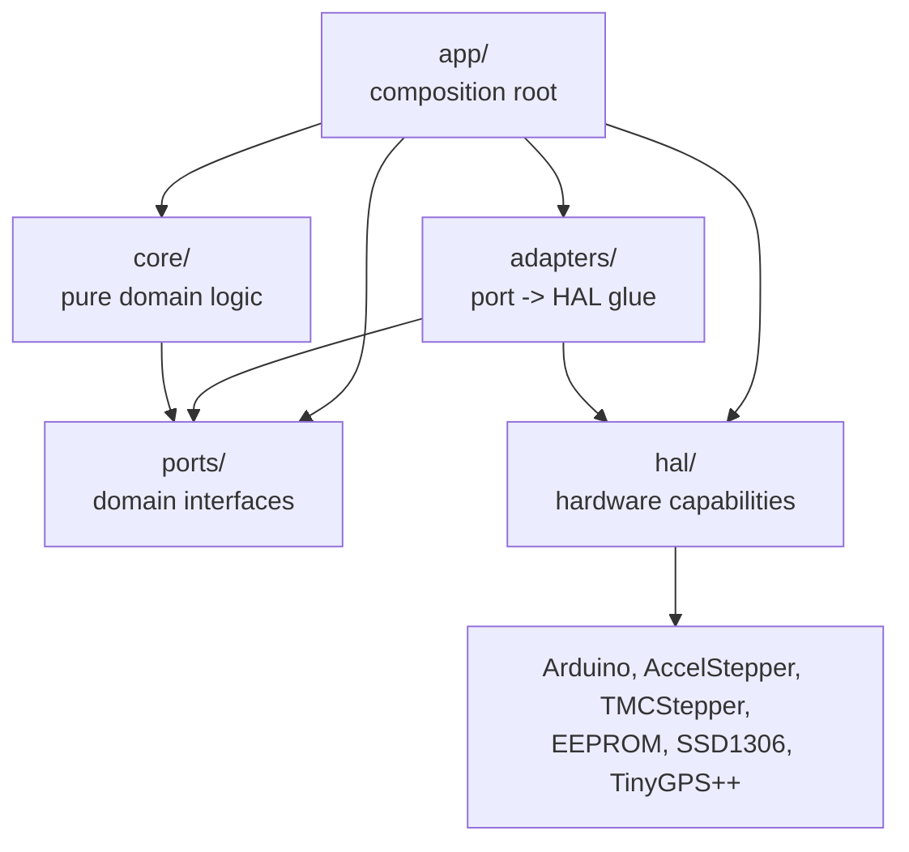

# Architecture

Goal architecture for OpenAstroTracker-Firmware: a hardware-independent domain core behind
explicit ports, adapters that bind those ports to the Arduino/HAL layer, and one composition
root per board.

See [PLAN.md](PLAN.md) for the migration plan.

---

## 1. Overview

The firmware drives an equatorial mount over a Meade LX200 serial protocol and runs on several
boards with different stepper drivers, displays and accessories.

The design separates four concerns:

| Concern | Owner |
|---------|-------|
| What the mount should do | `core/` — pure domain logic |
| What the domain needs from outside itself | `ports/` — domain interfaces |
| What the hardware can do | `hal/` — hardware capabilities and platform backends |
| Which combination runs on this board | `app/` — composition root |

Adapters sit between the middle two: each adapter implements a port using one or more HAL
services, and nothing else.

The resulting call graph is identical on every board. Board differences appear only as different
objects constructed in the composition root, never as different code paths in the domain.

---

## 2. Design principles

1. **The dependency rule is absolute.** `core/` may depend only on `ports/`. `adapters/` may depend
   on `ports/` and `hal/`. `hal/` may depend on hardware libraries. `app/` may depend on everything.
   Nothing points outward from an inner layer.

2. **The domain is hardware-free.** `core/` never includes `<Arduino.h>`, never uses `String`,
   `Serial`, `millis()`, `LOG()`, or a board pin header. It uses standard C++ and `etl::` where a
   container is required, because the firmware builds with `-D ETL_NO_STL`.

3. **Ports describe needs, HAL describes capabilities.** A port answers "what does the domain
   want" (`IStepperAxis::moveTo`, `IClock::now`). A HAL interface answers "what can this platform
   do" (`IStepperMotor::moveTo`, `ISerialPort::read`). An adapter composes HAL services to satisfy a
   port, so a new stepper library needs a new HAL backend and a new domain requirement needs a
   port, never the other way round.

   A HAL backend may wrap a platform library rather than a bare chip register: `IStepperMotor` is
   the motion-engine surface (`moveTo`, `setSpeed`, `run`/`runSpeed`, `currentPosition`,
   `distanceToGo`, `isRunning`, `setPinsInverted`, …), implemented by `AccelStepper` on
   ESP32/RP2040 and by the vendored `InterruptStepper` on AVR. Library names therefore appear only
   under `hal/`, never in `ports/` or `core/`.

4. **Configuration is read exactly once, in the composition root.** `Configuration*.hpp` macros are
   consumed by a `MountConfig` builder in `app/`; every layer below receives runtime objects.

5. **Runtime polymorphism replaces compile-time feature flags.** Optional axes (AZ, ALT, Focus) are
   either constructed or replaced by a null-object controller. Driver variants are selected as an
   `IMotorDriver` implementation at composition time. Feature `#ifdef`s therefore collapse into a
   single tested call graph instead of 2^N build variants.

6. **Testability is a design constraint.** If a decision cannot be exercised on the host, it belongs
   in an adapter, and the decision itself belongs in `core/`. The domain core is tested with faked
   ports; the target is ≥ 85% line coverage of `core/` with behavioural tests.

7. **Step generation is a backend detail; ISR boundaries are explicit where they exist.** Whether
   steps come from an MCU timer (AVR), a FreeRTOS task (ESP32), a polled engine (RP2040) or the
   driver itself (a TMC2209 in `VACTUAL` mode pulses nothing) is decided entirely inside `hal/`
   and never influences the core's structure. Where a backend *does* step from interrupt context,
   `IStepperAxis` separates the ISR-safe read (`snapshot()`) from main-loop-only mutation, so no
   controller can hide a cross-context call.

8. **The wire protocol is the only immovable contract.** Meade LX200 behaviour is frozen
   byte-for-byte so Stellarium and ASCOM keep working. Internal C++ APIs may change freely.

9. **Respect the AVR budget.** 256 KB flash and 8 KB SRAM on the ATmega2560: keep the vtable count
   small, mark adapters `final`, and allow static dispatch for hot paths if flash pressure demands
   it.

10. **Coordination is explicit and has one owner.** Controllers are peers only in the type system:
    none calls another's mutating methods. They read `MountState`, publish facts on `EventBus`, and
    ask `MountCoordinator` for anything that changes another controller's behaviour. No handler
    blocks waiting for an action to finish.

---

## 3. Layers

| Layer | Directory | May depend on | Contains | Test strategy |
|-------|-----------|---------------|----------|---------------|
| **Core** | `src/core/` | `src/ports/` | Controllers (`SlewController`, `TrackingController`, `GuidingController`, `HomingController`, `ParkingController`, `FocusController`, `AzAltController`), algorithms (`SiderealClock`, `CoordinateMath`, `CalendarMath`, `CoordinateFormatter`, `RaTrackingLimit`, `SlewProgressReport`), value types (`DayTime`, `RightAscension`, `Declination`, `Latitude`, `Longitude`), `MeadeParser`, `MountState`, `MountCoordinator`, `EventBus`, `MountConfig` | Host unit tests with faked ports in the `native` PIO env. No hardware, no Arduino. |
| **Ports** | `src/ports/` | the pure value types in `core/types/`, nothing else | `IClock`, `IScheduler`, `ILogger` (+ `LogFormat`), `IPersistentStore`, `IMountSettings`, `IStepperAxis` (+ `AxisSnapshot`), `IMotorDriver`, `IHomingSensor`, `IEndSwitch`, `IDisplay`, `IInfoDisplay` (+ `InfoDisplayState`), `ITransport`, `IGps`, `IGyro`, `IMountMotion`, `IMountConfiguration`, `IMountOptionalAxes`, `IMountReadModel`, `IMountSiteTime`, `IMountEvents` | Interfaces only — nothing to test. |
| **Adapters** | `src/adapters/` | `src/ports/` + `src/hal/` | `ArduinoClock`, `ArduinoScheduler`, `SerialLogger`, `NullLogger`, `EepromPersistentStore`, `MountSettingsStore`, `StepperAxis`, `Tmc2209Driver`, `NullMotorDriver`, `SerialTransport` (both transports — the Wi-Fi path is `SerialTransport<128>`), `TinyGpsAdapter`, `MeadeCommandAdapter`, `InfoDisplayPanel` | Integration tests against a faked HAL (`test_adapters`). The Arduino-dependent adapters (`MeadeCommandAdapter`, `SerialLogger`, `TinyGpsAdapter`, `Tmc2209Driver`, `InfoDisplayPanel`, the clock/scheduler) are compile-verified by the board builds instead, and `[env:native]` excludes them so the coverage number stays honest. |
| **HAL** | `src/hal/` | hardware libraries | Interfaces (`IGpioPin`, `ISerialPort`, `ISpiBus`, `II2cBus`, `IEeprom`, `IStepperMotor` (motion engine), `ITmcDriver`, `IOledPanel`, `ICharLcd`, `IButtonMatrix`, `ITimerService`, `ISystemClock`, `IWifiStack`), `InterruptCallback` (the ISR-to-function trampoline), `EepromLayout.hpp`, `InMemoryEeprom`, `WarningGuard.hpp`, plus per-platform backends (`arduino/`, `avr/`, `esp32/`, `rp2040/`). AVR wraps its vendored timer-ISR engines behind `InterruptStepperMotor`, exactly as the other platforms wrap their engine libraries. | Not host-tested; verified on hardware. |
| **App** | `src/app/` | all layers | Composition root: reads `Configuration*.hpp` into `MountConfig`, selects HAL backends, constructs adapters and controllers, owns the entry point | On-device smoke tests. |

### Dependency direction



Adapters are the only layer that touches both a port and a HAL interface; that is their entire
responsibility. `core/` never sees a HAL type, and `hal/` never sees a domain concept such as RA
or DEC.

`ports/` is otherwise dependency-free, with one deliberate exception: a port may name a value type
from `core/types/` when that type *is* the vocabulary (`IMountSettings` returns a `core::DayTime`, a
`core::Latitude`, a `core::Longitude`). Those headers are pure data with no behaviour that could call
back into the domain, so the arrow `core/ → ports/` is not cycled at the file level. A port must not
include a `core/` header that has behaviour.

### What still sits outside this layering

The refactor is finished for the command path, the motion path and the controllers. What is left is
UI and two peripherals, and it is left deliberately rather than by oversight — each item is listed
with what would finish it:

| Still outside | Why it is still there | What would finish it |
|---|---|---|
| `LcdMenu`, `LcdButtons`, `c7*_menu*.hpp` | moved: every screen now takes `app::UiPorts` (motion, configuration, read model, site/time, optional axes, clock, scheduler), so it names no `Mount` | the coordinator implements the same ports and `UiPorts` is built from it |
| `SSD1306_128x64_Display` | renders from `Mount` (pull) behind `InfoDisplayPanel` (push): `Mount` no longer calls it, but it still reads it | render from `ports::IInfoDisplay`'s snapshot struct instead of the mount |
| `EPROMStore` | static facade kept for the menu screens; `Mount` already uses `ports::IMountSettings` | delete once the menus use the typed store |
| `Gyro`, `HallSensorHoming`, `EndSwitches` | hardware-coupled helpers `Mount` still calls directly; the `IGyro`, `IHomingSensor` and `IEndSwitch` ports exist but nothing implements them yet | adapters over `hal::II2cBus` / `hal::IGpioPin` — the homing one needs the polling-rate decision recorded in `core/HomingController` |
| `c_buttons.hpp`, `a_inits.hpp` | the object graph and the entry point have moved to `app/` (`BoardWiring`, `main.cpp`, `SerialPump.hpp`, `MotorWiring`), and `b_setup.hpp` is deleted; what is left is the UI loop and the globals the menu screens still read | move with the menu screens (step 4 of Phase 7); no design change |

---

## 4. File layout

Paths are relative to the repository root.

```text
OpenAstroTracker-Firmware/
├── ARCHITECTURE.md
├── PLAN.md
├── platformio.ini                       # one env per board + the `native` host-test env
├── matrix_build.py                      # multi-configuration firmware build driver
├── Configuration.hpp                    # board-independent defaults
├── Configuration_adv.hpp                # advanced defaults (steps, speeds, microstepping)
├── Configuration_local_<board>.hpp      # per-board configuration
├── Constants.hpp                        # board IDs, feature-flag values
├── Version.h
│
├── boards/                              # per-board pin maps
│   ├── AVR_MEGA2560/pins_<board>.h
│   ├── AVR_MKS_GEN_L_V1/
│   ├── AVR_MKS_GEN_L_V2/
│   ├── AVR_MKS_GEN_L_V21/
│   ├── ESP32_ESP32DEV/
│   ├── RAMPS/
│   ├── RP2040_JACKW01/
│   └── RP2040_SKR_PICO/
│
├── src/
│   │
│   ├── app/                             # COMPOSITION ROOT
│   │   ├── main.cpp                     # entry point replacing the .ino sketch (done)
│   │   ├── BoardWiring.hpp/.cpp         # assembles the object graph for a board (done)
│   │   ├── SerialPump.hpp               # serial-control loop + transport construction (done)
│   │   ├── MotorWiring.hpp/.cpp         # builds every axis engine for the board (done)
│   │   ├── DriverWiring.hpp/.cpp        # builds + programs the TMC2209 UART drivers (done)
│   │   ├── SensorWiring.hpp/.cpp        # builds end switches and hall sensors (done)
│   │   └── MountConfigBuilder.hpp       # Configuration*.hpp -> runtime MountConfig (done)
│   │
│   ├── adapters/                        # PORT -> HAL GLUE
│   │   ├── ArduinoClock.hpp/.cpp        # IClock            <- ISystemClock          (done)
│   │   ├── ArduinoScheduler.hpp/.cpp    # IScheduler        <- Arduino yield()       (done)
│   │   ├── SerialLogger.hpp/.cpp        # ILogger           <- ISerialPort + clock   (done)
│   │   ├── NullLogger.hpp               # ILogger           null object for DEBUG_NONE builds (done)
│   │   ├── EepromPersistentStore.*      # IPersistentStore  <- IEeprom               (done)
│   │   ├── MountSettingsStore.hpp       # IMountSettings    -> EEPROMStore facade    (done)
│   │   ├── StepperAxis.hpp/.cpp         # IStepperAxis      <- IStepperMotor         (done)
│   │   ├── Tmc2209Driver.hpp/.cpp       # IMotorDriver      <- TMCStepper            (done)
│   │   ├── NullMotorDriver.hpp          # IMotorDriver      null object for non-TMC builds (done)
│   │   ├── TinyGpsAdapter.hpp/.cpp      # IGps              <- TinyGPS++ + Stream    (done)
│   │   ├── SerialTransport.hpp          # ITransport        <- ISerialPort (serial + Wi-Fi) (done)
│   │   ├── MeadeCommandAdapter.hpp/.cpp # IMeadeHandlers    <- the six mount ports (done)
│   │   ├── WifiControl.hpp/.cpp          # Meade over TCP + SkyFi UDP discovery (done)
│   │   ├── TcpConnectionPort.hpp/.cpp    # ISerialPort over ITcpConnection (done)
│   │   ├── InfoDisplayPanel.hpp/.cpp    # IEventSink        -> InfoDisplayRender     (done)
│   │   ├── HallHomingSensor.hpp/.cpp    # IHomingSensor     <- IGpioPin              (not built)
│   │   ├── GpioEndSwitch.hpp/.cpp       # IEndSwitch        <- IGpioPin              (not built)
│   │   ├── LcdMenuDisplay.hpp/.cpp      # IDisplay          <- ICharLcd / IButtonMatrix (not built)
│   │   └── Ssd1306InfoDisplay.hpp/.cpp  # IInfoDisplay      <- IOledPanel            (not built)
│   │
│   ├── ports/                           # DOMAIN INTERFACES
│   │   ├── IClock.hpp
│   │   ├── IScheduler.hpp
│   │   ├── ILogger.hpp
│   │   ├── LogFormat.hpp                # opaque, PROGMEM-safe log format handle
│   │   ├── IPersistentStore.hpp
│   │   ├── IMountSettings.hpp           # typed view of the persisted settings
│   │   ├── IStepperAxis.hpp             # + AxisSnapshot, threading contract
│   │   ├── IMotorDriver.hpp
│   │   ├── IHomingSensor.hpp
│   │   ├── IEndSwitch.hpp
│   │   ├── IDisplay.hpp
│   │   ├── IInfoDisplay.hpp             # + InfoDisplayState
│   │   ├── ITransport.hpp               # + writeResponse (egress for deferred replies)
│   │   ├── IGps.hpp                     # + GpsFix
│   │   ├── IGyro.hpp                    # + GyroAngles
│   │   ├── IMountMotion.hpp             # what the command layer may ask the mount to do
│   │   ├── IMountConfiguration.hpp      # + IMountMotion: the adjustable settings
│   │   ├── IMountOptionalAxes.hpp       # focuser, AZ/ALT — no-ops when absent
│   │   ├── IMountReadModel.hpp          # coordinates, derived HA/LST, status strings
│   │   ├── IMountSiteTime.hpp           # latitude, longitude, clock (core:: types)
│   │   └── IMountEvents.hpp             # subscribe/unsubscribe (deferred replies)
│   │
│   ├── hal/                             # HARDWARE CAPABILITIES
│   │   ├── IGpioPin.hpp
│   │   ├── ISerialPort.hpp
│   │   ├── ISpiBus.hpp
│   │   ├── II2cBus.hpp
│   │   ├── IEeprom.hpp
│   │   ├── IStepperMotor.hpp
│   │   ├── ITmcDriver.hpp
│   │   ├── IOledPanel.hpp
│   │   ├── ICharLcd.hpp
│   │   ├── IButtonMatrix.hpp
│   │   ├── ITimerService.hpp
│   │   ├── ISystemClock.hpp
│   │   ├── IWifiStack.hpp               # + ITcpListener/ITcpConnection/IUdpSocket
│   │   ├── EepromLayout.hpp             # storage layout constants
│   │   ├── InMemoryEeprom.hpp           # RAM-backed IEeprom (USE_DUMMY_EEPROM builds)
│   │   ├── WarningGuard.hpp             # PUSH/POP_NO_WARNINGS fallbacks for backends
│   │   ├── StepperMotorFactory.*        # axis role -> engine for the current platform
│   │   ├── arduino/                     # generic Arduino backends:
│   │   │   ├── ArduinoSystemClock.*     #   ISystemClock
│   │   │   ├── ArduinoGpioPin.*         #   IGpioPin
│   │   │   ├── ArduinoSerialPort.*      #   ISerialPort over any Stream
│   │   │   ├── ArduinoEeprom.*          #   IEeprom
│   │   │   └── AccelStepperMotor.*      #   IStepperMotor (ESP32 + RP2040)
│   │   ├── avr/                         # AVR timer-ISR engines and vectors:
│   │   │   ├── InterruptAccelStepper.h  #   vendored ISR-driven engine
│   │   │   ├── InterruptStepperMotor.hpp#   IStepperMotor over an ISR engine
│   │   │   ├── InterruptStepperFactory.hpp #  one factory per axis role
│   │   │   ├── StepperConfiguration.hpp #   engine types and slew/trk rates
│   │   │   └── TimerIsrVectors.cpp      #   TIMER1/3/4/5 ISR vectors
│   │   ├── esp32/                       # Esp32TimerService, Esp32WifiStack
│   │   └── rp2040/                      # Rp2040TimerService
│   │
│   ├── core/                            # PURE DOMAIN — no Arduino
│   │   ├── meade/
│   │   │   ├── MeadeParser.cpp/.hpp
│   │   │   ├── MeadeProtocol.hpp
│   │   │   ├── MeadeParserHelpers.cpp/.hpp
│   │   │   ├── CommandAssembler.hpp      # byte stream -> whole commands
│   │   │   ├── PendingReplies.hpp        # deferred replies owed to a host
│   │   │   ├── MountStatusReport.cpp/.hpp# the `:D#` status line
│   │   │   └── MeadeParser{Get,Set,Quit,Distance,Init,SyncControl,
│   │   │       Home,SlewRate,Gps,Focus,Movement,Extra}.cpp
│   │   ├── types/
│   │   │   ├── DayTime.cpp/.hpp
│   │   │   ├── Declination.cpp/.hpp
│   │   │   ├── Latitude.cpp/.hpp
│   │   │   ├── Longitude.cpp/.hpp
│   │   │   └── RightAscension.cpp/.hpp
│   │   ├── SiderealClock.cpp/.hpp       # LST and hour-angle math
│   │   ├── CoordinateMath.cpp/.hpp      # RA/DEC -> stepper positions
│   │   ├── CalendarMath.cpp/.hpp        # date arithmetic, local -> UTC date
│   │   ├── CoordinateFormatter.cpp/.hpp # RA/DEC text formatting
│   │   ├── CoordinateRead.cpp/.hpp      # stepper positions -> RA/DEC
│   │   ├── ActivityState.cpp/.hpp        # status bits -> Parked/Slewing/… classification
│   │   ├── SyncAdjustment.cpp/.hpp       # zero-point correction a sync applies
│   │   ├── FirmwareVersion.cpp/.hpp      # VERSION -> EEPROM migration number
│   │   ├── PersistentConfig.cpp/.hpp     # store load + version migration + DEC limits
│   │   ├── CoordinateText.cpp/.hpp       # RA/DEC format table + menu cursor
│   │   ├── SlewStart.cpp/.hpp            # what starting a slew must do first
│   │   ├── ManualSlew.cpp/.hpp           # direction bits -> axis targets
│   │   ├── DecLimitClamp.cpp/.hpp        # DEC travel-limit policy ("0" = no limit)
│   │   ├── MountRuntimeSettings.hpp      # live EEPROM-backed motion settings
│   │   ├── SiteTime.cpp/.hpp             # latitude/longitude/LST + the session clock
│   │   ├── TrackingController.hpp/.cpp  # sidereal rate, tracker-stop compensation
│   │   ├── SlewController.hpp/.cpp      # slew state machine
│   │   ├── GuidingController.hpp/.cpp   # guide-pulse math and timing
│   │   ├── HomingController.hpp/.cpp    # hall-sensor / end-switch state machine
│   │   ├── ParkingController.hpp/.cpp   # park position and transitions
│   │   ├── FocusController.hpp/.cpp     # optional focus axis
│   │   ├── AzAltController.hpp/.cpp     # optional AZ/ALT axes
│   │   ├── MountState.hpp/.cpp          # typed mount-status enum API
│   │   ├── MountCoordinator.hpp/.cpp    # admission, axis grants, tick order, completion
│   │   ├── EventBus.hpp/.cpp            # PositionChanged, SlewStarted, Parked, ...
│   │   └── MountConfig.hpp              # runtime configuration struct
│   │
│   ├── inc/                             # Arduino-facing globals for app/adapters/hal
│   │   ├── Globals.hpp
│   │   └── Globals.cpp
│   ├── macros/gcc/Macros.hpp            # LOG() macro and compiler pragmas
│   └── libs/                            # vendored libraries
│       ├── MappedDict/
│       └── TimerInterrupt/
│
├── unit_tests/
│   ├── test_core/                       # host tests for core/ (native env)
│   │   ├── test_main.cpp
│   │   ├── test_calendar.cpp
│   │   ├── test_coordinate_math.cpp
│   │   ├── test_coordinate_formatter.cpp
│   │   ├── test_sidereal.cpp
│   │   ├── types/
│   │   │   ├── test_daytime.cpp
│   │   │   ├── test_declination.cpp
│   │   │   ├── test_latitude.cpp
│   │   │   ├── test_longitude.cpp
│   │   │   └── test_right_ascension.cpp
│   │   └── meade/                       # one file per parser family + parser/helpers
│   │       └── test_Meade<Family>.cpp
│   ├── test_hal/
│   │   └── test_main.cpp
│   ├── test_adapters/                   # adapter + fake tests (native env, test_filter)
│   │   ├── test_main.cpp
│   │   ├── test_hal_fakes.cpp
│   │   ├── test_ArduinoClock.cpp
│   │   ├── test_SerialLogger.cpp
│   │   ├── test_EepromPersistentStore.cpp
│   │   ├── test_StepperAxis.cpp
│   │   └── test_NullMotorDriver.cpp
│   └── test_common/
│       └── hal_fakes/                   # in-memory EEPROM, virtual GPIO, controllable clock
│           ├── FakeSystemClock.hpp      #   hal::ISystemClock + ports::IClock
│           ├── FakeGpioPin.hpp          #   hal::IGpioPin
│           ├── FakeSerialPort.hpp       #   hal::ISerialPort
│           ├── FakeStepperMotor.hpp     #   hal::IStepperMotor
│           └── FakeEeprom.hpp           #   hal::IEeprom
│
└── docs/
    └── RP2040-WIRING.md
```

---

## 5. Cross-cutting rules

| Rule | Enforcement |
|------|-------------|
| `core/` never includes `<Arduino.h>`, `String`, `Serial`, `millis()`, `LOG()`, or a board pin header | `scripts/check_architecture.py`, run by the `architecture` CI job |
| `core/` and `ports/` contain zero feature `#ifdef`s | `scripts/check_architecture.py`, run by the `architecture` CI job |
| `core/` and `ports/` never include `hal/` or `adapters/` (the dependency arrow only points down) | `scripts/check_architecture.py`, run by the `architecture` CI job |
| Time comes from `IClock`; no direct `millis()` below `adapters/` | Interface contract |
| Logging goes through `ILogger`; no direct `Serial.print()` below `adapters/` | Interface contract |
| Configuration macros are read only in `app/` | CI grep check |
| Optional axes use `etl::optional` or a null object, never `#ifdef` branches | Code review |
| ISR-safe methods are named and documented on `IStepperAxis` | Interface contract |
| AVR builds link `-lprintf_flt` (`[avr_float_printf]` in `platformio.ini`) so `ILogger` still prints `%f` | Build config |
| String literals that outlive one call go in flash on AVR: `F("…")` for `String`/`print` paths and `OAT_SNPRINTF(buf, size, "…", …)` for printf paths — a plain literal is linked into `.data`, i.e. SRAM | Code review; `ramps` RAM budget (see PLAN.md) |
| Board-specific code (interrupt registers, pin mappings) lives only in `hal/<platform>/` | Code review |
| `Mount` is a legacy executor: it may hold sequencing and hardware writes, but every *decision* it makes belongs in `core/`. Its method list may only shrink, and the command layer no longer depends on it at all | Code review |
| Command handlers never block (`waitUntil*`, `Mount::delay()`, `while (millis() < …)`) | CI grep check |
| A controller mutates only its own `MountState` fields and never calls a peer controller | Code review |

---

## 6. Coordination and completion

Controllers are peers only in the type system: none calls another's mutating methods. Communication
uses three one-way channels.

| Channel | Direction | Carries | Example |
|---------|-----------|---------|---------|
| `core/MountState` | pull, `const` | current truth as typed enums | `SlewController` reading `state.tracking()` for tracker-off compensation |
| `core/EventBus` | push, fire-and-forget | facts that already happened | `SlewCompleted` → display repaint, pending reply completion |
| `core/MountCoordinator` | request → ack | anything that changes another controller's behaviour | `:MS#` suspends tracking and stops guiding |

Events are facts, never requests: an event named `StartSlew` is a request and belongs in the
coordinator API, otherwise completion and causation become indistinguishable. Each controller writes
only its own `MountState` fields and may read all of them. Event payloads are POD, bus capacity is
fixed (no heap), and events published during a controller update are queued and drained after the
tick — never dispatched inline, which would re-enter the controller that is mid-update.

### `MountCoordinator`

One instance per firmware, constructed in `app/`. It is the only object that holds all controllers
and the only caller of their mutating methods.

- **Admission** — one decision table for conflicting requests, tested on the host.
- **Axis ownership** — RA and DEC each have two `IStepperAxis` instances (slew/track, slew/guide),
  so two logical roles drive one physical actuator at different microstep resolutions. Exactly one
  `MotionOwner` (Tracking, Slew, Guide, Home, Park, Focus, AzAlt) holds a physical axis at a time.
  This is arbitration over the machine, not over a timer: today's AVR backend happens to share
  Timer3/Timer4/Timer5 between those roles and serialises them in `hal/`, but a board whose driver
  generates its own steps needs the same domain-level mutual exclusion and no timer at all.
- **Tick order** — `now = clock.now()` → poll inputs → controllers in fixed order
  (`Slew → Tracking → Guide → Home → Park → Focus → AzAlt`) → resolve completion and release grants
  → scan deadlines → drain `EventBus` → complete pending replies.
- **Completion and timeouts** — every request gets an id; completion comes from the owning
  controller's terminal state or from an `IClock` deadline.
- **Domain entry point** — `requestSlew`, `requestPark`, `requestHome`, `requestStop`,
  `requestGuide`, plus `state()`.

Admission preserves the firmware's current behaviour — requests are last-wins and each cancels only
what it conflicts with — with one deliberate fix: a goto during parking is refused, because today it
retargets the axes while `STATUS_PARKING` suppresses `isSlewingDECorRA()`.

| Request ↓ / Active → | Idle/Tracking | Slewing | Guiding | Homing | Parking |
|---|---|---|---|---|---|
| Goto slew | accept, suspend tracking | accept, retarget | accept, stop guide | accept, retarget | reject |
| Manual slew | accept, suspend tracking | accept, retarget | accept, stop guide | accept, retarget | reject |
| Park | accept | stop all, then accept | stop guide, then accept | stop all, then accept | idempotent |
| Guide pulse | accept if tracking, else ignore | ignore | accept, extend | ignore | ignore |
| Home | accept | accept, retarget | accept, stop guide | restart | accept |
| Focus / AzAlt | accept | accept | accept | accept | accept |

The `isParking()` gate in `startSlewing()`, `stopGuiding()` in the slew and home entry points, and
the "only while tracking" rule in `guidePulse()` are the current implementation of these cells; the
coordinator makes them explicit, single-sourced and tested.

`Mount` is a compatibility facade over the coordinator during migration; no coordination logic lives
in it.

### `Mount` vs `MountCoordinator`

They are not two versions of the same object. The coordinator is a new domain component; `Mount` is
the old one dissolving into it one responsibility at a time.

| | `MountCoordinator` | `Mount` |
|---|---|---|
| Layer / path | `core/` — part of the final layering | legacy root (`src/Mount.*`) — outside it |
| Lifetime | permanent; the domain entry point | legacy; it survives for the menu screens and the status panel, which are the last UI call sites |
| Owns | controllers, `MountState`, `EventBus` wiring, axis grants, deadlines | nothing |
| Drives time | `update(now)`, exactly once per app tick | never |
| API | `request*`, `update`, `state()` | only the methods legacy call sites still use |
| Called by | `app`, and through its ports `MeadeCommandAdapter` | menus, `SSD1306_128x64_Display` (through `InfoDisplayPanel`), the `EPROMStore` overlay, `testmenu` |
| Logic | admission, ordering, completion, timeouts | none — one delegating line per method |
| State | authoritative | none; `_mountStatus`, `_stepper*`, `_driver*` all move out |

Four rules keep them from collapsing into each other:

1. The coordinator exposes nothing but requests, `update()` and `state()`.
2. The facade holds no members beyond its dependencies, validates nothing and sequences nothing.
3. New code calls the coordinator; the facade's method list may only shrink.
4. If the facade's surface starts mirroring the coordinator, delete it. The menu screens no longer
   reach it — they take `app::UiPorts` — so what keeps it alive is the object graph itself: `Mount`
   still owns the axes and is what the composition root builds and ticks.

The 116 public methods of `Mount` are redistributed, not renamed:

| Cluster today | New home |
|---|---|
| motion commands (`startSlewing*`, `park`, `guidePulse`, `stop*`, `focus*`, `moveAZALTToHome`, `findHomeByHallSensor`) | coordinator requests → controllers |
| status queries (`isSlewing*`, `isGuiding`, `mountStatus`, `getStepperProgress`) | `MountState` reads; the progress arithmetic is already `core::SlewProgressReport` |
| coordinate math / formatting (`calculateLst`, `calculateRAandDECSteppers`, `RAString`, `getLocalDate`) | `core/` algorithms (done in Phase 1; `checkRALimit` joined them in Phase 6 as `core::RaTrackingLimit`) |
| configuration and persistence (`readConfiguration`, `setStepsPerDegree`, limits, calibration, homing offset) | `IPersistentStore` + `MountConfig` |
| hardware bring-up (`connectToDriver`, `testRA_UART_TX`) | `app/` composition root + `hal/`. Axes, drivers, end switches and homing sensors are already there: `app::attachSteppers()`, `attachDrivers()` and `attachSensors()` build them, and `Mount` only wires them in |
| loop and ISR (`loop`, `interruptLoop`, `delay`, `waitUntil*`) | `update()`, the platform ISR, or deleted |
| UI and diagnostics (`getStatusString`, `getMountHardwareInfo`, `getNumCommandsReceived`) | display adapters, `EventBus` subscribers, `MountState`. The panel is already off this list: `InfoDisplayPanel` owns it and ticks it from the loop |

### Waiting and answering

The LX200 protocol is poll-based: `:MS#`/`:MA#` acknowledge and the host observes progress through
`:D#`/`:Gm#`. Handlers therefore come in three shapes:

| Shape | Reply | Mechanism |
|---|---|---|
| **Immediate** | computed now | read `MountState` (`:Gm#`, `:Gd#`, `:D#`) |
| **Request/ack** | accepted or protocol error now; completion polled | `coordinator.request*()` (`:MS#`, `:PS#`, `:Q#`) |
| **Deferred reply** | only at completion | `PendingReply` slot (`:gT#` GPS, drift alignment) |

A deferred handler takes a slot in `core/meade/PendingReplies` instead of answering, and the
adapter reports "no bytes yet" rather than "no bytes". The table is a fixed-capacity (4),
heap-free array of `{correlation, ITransport *out, MountEventType completesOn, ReplyKind kind,
deadlineMs}`; `adapters/MeadeCommandAdapter` subscribes to the mount's event stream
(`ports::IMountEvents`), formats the wire bytes for the entry a completion event matches, and
writes them through `ITransport::writeResponse()`. Keeping the requesting transport in the entry
is what lets serial and Wi-Fi coexist — `transportGone()` drops a peer's entries when its
connection closes. Matching is by event rather than by correlation because `MountEvent` is two
bytes and carries no id; two entries waiting on the same event complete oldest-first.

Every entry has an `IClock` deadline, checked on each main-loop tick; expiry produces the
protocol's failure reply, so a host never hangs.

Handlers never block — no `waitUntilStopped`, no `waitUntilAllStopped`, no `Mount::delay()`, no
`while (millis() < …)`. Blocking does not stop stepping (the ISR or the ESP32 task owns that), but it
starves the AVR serial ring buffer, freezes the display and skips coordinator ticks.

**One bounded exception, and it is not a wait loop for the mount.** `:gTnnn#` (GPS) probes the GPS
once and gives up after at most 250 ms, answering `0` for "not ready yet" — which
`MeadeProtocol.hpp` documents as the answer to retry on. It cannot become deferred: the GPS is
pumped by the Ha/GPS menu screen, so in serial control there is nothing to produce the fix and the
reply would only ever arrive on its deadline. Making it truly asynchronous needs a GPS tick in the
main loop, which is a separate change and unverifiable without the hardware.

### What the composition root wires today

`src/app/BoardWiring.cpp` is the composition root: one translation unit, definitions in construction
order, nothing below it constructs a backend or reads a `Configuration*.hpp` macro. It owns the clock,
scheduler and logger, the EEPROM backend and the settings store, the display/menu singletons, the
enable pins this board compiles in, the `Mount` itself, the optional status panel and the Wi-Fi
controller. `src/app/main.cpp` holds `setup()`; `src/app/SerialPump.hpp` holds the serial-control
loop. `Mount` receives one `MountDeps` value with the clock, the scheduler, the logger, the typed
settings store and the driver enable pins.

- A board without AZ/ALT/Focus gets no `MountDeps` entry for that axis, so no RAM goes to a pointer
  nothing reads; each enable pin costs a pointer plus a two-byte `ArduinoGpioPin`.
- With `DEBUG_LEVEL == DEBUG_NONE` the root installs `adapters::NullLogger` instead of
  `SerialLogger`: `OAT_LOG()` compiles out, so a serial sink would be a vtable and a few bytes of
  the ATmega2560's 8 KB spent on calls that can never happen.
- The mutable globals the menu screens read (`inStartup`, `okToUpdateMenu`, `quitSerialOnNextButtonRelease`,
  `RAselect`/`DECselect`/`HAselect`, `gps`) are declared `extern` in `src/a_inits.hpp` and defined
  here, so that header is safe to include from more than one translation unit.
- `EEPROMStore` keeps its static facade for the menu screens and the Meade adapter. It is handed the
  same `IPersistentStore` and `ILogger` here (`setStore`, `setLogger`), and `Mount` reaches the typed
  settings through `ports::IMountSettings` instead of naming the facade.

---

## 7. How a command flows

```text
Serial or Wi-Fi bytes
   │
   ▼
adapters/SerialTransport  ──(ITransport)──┐   (the Wi-Fi path is SerialTransport<128>)
adapters/SerialTransport  ──(ITransport)──┘
   │
   ▼
core/meade/MeadeParser            # pure: classifies the command, parses suffixes
   │
   ▼
adapters/MeadeCommandAdapter      # implements IMeadeHandlers
   │
   ├── immediate ────────────────► reply bytes via ITransport::write()
   │
   ├── request/ack ──► core/MountCoordinator.request*()
   │                        │
   │                        ▼
   │                   core controllers   # Slew, Tracking, Guide, Home, Park, ...
   │                        │
   │                        ▼
   │                   IStepperAxis → adapters/StepperAxis → hal/<platform>
   │
   └── deferred ─────► PendingReply{correlation, out, deadline}
                            ▲
                            │ completion events
                       core/EventBus  ◄── controllers, MountState
```

Replies leave through the same transport object that carried the command. Displays are not called by
controllers either: they subscribe to `core/EventBus`.

---

## 8. Adding to the architecture

Where a change goes, by kind. The rule behind every row is the same: **decide in `core/`, describe
the need in `ports/`, touch hardware only in `hal/` and `adapters/`, and wire the last step in
`app/`.**

| You are adding | Put it in | Test it with |
|---|---|---|
| A **Meade command** | the family handler in `core/meade/MeadeParser*.cpp` + a method on the matching `IMeade*Handlers`, then the method body in `MeadeCommandAdapter` | `unit_tests/test_core/meade/` (wire bytes) and `test_adapters/test_meade_pipeline.cpp` (a whole command) |
| A **domain decision** (a rule, a state machine, an algorithm) | a `core/` class or a static function on one; no Arduino, no ports unless it needs time or hardware | `unit_tests/test_core/`, with fakes from `test_common/hal_fakes/` |
| A **hardware capability** | an interface in `src/hal/`, plus one backend per platform under `hal/<platform>/` | the board builds; behaviour on the bench |
| A **port → hardware binding** | an adapter in `src/adapters/`, `final`, holding HAL references | `unit_tests/test_adapters/` over `fakes::Fake*` |
| A **persisted setting** | a field in `hal/EepromLayout.hpp`, an accessor pair on `ports::IMountSettings`, the read/write in `EepromPersistentStore` + `MountSettingsStore` | `test_hal/test_eeprom_layout.cpp` (layout), `test_adapters` (round-trip) |
| An **optional axis or peripheral** | a port entry that is a no-op when absent (the null-object shape), not an `#if` | the null object's no-op behaviour, plus the board that has it |
| A **status panel / display element** | a `core::IEventSink` subscriber fed by `core::EventBus`, ticked from the loop — never called by `Mount` | the board with the panel; the event contract in `test_event_bus` |
| A **board** | `boards/<board>/pins_<board>.h`, `Configuration_local_<board>.hpp`, a PIO env, and the branch in `src/app/BoardWiring.cpp` | `python matrix_build.py -b <board>` |

Two things never move inwards: a library name (belongs in `hal/`) and a wire format (belongs in
`core/meade/`). One thing never moves outwards: a decision.

**Pick the handler shape before writing a Meade command** (§6): *immediate* when the answer already
exists in `MountState`, *request/ack* when the host can poll `:D#`, *deferred* only when the
protocol wants the answer at completion and there is something to complete it.

**When a rule conflicts with another controller**, add a row to the coordinator's admission table
and a test for it; do not call the peer controller directly.
