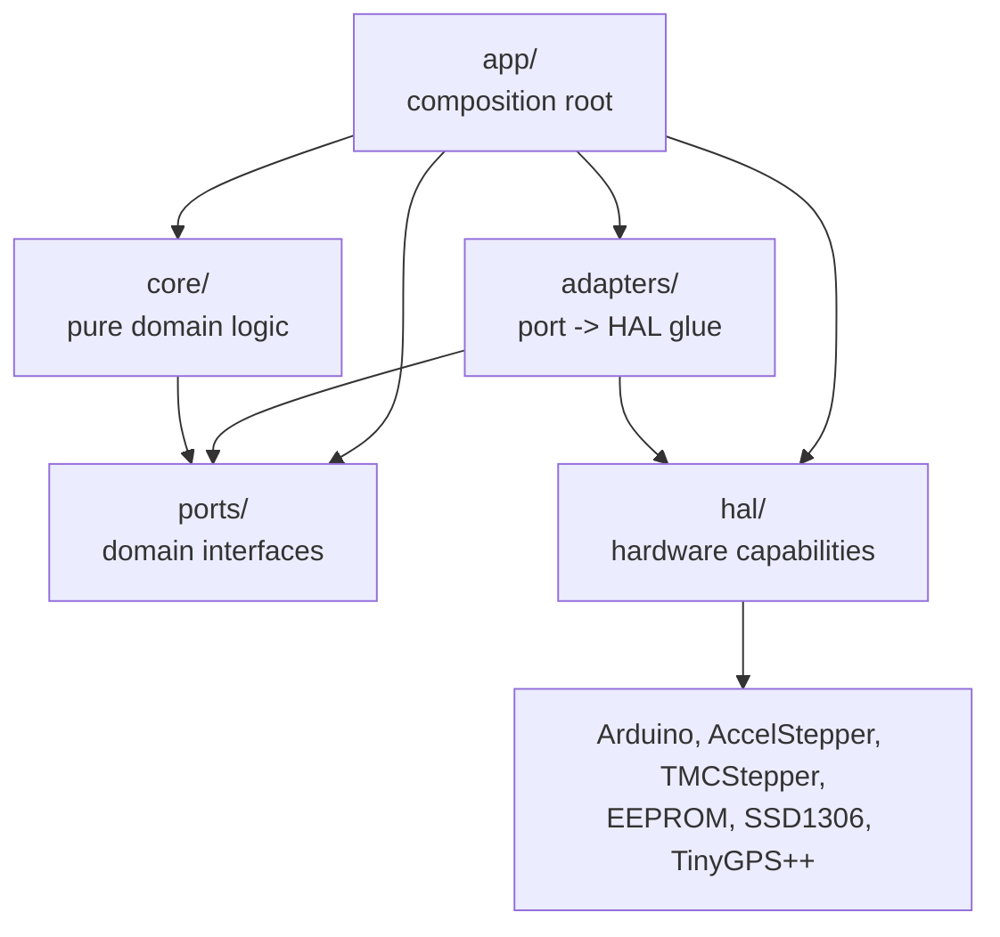

# Architecture

Goal architecture for OpenAstroTracker-Firmware: a hardware-independent domain core behind
explicit ports, adapters that bind those ports to the Arduino/HAL layer, and one composition
root per board.

See [PLAN.md](PLAN.md) for the migration plan.

---

## 1. Overview

The firmware drives an equatorial mount over a Meade LX200 serial protocol and runs on several
boards with different stepper drivers, displays and accessories.

The design separates four concerns:

| Concern | Owner |
|---------|-------|
| What the mount should do | `core/` — pure domain logic |
| What the domain needs from outside itself | `ports/` — domain interfaces |
| What the hardware can do | `hal/` — hardware capabilities and platform backends |
| Which combination runs on this board | `app/` — composition root |

Adapters sit between the middle two: each adapter implements a port using one or more HAL
services, and nothing else.

The resulting call graph is identical on every board. Board differences appear only as different
objects constructed in the composition root, never as different code paths in the domain.

---

## 2. Design principles

1. **The dependency rule is absolute.** `core/` may depend only on `ports/`. `adapters/` may depend
   on `ports/` and `hal/`. `hal/` may depend on hardware libraries. `app/` may depend on everything.
   Nothing points outward from an inner layer.

2. **The domain is hardware-free.** `core/` never includes `<Arduino.h>`, never uses `String`,
   `Serial`, `millis()`, `LOG()`, or a board pin header. It uses standard C++ and `etl::` where a
   container is required, because the firmware builds with `-D ETL_NO_STL`.

3. **Ports describe needs, HAL describes capabilities.** A port answers "what does the domain
   want" (`IStepperAxis::moveTo`, `IClock::now`). A HAL interface answers "what can this chip do"
   (`IStepperMotor::step`, `ISerialPort::read`). An adapter composes HAL services to satisfy a
   port, so a new stepper library needs a new HAL backend and a new domain requirement needs a
   port, never the other way round.

4. **Configuration is read exactly once, in the composition root.** `Configuration*.hpp` macros are
   consumed by a `MountConfig` builder in `app/`; every layer below receives runtime objects.

5. **Runtime polymorphism replaces compile-time feature flags.** Optional axes (AZ, ALT, Focus) are
   either constructed or replaced by a null-object controller. Driver variants are selected as an
   `IMotorDriver` implementation at composition time. Feature `#ifdef`s therefore collapse into a
   single tested call graph instead of 2^N build variants.

6. **Testability is a design constraint.** If a decision cannot be exercised on the host, it belongs
   in an adapter, and the decision itself belongs in `core/`. The domain core is tested with faked
   ports; the target is ≥ 85% line coverage of `core/` with behavioural tests.

7. **ISR boundaries are explicit.** The stepper interrupt loop runs in interrupt context (AVR timer
   ISR, or a FreeRTOS task on ESP32). `IStepperAxis` separates ISR-safe reads (`Snapshot()`) from
   main-loop-only mutation, so no controller can hide a cross-context call.

8. **The wire protocol is the only immovable contract.** Meade LX200 behaviour is frozen
   byte-for-byte so Stellarium and ASCOM keep working. Internal C++ APIs may change freely.

9. **Respect the AVR budget.** 256 KB flash and 8 KB SRAM on the ATmega2560: keep the vtable count
   small, mark adapters `final`, and allow static dispatch for hot paths if flash pressure demands
   it.

---

## 3. Layers

| Layer | Directory | May depend on | Contains | Test strategy |
|-------|-----------|---------------|----------|---------------|
| **Core** | `src/core/` | `src/ports/` | Controllers (`SlewController`, `TrackingController`, `GuidingController`, `HomingController`, `ParkingController`, `FocusController`, `AzAltController`), algorithms (`SiderealClock`, `CoordinateMath`, `CalendarMath`, `CoordinateFormatter`), value types (`DayTime`, `RightAscension`, `Declination`, `Latitude`, `Longitude`), `MeadeParser`, `MountState`, `EventBus`, `MountConfig` | Host unit tests with faked ports in the `native` PIO env. No hardware, no Arduino. |
| **Ports** | `src/ports/` | nothing | `IClock`, `ILogger`, `IPersistentStore`, `IStepperAxis`, `IMotorDriver`, `IHomingSensor`, `IEndSwitch`, `IDisplay`, `IInfoDisplay`, `ITransport`, `IGps` | Interfaces only — nothing to test. |
| **Adapters** | `src/adapters/` | `src/ports/` + `src/hal/` | `ArduinoClock`, `SerialLogger`, `EepromPersistentStore`, `AccelStepperAxis`, `InterruptAccelStepperAxis`, `Tmc2209Driver`, `NullMotorDriver`, `HallHomingSensor`, `GpioEndSwitch`, `LcdMenuDisplay`, `Ssd1306InfoDisplay`, `SerialTransport`, `WifiTransport`, `TinyGpsAdapter`, `MeadeCommandAdapter` | Integration tests against a faked HAL. |
| **HAL** | `src/hal/` | hardware libraries | Interfaces (`IGpioPin`, `ISerialPort`, `ISpiBus`, `II2cBus`, `IEeprom`, `IStepperMotor`, `ITmcDriver`, `IOledPanel`, `ICharLcd`, `IButtonMatrix`, `ITimerService`, `ISystemClock`, `IWifiStack`) plus per-platform backends (`arduino/`, `avr/`, `esp32/`) | Not host-tested; verified on hardware. |
| **App** | `src/app/` | all layers | Composition root: reads `Configuration*.hpp` into `MountConfig`, selects HAL backends, constructs adapters and controllers, owns the entry point | On-device smoke tests. |

### Dependency direction



Adapters are the only layer that touches both a port and a HAL interface; that is their entire
responsibility. `core/` never sees a HAL type, and `hal/` never sees a domain concept such as RA
or DEC.

---

## 4. File layout

Paths are relative to the repository root.

```text
OpenAstroTracker-Firmware/
├── ARCHITECTURE.md
├── PLAN.md
├── platformio.ini                       # one env per board + the `native` host-test env
├── matrix_build.py                      # multi-configuration firmware build driver
├── Configuration.hpp                    # board-independent defaults
├── Configuration_adv.hpp                # advanced defaults (steps, speeds, microstepping)
├── Configuration_local_<board>.hpp      # per-board configuration
├── Constants.hpp                        # board IDs, feature-flag values
├── Version.h
│
├── boards/                              # per-board pin maps
│   ├── AVR_MEGA2560/pins_<board>.h
│   ├── AVR_MKS_GEN_L_V1/
│   ├── AVR_MKS_GEN_L_V2/
│   ├── AVR_MKS_GEN_L_V21/
│   ├── ESP32_ESP32DEV/
│   ├── RAMPS/
│   ├── RP2040_JACKW01/
│   └── RP2040_SKR_PICO/
│
├── src/
│   │
│   ├── app/                             # COMPOSITION ROOT
│   │   ├── main.cpp                     # entry point replacing the .ino sketch
│   │   ├── MountConfigBuilder.hpp/.cpp  # Configuration*.hpp -> runtime MountConfig
│   │   └── BoardWiring.hpp/.cpp         # assembles the object graph for a board
│   │
│   ├── adapters/                        # PORT -> HAL GLUE
│   │   ├── ArduinoClock.hpp/.cpp        # IClock            <- ISystemClock
│   │   ├── SerialLogger.hpp/.cpp        # ILogger           <- ISerialPort
│   │   ├── EepromPersistentStore.*      # IPersistentStore  <- IEeprom + EepromLayout
│   │   ├── AccelStepperAxis.*           # IStepperAxis      <- IStepperMotor
│   │   ├── InterruptAccelStepperAxis.*  # IStepperAxis      <- IStepperMotor + ITimerService
│   │   ├── Tmc2209Driver.hpp/.cpp       # IMotorDriver      <- ISerialPort / pins
│   │   ├── NullMotorDriver.hpp          # IMotorDriver      null object for non-TMC builds
│   │   ├── HallHomingSensor.hpp/.cpp    # IHomingSensor     <- IGpioPin
│   │   ├── GpioEndSwitch.hpp/.cpp       # IEndSwitch        <- IGpioPin
│   │   ├── LcdMenuDisplay.hpp/.cpp      # IDisplay          <- ICharLcd / IButtonMatrix
│   │   ├── Ssd1306InfoDisplay.hpp/.cpp  # IInfoDisplay      <- IOledPanel
│   │   ├── SerialTransport.hpp/.cpp     # ITransport        <- ISerialPort
│   │   ├── WifiTransport.hpp/.cpp       # ITransport        <- IWifiStack
│   │   ├── TinyGpsAdapter.hpp/.cpp      # IGps              <- serial stream + TinyGPS++
│   │   └── MeadeCommandAdapter.hpp/.cpp # IMeadeHandlers    <- core controllers
│   │
│   ├── ports/                           # DOMAIN INTERFACES
│   │   ├── IClock.hpp
│   │   ├── ILogger.hpp
│   │   ├── IPersistentStore.hpp
│   │   ├── IStepperAxis.hpp
│   │   ├── IMotorDriver.hpp
│   │   ├── IHomingSensor.hpp
│   │   ├── IEndSwitch.hpp
│   │   ├── IDisplay.hpp
│   │   ├── IInfoDisplay.hpp
│   │   ├── ITransport.hpp
│   │   └── IGps.hpp
│   │
│   ├── hal/                             # HARDWARE CAPABILITIES
│   │   ├── IGpioPin.hpp
│   │   ├── ISerialPort.hpp
│   │   ├── ISpiBus.hpp
│   │   ├── II2cBus.hpp
│   │   ├── IEeprom.hpp
│   │   ├── IStepperMotor.hpp
│   │   ├── ITmcDriver.hpp
│   │   ├── IOledPanel.hpp
│   │   ├── ICharLcd.hpp
│   │   ├── IButtonMatrix.hpp
│   │   ├── ITimerService.hpp
│   │   ├── ISystemClock.hpp
│   │   ├── IWifiStack.hpp
│   │   ├── EepromLayout.hpp             # storage layout constants
│   │   ├── arduino/                     # generic Arduino backends
│   │   ├── avr/                         # Timer1/Timer3 ISR, fast pin I/O
│   │   └── esp32/                       # hardware timers, Wi-Fi glue
│   │
│   ├── core/                            # PURE DOMAIN — no Arduino
│   │   ├── meade/
│   │   │   ├── MeadeParser.cpp/.hpp
│   │   │   ├── MeadeProtocol.hpp
│   │   │   ├── MeadeParserHelpers.cpp/.hpp
│   │   │   └── MeadeParser{Get,Set,Quit,Distance,Init,SyncControl,
│   │   │       Home,SlewRate,Gps,Focus,Movement,Extra}.cpp
│   │   ├── types/
│   │   │   ├── DayTime.cpp/.hpp
│   │   │   ├── Declination.cpp/.hpp
│   │   │   ├── Latitude.cpp/.hpp
│   │   │   ├── Longitude.cpp/.hpp
│   │   │   └── RightAscension.cpp/.hpp
│   │   ├── SiderealClock.cpp/.hpp       # LST and hour-angle math
│   │   ├── CoordinateMath.cpp/.hpp      # RA/DEC -> stepper positions
│   │   ├── CalendarMath.cpp/.hpp        # date arithmetic, local -> UTC date
│   │   ├── CoordinateFormatter.cpp/.hpp # RA/DEC text formatting
│   │   ├── TrackingController.hpp/.cpp  # sidereal rate, tracker-stop compensation
│   │   ├── SlewController.hpp/.cpp      # slew state machine
│   │   ├── GuidingController.hpp/.cpp   # guide-pulse math and timing
│   │   ├── HomingController.hpp/.cpp    # hall-sensor / end-switch state machine
│   │   ├── ParkingController.hpp/.cpp   # park position and transitions
│   │   ├── FocusController.hpp/.cpp     # optional focus axis
│   │   ├── AzAltController.hpp/.cpp     # optional AZ/ALT axes
│   │   ├── MountState.hpp/.cpp          # typed mount-status enum API
│   │   ├── EventBus.hpp/.cpp            # PositionChanged, SlewStarted, Parked, ...
│   │   └── MountConfig.hpp              # runtime configuration struct
│   │
│   ├── inc/                             # Arduino-facing globals for app/adapters/hal
│   │   ├── Globals.hpp
│   │   └── Globals.cpp
│   ├── macros/gcc/Macros.hpp            # LOG() macro and compiler pragmas
│   └── libs/                            # vendored libraries
│       ├── MappedDict/
│       └── TimerInterrupt/
│
├── unit_tests/
│   ├── test_core/                       # host tests for core/ (native env)
│   │   ├── test_main.cpp
│   │   ├── test_calendar.cpp
│   │   ├── test_coordinate_math.cpp
│   │   ├── test_coordinate_formatter.cpp
│   │   ├── test_sidereal.cpp
│   │   ├── types/
│   │   │   ├── test_daytime.cpp
│   │   │   ├── test_declination.cpp
│   │   │   ├── test_latitude.cpp
│   │   │   ├── test_longitude.cpp
│   │   │   └── test_right_ascension.cpp
│   │   └── meade/                       # one file per parser family + parser/helpers
│   │       └── test_Meade<Family>.cpp
│   ├── test_hal/
│   │   └── test_main.cpp
│   └── test_common/
│       └── hal_fakes/                   # in-memory EEPROM, virtual GPIO, controllable clock
│
└── docs/
    └── RP2040-WIRING.md
```

---

## 5. Cross-cutting rules

| Rule | Enforcement |
|------|-------------|
| `core/` never includes `<Arduino.h>`, `String`, `Serial`, `millis()`, `LOG()`, or a board pin header | CI grep check |
| `core/` and `ports/` contain zero feature `#ifdef`s | CI grep check |
| Time comes from `IClock`; no direct `millis()` below `adapters/` | Interface contract |
| Logging goes through `ILogger`; no direct `Serial.print()` below `adapters/` | Interface contract |
| Configuration macros are read only in `app/` | CI grep check |
| Optional axes use `etl::optional` or a null object, never `#ifdef` branches | Code review |
| ISR-safe methods are named and documented on `IStepperAxis` | Interface contract |
| Board-specific code (interrupt registers, pin mappings) lives only in `hal/<platform>/` | Code review |
| `Mount`, where retained for Meade back-compat, is a facade only and holds no domain logic | Code review |

---

## 6. How a command flows

```text
Serial or Wi-Fi bytes
   │
   ▼
adapters/SerialTransport  ──(ITransport)──┐
adapters/WifiTransport    ──(ITransport)──┘
   │
   ▼
core/meade/MeadeParser            # pure: classifies the command, parses suffixes
   │
   ▼
IMeadeHandlers                    # implemented by adapters/MeadeCommandAdapter
   │
   ▼
core controllers                  # SlewController, TrackingController, ...
   │
   ▼
IStepperAxis                      # port
   │
   ▼
adapters/AccelStepperAxis         # HAL: IStepperMotor + ITimerService
   │
   ▼
hal/avr | hal/esp32 | hal/arduino backends
```

Displays are not called by controllers. Controllers publish on `core/EventBus` and the display
adapters subscribe.

---

## 7. Adding to the architecture

**A new Meade command** — add the handler method to the relevant `IMeade*Handlers` interface in
`core/meade/MeadeParser.hpp`, implement parsing in the matching `MeadeParser*.cpp`, add a test in
`unit_tests/test_core/meade/`, then implement the method in `MeadeCommandAdapter`. The first three
steps involve no Arduino code.

**A new domain behaviour** — put the decision in a `core/` controller, express any hardware need as
a port in `src/ports/`, and fake that port in the unit test. Never call HAL from `core/`.

**A new peripheral** — define or reuse a HAL interface in `src/hal/`, implement it for each platform
that has the peripheral, write the adapter that satisfies the port, and construct it in `app/`.

**A new board** — add `boards/<board>/pins_<board>.h`, a `Configuration_local_<board>.hpp`, a PIO
env, and a branch in the composition root. Nothing in `core/`, `ports/`, or `adapters/` changes.
