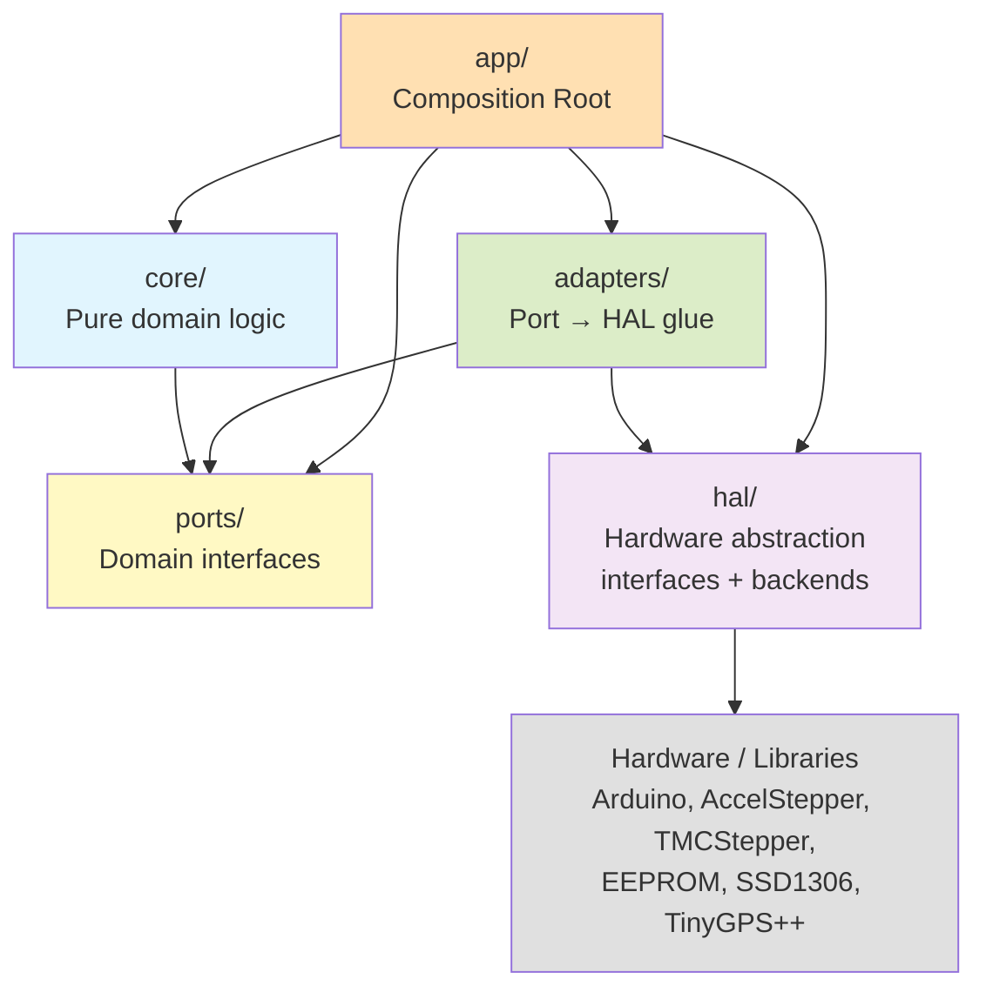

# Plan: Clean-Architecture Refactor of OpenAstroTracker-Firmware

## TL;DR
Refactor a ~5k-line `Mount` god-object firmware toward clean architecture for embedded:
a pure **Domain Core** (no Arduino, fully unit-testable) sitting behind **Port interfaces**,
with **Adapters** wrapping hardware (AccelStepper, TMC2209, EEPROM, displays, Wi-Fi, clock).
Approach: **hybrid** — extract pure logic into `core/` first, then test (invert the typical "test-first" order because `src/` root files transitively include `<Arduino.h>` via `inc/Globals.hpp` and are untestable in the `native` PIO env), then **strangler-fig** the hardware-coupled pieces (drivers, slewing loop, command executor) behind ports. Compile-time `#ifdef` axes/drivers migrate to **runtime polymorphism** so unsupported combinations no longer change the call graph. Goal endpoint: `src/core/` is buildable & 100% unit-tested on host; `src/adapters/` contains all Arduino/library coupling; `src/app/` wires them up per board.

---

## Architecture

### Goals

| # | Goal | Rationale |
|---|------|-----------|
| 1 | **Make domain logic host-testable** | The `native` PIO env can't compile `src/` root files (they transitively include `<Arduino.h>` via `inc/Globals.hpp`). Pure logic must live in `src/core/` with zero Arduino deps so tests run in milliseconds, not on hardware. |
| 2 | **Shrink the `Mount` god-object** | `Mount.cpp` is 4,361 LOC holding all domain behavior. End state: `Mount` is a thin facade (≤ 500 LOC) over focused controllers in `core/`. |
| 3 | **Eliminate `#ifdef` from domain code** | Feature flags for axes, driver types, and sensors currently produce 2^N untested build combinations. These become runtime polymorphism behind interfaces — the composition root makes one choice; `core/` never branches. |
| 4 | **Swap hardware without touching logic** | Changing stepper library, display type, or EEPROM backend must not require edits to `core/` or `ports/`. |
| 5 | **Coverage that means something** | Target: `core/` ≥ 85% line coverage with tests that verify behavior (not tautologies). |

### Requirements & Constraints

| Category | Constraint | Why |
|----------|-----------|-----|
| **Hardware** | Must build & run on all supported boards: AVR_MEGA2560, MKS_GEN_L_V1/V2/V21, ESP32_ESP32DEV, RP2040_JACKW01, RP2040_SKR_PICO (`oaeboardv1` is also a PIO env). The CI matrix builds **7** boards | Existing user base; CI matrix enforces this. |
| **Memory** | AVR_MEGA2560 has 256 KB flash, 8 KB SRAM | Flash overflow is caught at link time. Mitigation: keep vtable count ≤ ~12, mark adapters `final`, consider template-based static dispatch as escape hatch. |
| **C++ standard** | `core/` must stay **C++11-compatible** until the AVR spike proves otherwise: `etl::optional` is fine (header-only, C++11-safe), **`if constexpr` is not available** | Measured on the tree: only `esp32`, `oaeboardv1` and `native` set `-std=gnu++17`. The four AVR envs set **no** `-std`, so they inherit the Arduino core's **gnu++11** on **avr-gcc 7.3.0** — and they already compile all of `src/core/**`. Raising AVR's standard is an unproven spike (Phase 2a). |
| **Testability** | `core/` must never include `<Arduino.h>` or use `String`, `Serial`, `millis()`, `LOG()` | Enforced by CI grep check. `native` env only compiles `core/`, `ports/`, `adapters/`. |
| **Back-compat** | Meade LX200 serial protocol behavior is invariant | External interfaces (Stellarium, ASCOM) must not break. Internal C++ APIs may change freely. |
| **Shippable increments** | Every phase/step must be independently shippable — all boards green, all tests green | No flag days; thin overlays preserve old call-sites during transition. |
| **Tooling** | PlatformIO + Googletest + **hand-written port fakes** + gcovr | Googletest + gcovr are configured in `platformio.ini` and CI (`ci.yml`). ArduinoFake/FakeIt is **not required**: every port is a pure abstract interface and `core/` is Arduino-free, so plain fakes under `unit_tests/test_common/hal_fakes/` cover every test (Phase 0, item 5). |

### Layers & Dependencies

Dependencies point inward only. No layer may reference a layer above it.



| Layer | Directory | Depends on | Contains | Test strategy |
|-------|-----------|------------|----------|---------------|
| **core/** | `src/core/` | `ports/` only | Domain controllers (`SlewController`, `TrackingController`, …), algorithms (`SiderealClock`, `CoordinateMath`, …), `MeadeParser`, `MountState`, `EventBus`, `MountConfig` | Pure unit tests with hand-written fakes of the ports. No hardware, no Arduino. `native` env. |
| **ports/** | `src/ports/` | nothing | Domain interfaces: `IClock`, `ILogger`, `IPersistentStore`, `IStepperAxis`, `IMotorDriver`, `IDisplay`, `IHomingSensor`, `IEndSwitch`, `IGps`, `ITransport` | Pure abstract interfaces — no implementation to test. |
| **adapters/** | `src/adapters/` | `ports/` + `hal/` | Thin glue: `StepperAxis`, `EepromPersistentStore`, `SerialLogger`, `Tmc2209Driver`, `HallHomingSensor`, `SerialTransport`, `WifiTransport`, `MeadeCommandAdapter` | Integration tests: adapter → faked HAL port. |
| **hal/** | `src/hal/` | hardware libraries only | Interfaces (`IGpioPin`, `ISerialPort`, `IStepperMotor`, `ITmcDriver`, `ISystemClock`, `ITimerService`, …) + backends under `hal/arduino/` (generic Arduino, used by every platform), `hal/esp32/` and `hal/rp2040/`. AVR has no backend — the compile-time-specialised engines stay concrete (Phase 2b, step 6) | Not host-tested (wraps hardware). Verified by on-device smoke tests. |
| **app/** | `src/app/` | all layers | Composition root. Board-specific configuration comes from a header (e.g. `Configuration_local_oaeboardv1.hpp`, selected by the PIO environment) which populates a runtime `MountConfig` struct. Wires up the object graph. Replaces the legacy `.ino` entry point. | Verified by on-device smoke tests across the CI-matrix boards. |

**Why both `hal/` and `ports/`:**
- `hal/` describes *what the hardware can do* (pin toggles, UART bytes, timer ticks). One backend per platform.
- `ports/` describes *what the domain needs* (axis position, persistent value, "now"). Adapters compose one or more HAL services to satisfy a port — e.g. `StepperAxis` implements `IStepperAxis` over `IStepperMotor`, whose platform backend wraps the stepper library (`AccelStepper` on ESP32/RP2040, `InterruptStepper` on AVR).
- This split means a new stepper library requires a new HAL backend, not a port change. A new domain requirement (e.g. "axis acceleration profile") requires a port change, not a HAL change.

### Cross-cutting rules

| Rule | Enforcement |
|------|-------------|
| `core/` never includes `<Arduino.h>`, `String`, `Serial`, `millis()`, `LOG()`, or any board pin header | CI grep check (Phase 4+) |
| `core/` and `ports/` contain zero `#ifdef` for feature flags | CI grep check (Phase 4+) |
| Time = `IClock` port (backed by `hal::ISystemClock`); no direct `millis()` | Interface contract |
| Logging = `ILogger` port (backed by `hal::ISerialPort`); no direct `Serial.print()` | Interface contract |
| Configuration = runtime `MountConfig` struct populated once in `app/` from `Configuration*.hpp` macros | Single translation unit reads macros |
| Optional axes (AZ, ALT, Focus) = `etl::optional` or null-object pattern; no `#ifdef` branches | Composition root constructs or injects null |
| ISR-safety: `IStepperAxis::Snapshot()` returns an ISR-safe state snapshot; mutation methods are main-loop-only | Settled in Phase 2 before Phase 3 controller extraction |
| `Mount` becomes a thin facade (≤ 500 LOC) over `core/` controllers, retained for Meade back-compat, gradually deprecated | Shrinks each phase as controllers are extracted |

---

## Current State (after Meade parser migration + Phase 1 extraction)

### ✅ Completed: Meade parser migrated to `core/`

The Meade LX200 command parser has been fully extracted into `src/core/meade/` as a pure, host-testable, allocation-light parser with no side effects. The split is:

| Layer | Location | Status |
|-------|----------|--------|
| **Parser** (pure) | `src/core/meade/MeadeParser.*` + 12 family-specific `.cpp` files | ✅ Done — covered by 14 test files in `unit_tests/test_core/meade/`; `core/meade/` line coverage 87.0% |
| **Protocol spec** | `src/core/meade/MeadeProtocol.hpp` | ✅ Done — comprehensive protocol documentation |
| **Handler interfaces** | `src/core/meade/MeadeParser.hpp` (12 `IMeade*Handlers` interfaces + aggregate `IMeadeHandlers`) | ✅ Done — clean typed contracts |
| **Executor/Adapter** | `src/MeadeCommandProcessor.hpp/cpp` | ✅ Done — implements `IMeadeHandlers`, delegates to `Mount`/`LcdMenu` |

The parser directory (`src/core/meade/`) contains 17 files (12 family dispatchers + `MeadeParser.cpp/.hpp` + `MeadeParserHelpers.cpp/.hpp` + `MeadeProtocol.hpp`) covering all 12 command families (Get, Set, Quit, Distance, Init, SyncControl, Home, SlewRate, GPS, Focus, Movement, Extra). Each family has:
- A typed handler interface (e.g. `IMeadeGetHandlers`, `IMeadeMovementHandlers`)
- A `handleMeade*` entry point that parses suffixes, invokes handler callbacks, and serializes `MeadeResponse`
- Value types for coordinates (e.g. `RaCoordinate`, `DecCoordinate`)

The `MeadeCommandProcessor` adapter bridges the parser to the legacy `Mount` singleton, implementing all 127 handler overrides. It is the **only** file in `src/` root that references the core parser.

### Test coverage

14 test files in `unit_tests/test_core/meade/` provide comprehensive wire-byte coverage for every parser family using fake handler stubs. Line coverage of `core/meade/` is 87.0% (`MeadeParser.cpp` 43.1%, `MeadeParserExtra.cpp` 69.6%, most family dispatchers ≥ 95%). Tests verify:
- Exact wire-byte formatting (zero-padding, sign rules, terminators)
- Suffix classification and handler dispatch routing
- Edge cases (malformed input, overflow, unknown sub-commands)
- Parser-level validation (the `parseMeadeCommand` classifier)

### ✅ Completed: Phase 1 pure-logic extraction (modules + tests)

All seven Phase 1 modules exist under `src/core/`, plus `src/hal/EepromLayout.hpp`, and are covered by host tests — see the status markers on each Phase 1 step below. Pure arithmetic for `DayTime`, `Declination`, `Latitude`, `Longitude`, `RightAscension` and `Sidereal` is fully extracted, and the `src/` originals are now thin overlays that delegate to `core/`.

**Wiring is complete (Steps 4–7):**

1. ✅ `Mount::calculateRAandDECSteppers()` now builds a `core::SlewGeometry`, calls `core::calculateStepperPositions()`, and copies the result back. Rounding was reconciled to the legacy expressions (`long(-moveRA) * stepsPerSiderealHour`, product truncated on assignment) so the refactor is bit-for-bit identical; `SlewResult` now reports which candidate was selected (`SlewSolution`) plus the post-flip RA/DEC, so `Mount` keeps its existing `DEBUG_COORD_CALC` logs. Pinned by unit tests.
2. ✅ `Mount::getLocalDate()` now converts the elapsed day-ends into a whole-day count and calls `core::addDays()`; the inline month-length/leap-year loop is gone.
3. ✅ `Mount::RAString()`/`DECString()` call `core::formatRA()`/`core::formatDEC()`. `formatRA` gained a `bufSize` argument (it previously hard-coded `snprintf(..., 32, ...)` against `Mount`'s 24-byte `scratchBuffer`) and no longer forces `abs()`, matching the legacy `sprintf` output exactly.
4. ✅ `src/hal/EepromLayout.hpp` is now the single source of truth for magic markers, item flags, item addresses and `SteppingStorageNormalized`. It exposes them as `hal::eeprom::*` (a namespace rather than a struct, so unscoped enumerators can be brought into `EPROMStore.cpp` with one `using namespace` on pre-C++20 toolchains), `EEPROMStore`'s private aliases point at it, and `test_hal/test_eeprom_layout.cpp` pins the on-device layout on the host.

### What remains (Phase 2 onward)

The parser is pure and tested. The executor (`MeadeCommandProcessor`) is an adapter that still couples to `Mount*` and `LcdMenu*` directly. The `Mount` god-object still contains all domain logic (slewing, tracking, guiding, parking, homing, focus, coordinate math).

Phase 2a (contracts), 2b (adapters + injection) and 2c (call-site cleanup) have all landed — see the status markers on the Phase 2 steps below. `src/ports/` holds the 14 domain interfaces, `src/hal/` the 13 HAL interfaces plus the per-platform backends, `src/adapters/` the ten adapters (the eight from 2b plus `MountSettingsStore` and `NullLogger` from 2c), and `unit_tests/test_common/hal_fakes/` the hand-written fakes. `Mount` holds ports: clock, scheduler, logger and settings are injected through `MountDeps`, its axes and drivers are created as adapters, `EEPROMStore` writes through the injected `IPersistentStore` instead of the Arduino EEPROM API, and no `LOG()`, `millis()`, `digitalWrite()` or `EEPROMStore::` call site is left inside `Mount`. `src/app/` still holds only a README: the composition root is `src/b_setup.hpp` until Phase 4/5 moves it.

---

## Phased Plan (each phase shippable & green in CI)

### Phase 0 — Safety net & tooling (no behavior change) ✅ COMPLETE
*Foundation for everything else; must land first. Fully implemented — per-item status below.*

1. ~~Add FFF as header-only dep~~ — **Superseded and dropped.** No mocking framework is needed: the ports are pure abstract interfaces, so hand-written fakes (Phase 2a, `unit_tests/test_common/hal_fakes/`) cover every test.
2. ~~Add `native_core` PIO env~~ — **Superseded.** Only the `native` env is used. The existing `native` env already has strict warnings (`-Wall -Wextra -Werror -Wpedantic -Wshadow`). Note: `src/core/README.md` mentioned `native_core` and has been corrected.
3. ✅ gcovr-based **coverage reporting** in `native` env — **Done.** `scripts/test-coverage.py` appends `--coverage` to `LINKFLAGS`; `build_src_flags` carries the compile-side flag. Reports (HTML + markdown) are produced by `./scripts/test-coverage.sh`. **There is no `coverage` PlatformIO target** — `pio run -e native -t coverage` fails with "unknown target". Current: 90.2% lines, 98.2% functions, 79.6% branches (366 test cases).
4. ✅ CI workflow — **Done.** `.github/workflows/ci.yml` runs `./scripts/test-coverage.sh` (which runs `pio test -e native`, then gcovr) and publishes `coverage.md` to the step summary. Threshold gating deferred to a later phase.
5. ✅ **No Arduino API fakes needed** — **Resolved (was: ArduinoFake as `test_lib_deps`).** `unit_tests/test_common/ArduinoFake/` held only six `CMakeLists.txt` files (no headers, no sources) and was dead weight — **deleted**. Every port is a pure abstract interface and `core/` is Arduino-free, so host tests need plain hand-written fakes, not an Arduino-API mock. ArduinoFake/FakeIt is **not** a prerequisite for Phase 2. The only test-plumbing change left is a `test_adapters` entry in `test_filter` (Phase 2a, step 4).
6. ✅ Folder structure — **Done.** `src/ports/`, `src/hal/`, `src/adapters/`, `src/app/` all exist with descriptive README files (they now link to [`PLAN.md`](PLAN.md)).

**Verify:** `./scripts/test-coverage.sh` → 366 test cases, 0 failures; coverage report generates; the 7-board CI matrix builds green via `matrix_build.py`.

**Changes from original plan (per feedback):** FFF and FakeIt/ArduinoFake both dropped (hand-written port fakes instead); `native_core` env eliminated (use `native` only); coverage threshold gating deferred to a later phase. **No open items.**

### Phase 1 — Extract pure domain logic into `core/`, then test — ✅ COMPLETE
*The original plan called for testing before extraction. That doesn't work here: every `src/` root file includes `inc/Globals.hpp` → `<Arduino.h>`, and uses `String`/`LOG()`/Arduino APIs. The `native` PIO env only builds `core/`, `ports/`, `adapters/` — not `src/` root files. **New approach: extract pure subsets into `core/` first, then write exhaustive tests.** Each step is independently shippable. No behavior change.*

**Structure:** Data containers (`DayTime`, `Declination`, `Latitude`, `Longitude`, `RightAscension`) go under `src/core/types/`. Algorithm modules (`SiderealClock`, `CoordinateMath`, `CalendarMath`, `CoordinateFormatter`) live at `src/core/` root. EEPROM layout constants (`EepromLayout`) live in `src/hal/` — they describe a storage format, not domain behavior.

```
src/core/
├── meade/                        # ✅ extracted — parser + protocol
├── types/                        # ✅ extracted — pure data containers
│   ├── DayTime.hpp/.cpp
│   ├── Declination.hpp/.cpp
│   ├── Latitude.hpp/.cpp
│   ├── Longitude.hpp/.cpp
│   └── RightAscension.hpp/.cpp
├── SiderealClock.hpp/.cpp        # ✅ algorithm producing DayTime outputs
├── CoordinateMath.hpp/.cpp       # ✅ wired into Mount::calculateRAandDECSteppers
├── CalendarMath.hpp/.cpp         # ✅ wired into Mount::calculateLst + Mount::getLocalDate
└── CoordinateFormatter.hpp/.cpp  # ✅ wired into Mount::RAString/DECString
```

The `src/` originals become **thin overlays**: they `#include` the `core/` version and add only Arduino-dependent methods (`ParseFromMeade`, `ToString`; `Declination` and `Longitude` also override `formatString` for their wire formats). This preserves back-compat — no flag day. **Status:** all seven steps are extracted, wired and tested — the `src/` originals no longer hold their own copies of the extracted logic.

#### Step 1: DayTime — extract pure arithmetic subset ✅ DONE
*Parallel with Steps 5, 7.*

**What's pure** (uses only `long` math, no Arduino types): constructors, `getHours/getMinutes/getSeconds/getTotalHours/getTotalMinutes/getTotalSeconds`, `set`, `addHours/addMinutes/addSeconds`, `addTime/subtractTime`, `sign`, `checkHours`.

**What stays** (uses Arduino `String` or `LOG()`): `ParseFromMeade`, `ToString`, `formatString`.

**Plan:**
1. ✅ Create `src/core/types/DayTime.hpp/.cpp` — pure header with arithmetic only.
2. ✅ Keep original `src/DayTime.hpp/cpp` as overlay: `#include "core/types/DayTime.hpp"` + Arduino-dependent methods (`ParseFromMeade`, `ToString`).
3. ✅ Write `unit_tests/test_core/types/test_daytime.cpp` — construction, 24h wrap, negative hours, add/subtract across midnight.

#### Step 2: Declination, Latitude, Longitude, RightAscension — extract pure subsets ✅ DONE
*Depends on Step 1.*

All four inherit `DayTime`. Pure parts: `checkHours()` clamping, degree conversion, constructors. What stays: `ParseFromMeade(String const&)`, `ToString()`, `formatString()`.

**Plan:**
1. ✅ Create `src/core/types/Declination.hpp/.cpp`, `Latitude.hpp/.cpp`, `Longitude.hpp/.cpp`, `RightAscension.hpp/.cpp` — each inherits `core::DayTime`.
2. ✅ Old `src/Declination.hpp` etc. become: `#include "core/types/<Type>.hpp"` + `ParseFromMeade`/`ToString`/`formatString` overlay.
3. ✅ Write `test_declination.cpp`, `test_latitude.cpp`, `test_longitude.cpp`, `test_right_ascension.cpp` — clamping edges, hemisphere handling, 24h wrapping.

#### Step 3: Sidereal — extract pure math, leave GPS behind ✅ DONE
*Depends on Step 1.*

`Sidereal.cpp` is 130 lines. The GPS path (`calculateByGPS`) uses TinyGPS++. The pure math (`calculateByDateAndTime`, `calculateHa`, `calculateTheta`, `calculateDeltaJd`) uses only `double` + `DayTime`.

**Plan:**
1. ✅ Create `src/core/SiderealClock.hpp/.cpp` — pure primitives `calculateTheta`/`calculateDeltaJd`/`calculateHaDegrees`; the `calculateByDateAndTime`/`calculateHa` entry points remain in `src/Sidereal.cpp` and compose them.
2. ✅ Keep old `src/Sidereal.cpp` with `calculateByGPS` + thin wrappers delegating to `core::SiderealClock`.
3. ✅ Create `test_core/test_sidereal.cpp` — LST/HA from known dates (equinoxes, solstices), leap years.

#### Step 4: Mount — extract `calculateRAandDECSteppers` math ✅ DONE
*Depends on Steps 1-2.*

The ~200-line function computes stepper positions from RA/DEC targets. Core math is pure arithmetic on floats/longs (hemisphere, meridian flip, 3-solution selection).

**Plan:**
1. ✅ Create `src/core/CoordinateMath.hpp/.cpp` with plain structs (`SlewGeometry`, `SlewResult`) and free function `calculateStepperPositions()`. `SlewResult` returns the three candidate solutions inline rather than via the out-parameters the original plan described.
2. ✅ `Mount::calculateRAandDECSteppers()` fills a `SlewGeometry` and calls the free function. Rounding was reconciled to the legacy expressions — the candidate solutions truncate the hour delta to whole hours before scaling and the selected target scales the unrounded delta in float — so results are identical to the pre-refactor code. `SlewResult` also reports the selected candidate (`SlewSolution`) and the post-flip RA/DEC, letting `Mount` keep its `DEBUG_COORD_CALC` logs.
3. ✅ Write `test_core/test_coordinate_math.cpp` — covers both flip directions, meridian-flip boundaries, pole targets (including a flipped pole target), the reported solution, and the legacy rounding of the candidate solutions.

#### Step 5: Mount — extract calendar math ✅ DONE
*Parallel with Steps 1, 7.*

`Mount::getLocalDate()` handles year/month/day increment with month-length tables and leap-year logic. Pure integer math.

**Plan:**
1. ✅ Create `src/core/CalendarMath.hpp/.cpp` with `struct CalendarDate`, `addDays()` and `localToUtcDate()`.
2. ✅ `localToUtcDate()` is used by `Mount::calculateLst`, and `Mount::getLocalDate()` now folds the elapsed day-ends into a whole-day count and delegates to `core::addDays()` — the inline month-length/leap-year loop is gone.
3. ✅ Write `test_core/test_calendar.cpp` — month boundaries, leap years incl. century rules.

#### Step 6: Mount — extract coordinate formatting ✅ DONE
*Depends on Steps 1-2.*

`Mount::RAString()` and `Mount::DECString()` format RA as HH:MM:SS# and DEC as sDD*MM:SS#. Pure char-buffer manipulation.

**Plan:**
1. ✅ Create `src/core/CoordinateFormatter.hpp/.cpp` with `formatRA(char*, size_t, const core::DayTime&, const char*)` and `formatDEC(char*, const Declination&, const char*)`. `formatRA` takes the buffer capacity because it previously hard-coded `snprintf(..., 32, ...)` while `Mount::scratchBuffer` is only 24 bytes.
2. ✅ `Mount::RAString()`/`DECString()` call the formatter. `formatRA` no longer forces `abs()` on the hours, so output matches the legacy `sprintf` byte-for-byte (including a negative-hours edge case) and DEC still dispatches through the virtual `Declination::formatString`.
3. ✅ Write `test_core/test_coordinate_formatter.cpp` — exact wire-byte output, sign rules, zero-padding.

#### Step 7: EPROMStore — extract validation logic ✅ DONE
*Parallel with Steps 1, 5.*

`EPROMStore` uses Arduino EEPROM API directly. Data-validation logic (magic markers `0xCE`/`0xCF`, struct layouts) is separable.

**Plan:**
1. ✅ `src/hal/EepromLayout.hpp` holds the layout — magic markers, item flags, extended flags, item addresses and `SteppingStorageNormalized` — with no Arduino deps. It exposes them as `hal::eeprom` (a namespace rather than a struct, so the unscoped enumerators can be pulled into `EPROMStore.cpp` with one `using namespace` on pre-C++20 toolchains instead of being re-listed). `EEPROMStore`'s private `ItemFlag`/`ExtendedItemFlag`/`ItemAddress` are aliases of it, and `unit_tests/test_hal/test_eeprom_layout.cpp` pins every address, flag mask and the store size against the shipped V1.x layout.
2. Full `IPersistentStore` port + adapter comes in Phase 2.

**Verify:** `./scripts/test-coverage.sh` — all new tests pass (366 test cases); every board env builds green via the CI matrix (`python matrix_build.py -b <board>`; a bare `pio run -e <board>` needs an untracked `Configuration_local_*.hpp`); coverage shows ≥ 85% line coverage on new `core/` files (**met** — every Phase 1 module is ~100% except `core/meade/` at 87.0%); manual: mount slews to known coordinates on real hardware.

### Phase 2 — Introduce HAL, Ports & Adapters ✅ COMPLETE
*Define the HAL surface, define the domain ports, and start routing current call sites through them. Keep current behavior bit-for-bit. Split into three independently shippable sub-phases: **2a** contracts (no production change), **2b** adapters + `Mount` injection, **2c** call-site cleanup.*

**Prerequisites:** none blocking. ArduinoFake/FakeIt is **not** required (ports are pure interfaces; Phase 2a supplies hand-written fakes). The build-config work that makes 2a shippable — `test_adapters` in `test_filter`, per-board HAL source filters, the AVR C++-standard spike and the ETL dependency — is folded into 2a step 4.

**Calibration facts (measured on the current tree):** `Mount.cpp` is 4,361 LOC with **~134 public method declarations** and contains **274 `LOG()` sites (273 literal formats totalling 13,857 bytes, currently kept in PROGMEM via `F()`), 47 `EEPROMStore::` sites, 21 `millis()`, 19 `digitalWrite()`, 184 TMC-driver calls and 251 stepper-axis calls (on 236 call sites)**. `Mount::loop()` is 293 lines. These counts are the real size of 2b/2c: the work is mechanical but large. The global is defined in `src/b_setup.hpp` (`Mount mount(&lcdMenu);`); the only `extern Mount mount;` is in `src/testmenu.cpp`. Stepping has **three** concurrency models, not two (step 9).

#### 2a — Contracts (no production changes) ✅ COMPLETE

*Status: all four steps landed. `pio test -e native` runs 377 cases green (366 prior + 11 fake smoke tests); `ramps`, `mksgenlv21`, `esp32`, `oaeboardv1` and `rp2040_skr_pico` build green, and `mksgenlv1` was verified with a temporary local config (the CI matrix supplies one for the boards that have none in-tree). Nothing in `src/` root includes any new interface yet, so behaviour is untouched.*

1. ✅ Define **HAL interfaces** in `src/hal/`:
   - `IGpioPin`, `ISerialPort`, `ISpiBus`, `II2cBus`, `IEeprom`,
   - `IStepperMotor`, `ITmcDriver` (UART register IO),
   - `IOledPanel`, `ICharLcd`, `IButtonMatrix`,
   - `ITimerService` (periodic/one-shot callbacks), `ISystemClock` (`millis`/`micros`),
   - `IWifiStack`.
   - `IStepperMotor` is the **motion-engine** surface: `moveTo`, `move`, `setSpeed`, `setMaxSpeed`, `setAcceleration`, `run`, `runSpeed`, `currentPosition`, `setCurrentPosition`, `targetPosition`, `distanceToGo`, `isRunning`, `setPinsInverted`, plus microstep/enable config. It is **not** a bare step/dir pulse interface, and it is **not** a copy of `IStepperAxis`: `core/`/`ports/` never name a stepper library. See the *Stepper axis layering* decision.
   - Done: all 13 headers exist (one interface per file) and are Arduino-free. `ISerialPort` is deliberately *open-port* only — baud rate and pins are a backend constructor concern, so one `ArduinoSerialPort(Stream &)` covers `HardwareSerial`, `SerialUSB`, `SoftwareSerial` and the AVR `Serial`. `IGpioPin::writeAnalog` is named that way because `analogWrite` is a global Arduino symbol.
2. ✅ Implement HAL backends (headers stay Arduino-free; each backend directory compiles only for its platform):
   - `hal/arduino/` — generic Arduino implementation (`ArduinoGpioPin`, `ArduinoSerialPort`, `ArduinoEeprom`, `ArduinoSystemClock`, …).
   - `hal/avr/` — planned, then **dropped with a measurement**: an `InterruptStepperMotor` wrapper implementing `hal::IStepperMotor` would put a ~50-byte vtable in the 8 KB SRAM for each of the seven compile-time-specialised AVR engines (~350 B on a RAMPS build), so AVR keeps the concrete engines and has **no HAL backend** (see 2b step 6 and [`src/hal/README.md`](src/hal/README.md)). The Timer1/3/4/5 ISR vectors in [`src/Core.cpp`](src/Core.cpp), the Timer2 path in [`src/InterruptCallback.cpp`](src/InterruptCallback.cpp) and the vendored `InterruptStepper` bindings in [`src/StepperConfiguration.hpp`](src/StepperConfiguration.hpp) stay where they are; moving them is a Phase 4 concern.
   - `hal/rp2040/` — RP2040-specific: the `add_repeating_timer_us` alarm ISR in [`src/InterruptCallback.cpp`](src/InterruptCallback.cpp) (`TimerInterrupt` is already `lib_ignore`d for those envs) plus `Rp2040TimerService`.
   - `hal/esp32/` — ESP32-specific: `Esp32TimerService`, `Esp32WifiStack`.
   - `hal/arduino/AccelStepperMotor` — one stepper engine wrapper (over `AccelStepper`) shared by ESP32 and RP2040, rather than a per-platform copy.
   - `unit_tests/test_common/hal_fakes/` — pure C++ fakes (in-memory EEPROM, virtual GPIO, controllable clock, fake serial). Test code only, **not** in `src/`.
   - Done: `hal/arduino/` has `ArduinoSystemClock`, `ArduinoGpioPin`, `ArduinoSerialPort`, `ArduinoEeprom` and `AccelStepperMotor`; `hal/esp32/` has `Esp32TimerService` (over `esp_timer`) and `Esp32WifiStack` (with `ITcpListener`/`ITcpConnection`/`IUdpSocket` wrappers); `hal/rp2040/` has `Rp2040TimerService` (over `add_repeating_timer_us`/`add_alarm_in_us`). `hal/arduino/AccelStepperMotor` is shared by ESP32 and RP2040 instead of being copied into both platform directories. `ISpiBus`/`II2cBus` are contracts only: nothing needs them until the display adapters arrive in Phase 3.
3. ✅ Define domain **ports** in `src/ports/`:
   - `IClock`, `ILogger`, `IPersistentStore`,
   - `IStepperAxis` — sized to the real call surface: `currentPosition`, `setCurrentPosition`, `targetPosition`, `distanceToGo`, `move`, `moveTo`, `runToNewPosition`, `runToPosition`, `run`, `runSpeed`, `stop`, `isRunning`, `setMaxSpeed`, `maxSpeed`, `setAcceleration`, `setSpeed`, `speed`, `setPinsInverted`, plus the ISR-safe `Snapshot()`. Keep the existing two-instances-per-axis split (RA slew + tracking, DEC slew + guide).
   - `IMotorDriver` — sized to the real call surface: `beginSerial`/`begin`, `microsteps`, `rms_current`, `toff`, `blank_time`, `vsense`, `semin`, `iholddelay`, `TPOWERDOWN`, `TCOOLTHRS`, `SGTHRS`, `en_spreadCycle`, `pdn_disable`, `mstep_reg_select`, `I_scale_analog`, `fclktrim`, `cs_actual`; null implementation for non-TMC.
   - `IHomingSensor`, `IEndSwitch`, `IDisplay`, `IInfoDisplay`, `ITransport`, `IGps`, `IGyro`.
   - Done: all 12 ports exist. `IStepperAxis` carries the settled threading contract in its header (only `snapshot()` is ISR-callable; everything else is main-loop-only; timers are shared, so axis ownership is granted by the coordinator). `ILogger` takes an opaque `LogFormat` built with `OAT_LOG_FORMAT()`, which expands to `PSTR()` on AVR and a plain pointer elsewhere — that is the only platform-specific line under `ports/`, and it exists to keep the 273 format literals out of SRAM. `IPersistentStore` is byte-addressed; the layout and value encoding stay with the EEPROM adapter.
4. ✅ Update **build configuration** — all of it belongs in 2a, because nothing references the new interfaces yet:
   - **`native` env:** compiles *all* of `src/adapters/` and none of `src/hal/`. With the stepper library confined to `hal/`, `StepperAxis` stays pure and needs no per-file exclusion; if a future adapter must include an Arduino header, add an exclusion rather than moving it into `hal/`. Add `test_adapters` to `test_filter` so adapter tests actually run (today only `test_core` + `test_hal` are filtered).
   - **Every embedded env needs platform source filters.** `[common_embedded]` uses `src_filter = +<*>` (minus `libs/`), so without exclusions the AVR build would try to compile `hal/esp32/` and `hal/rp2040/` the moment they exist. Add per-env `build_src_filter`: AVR (`ramps`, `mksgenlv1/v2/v21`) → `-<hal/esp32/> -<hal/rp2040/>`; `esp32` + `oaeboardv1` → `-<hal/avr/> -<hal/rp2040/>`; `rp2040_jackw01` + `rp2040_skr_pico` → `-<hal/avr/> -<hal/esp32/>`.
     - Done: the AVR and RP2040 halves are in place. The `-<hal/avr/>` exclusions were **not** added, because 2b dropped the AVR backend (see step 2) so the directory has never existed — add them to the ESP32 and RP2040 envs if one appears.
   - **AVR C++-standard spike.** The AVR envs set no `-std` and inherit **gnu++11** from the Arduino core on **avr-gcc 7.3.0**, yet they compile all of `src/core/**`. Until this spike proves otherwise, `core/` must stay C++11-compatible: keep `etl::optional` (header-only, C++11-safe) and **avoid `if constexpr`**. Try `-std=gnu++14`, then `gnu++17`, on `ramps`; record the outcome here.
     - **Outcome (measured):** both standards build and link on `ramps` with avr-gcc 7.3.0. A `-std=gnu++17` in `build_flags` reaches every `src/` TU without any `build_unflags`, leaving the Arduino core on its own gnu++11. Flash and RAM came out byte-identical to the gnu++11 build, so raising the standard costs nothing. (The vendored `InterruptStepper` library already builds itself with `-std=c++17`, so the AVR toolchain was in fact already mixing standards.)
     - **Decision: stay C++11.** The firmware still supports Arduino IDE builds, which compile AVR sketches with the core's default standard; using C++17 in `core/` would silently break that path. The spike proves C++17 is available if that constraint is ever dropped.
   - **ETL dependency.** `-D ETL_NO_STL` is already global (`[env]`), but ETL is in no `lib_deps` anywhere and nothing uses `etl::` yet. Add ETL to `[common].lib_deps` for boards and to `[env:native].test_lib_deps` (the `native` env has **no** `lib_deps` block) before Phase 4 relies on `etl::optional`.
     - Done: `etlcpp/Embedded Template Library @ 20.32.1` is in `[common]`, in `[common_rp2xxx]` (that section duplicates instead of extending `[common]`) and in `[env:native].test_lib_deps`. ETL already arrived transitively through `InterruptStepper`, whose manifest pins **exactly** `20.32.1`; declaring any wider range makes LDF install a second, conflicting copy (measurable as +108 B of AVR flash), so the pin matches that manifest. Same ETL version on every board.
   - Done: `[common_embedded]` now uses `build_src_filter` (the `src_filter` spelling is the deprecated alias) so each env can extend it, `test_adapters` is in `[env:native].test_filter`, and `unit_tests/test_adapters/test_hal_fakes.cpp` is the first suite in it.

**Verify (2a):** `pio test -e native` green; `matrix_build.py -b <board>` still links for all 7 CI boards after the HAL exclusions (nothing references the new interfaces yet).

**Verified:** `pio test -e native` → 377/377 passed (11 new). Board builds: `ramps` (AVR interrupt-stepper), `mksgenlv21` (AVR AccelStepper), `mksgenlv1` (AVR AccelStepper, temporary local config), `esp32`, `oaeboardv1`, `rp2040_skr_pico` all SUCCESS. On `ramps` the cost is **zero**: `168430` B flash and `7457` B RAM before and after (64.5% / 91.0%) — the unreferenced backends are fully dead-stripped.

#### 2b — Adapters + `Mount` injection ✅ COMPLETE

*Status: eight adapters exist and are host-tested where they can be; `Mount` takes its clock and scheduler through the constructor and creates its axes and drivers as adapters; `EEPROMStore` no longer touches the Arduino EEPROM API. `pio test -e native` runs 399 cases green (22 new), and `ramps`, `mksgenlv21`, `esp32`, `oaeboardv1`, `rp2040_skr_pico` build green.*

5. ✅ Provide **adapters** in `src/adapters/` that bind ports to HAL. Only adapters with no upward dependency on the legacy `Mount` (and no Phase 5 dependency) belong here:
   - ✅ `ArduinoClock` (port `IClock` ← hal `ISystemClock`), `ArduinoScheduler` (`IScheduler` ← Arduino `yield()`), `SerialLogger`, `EepromPersistentStore` (over `hal::IEeprom`).
     - **`SerialLogger` keeps flash residency**: it formats through `ports::LogFormat`, which on AVR is read with `vsnprintf_P`, so the 273 format literals never land in `.data`. It mirrors the legacy line shape (`[uptime]{delta}ms: message`), with a fixed 192-byte stack line buffer instead of the heap `String` the old `logv()` built.
     - **`EepromPersistentStore` is thin, and `EPROMStore` stays the format owner.** The plan said the layout logic would move into the adapter; it did not, deliberately: the ~685 lines of typed accessors are 50 `LOG()` sites deep, so moving them now would either drag Arduino logging into an adapter (making it untestable) or delete diagnostics. What did move is every platform `#if` — [`src/EPROMStore.cpp`](src/EPROMStore.cpp) no longer includes `<EEPROM.h>` or branches on `ESP32`/`RP2040`/`USE_DUMMY_EEPROM`; it reads and writes through the injected `ports::IPersistentStore`, and the composition root picks `hal::ArduinoEeprom` or `hal::InMemoryEeprom`. Revisit when `ILogger` is wired into the store in 2c.
   - ✅ `StepperAxis` — implements `IStepperAxis` over `hal::IStepperMotor`; pure C++, host-tested against a faked engine. One adapter covers every platform: the AVR difference (`run()`/`runSpeed()` are stubs; the ISR steps autonomously) lives in the engine, not in the adapter. There is deliberately no `AccelStepperAxis` and no `InterruptAccelStepperAxis`.
   - ✅ `Tmc2209Driver` (UART + software-serial variants over `TMC2209Stepper`), `NullMotorDriver`. `IMotorDriver` also exposes `testConnection()`/`VACTUAL()`/`shaft()`, which the UART self-test and `connectToDriver()` need. The adapter talks to the library directly rather than through `hal::ITmcDriver`: a HAL wrapper would have to re-export the same 20 registers and would still not be host-testable. Introduce `hal::ITmcDriver` when a second driver family appears.
   - ✅ `TinyGpsAdapter` — its only consumer today is the out-of-scope [`src/c72_menuHA_GPS.hpp`](src/c72_menuHA_GPS.hpp) plus a forward-declared `gpsAqcuisitionComplete()` in [`src/MeadeCommandProcessor.cpp`](src/MeadeCommandProcessor.cpp); the real consumer arrives in Phase 5. It is compile-verified only: the `native` env excludes it (and `Tmc2209Driver`/`ArduinoScheduler`) from `build_src_filter`.
   - **Deferred to Phase 3** (they call `Mount` today and would violate "adapters depend only on ports + HAL"): `HallHomingSensor` (33 `_pMount->` calls), `GpioEndSwitch` (18 `_pMount->` calls), `Ssd1306InfoDisplay` (23 `mount->` calls), `LcdMenuDisplay` (the menu screens call `mount.*` 192 times and instantiate LiquidCrystal/U8g2 inside [`src/LcdMenu.hpp`](src/LcdMenu.hpp)). Phase 3's `HomingController`/`EventBus` supplies the read model they need.
   - **Deferred to Phase 5:** `SerialTransport` and `WifiTransport` (Phase 5 step 2 introduces both; they feed `core/meade/MeadeParser` and need the Meade execution layer). Their ports (`ITransport`, `IDisplay`, `IInfoDisplay`) are still defined in 2a and stay unimplemented until then.
6. ✅ Refactor `Mount` to **hold port pointers** injected at construction instead of owning concrete types. Composition happens in `app/` (currently `b_setup.hpp`).
   - ~~`Mount(LcdMenu *, ports::IClock *, ports::IScheduler *)`~~ — superseded by 2c's `MountDeps` (one aggregate: clock, scheduler, logger, settings, enable pins). 2b shipped the two-pointer constructor with the pointers declared first among the members so the initialiser order stayed warning-clean. `[`src/b_setup.hpp`](src/b_setup.hpp)` constructs `hal::ArduinoSystemClock`, `adapters::ArduinoClock` and `adapters::ArduinoScheduler` before the `mount` global and passes them in.
   - `_stepperRA/_stepperTRK/_stepperDEC/_stepperGUIDE` (+AZ/ALT/Focus) are `ports::IStepperAxis *` on every platform **except AVR**, where they stay concrete `StepperXxx *`. That is a measured decision, not an oversight: the engines are compile-time specialised per axis and each polymorphic wrapper costs a ~50-byte vtable in the 8 KB SRAM (7 engines = ~350 B). Measured on `ramps`, going through the port cost **+551 B RAM and +20 KB flash** (97.8% RAM, 184 B free — not shippable); with the concrete AVR path the cost is **+153 B RAM and +6.7 KB flash** for the remaining adapters. This is PLAN.md's *template-based static dispatch* escape hatch, and the `hal/avr/InterruptStepperMotor` wrapper was dropped because with it every AVR build would pay that vtable bill.
   - `_driverRA/_driverDEC/_driverAZ/_driverALT/_driverFocus` are `ports::IMotorDriver *` on every platform, including AVR (~56 B for the one `Tmc2209Driver` vtable). `connectToDriver()` and `testUART_vactual()` were re-typed accordingly.
   - The `new` sites in `configureRA/DEC/AZ/ALT/FocusStepper()` and `configure*driver()` remain the seam. `setupHoming()`/`setupEndSwitches()` are untouched (their adapters are Phase 3).
   - **Measured sizes** (`pio run -e <board>`): `ramps` 7457 → **7610 B RAM** (+153, 92.9%) and 168430 → **175158 B flash** (+6.7 KB, 67.1%); `esp32` 46008 B / 844981 B; `oaeboardv1` 22444 B / 370921 B; `rp2040_skr_pico` 11316 B / 128700 B. The AVR flash growth is the TMC register writers no longer being inlined through a vtable, and it fits with ~86 KB to spare.
7. ✅ **`Mount::delay()`** keeps its "keep the tracker running" semantics: it takes the deadline from `IClock` and yields through a new `ports::IScheduler` (backed by `adapters::ArduinoScheduler` → Arduino `yield()`), so it needs neither `millis()` nor `yield()`.

**Verify (2b):** adapter tests run against `hal_fakes`; all prior tests green; every board env builds; manual smoke: slew, park/unpark, guide pulses (same objects, same behaviour).

**Verified:** `pio test -e native` → 399/399 (22 new adapter tests). `ramps`, `mksgenlv21`, `esp32`, `oaeboardv1`, `rp2040_skr_pico` build green; `mksgenlv1` was verified in 2a with a temporary local config and shares the AVR-only code paths with `mksgenlv21`. **Not verified:** the on-hardware smoke test (slew/park/guide/home) — the stepper objects, driver calls and EEPROM path are the same ones as before, but that needs a mount.

#### 2c — Call-site cleanup ✅ COMPLETE

*Status: `Mount` reaches time, diagnostics, enable pins and persisted settings only through ports; `EPROMStore` logs through the same `ILogger`. `pio test -e native` runs 399 cases green, and `ramps`, `mksgenlv21`, `mksgenlv2`, `mksgenlv1` (temporary local config), `esp32`, `oaeboardv1`, `rp2040_skr_pico` and `rp2040_jackw01` (temporary local config) build green.*

8. ✅ Replace `millis()`, `digitalWrite()` and `EEPROMStore::` calls inside `Mount` with port calls. For `LOG()`: **the AVR RAM budget forbids a naive `_logger->log(level, "literal", ...)`** — the 273 format literals (13.9 KB) would move from PROGMEM into `.data` on an 8 KB-SRAM ATmega2560. Settle the `ILogger` contract first: it must preserve PROGMEM on AVR (opaque format type, adapter-side `F()` expansion, or a string table). Only then migrate the 274 call sites.
   - **The call-site shape is `OAT_LOG(logger, level, format, …)`**, added next to `LOG()` in [`src/Utility.hpp`](src/Utility.hpp). It expands to `(logger)->log((level), OAT_LOG_FORMAT(format), …)`, so the literal stays in flash through `PSTR()` on AVR, and it expands to nothing when `DEBUG_LEVEL == DEBUG_NONE` — the same compile-time elimination `LOG()` had, which matters because `DEBUG_LEVEL` defaults to `DEBUG_NONE` and shipping builds must not pay for 359 dead call sites. `SerialLogger` then applies the level mask at run time, exactly as `logv()` did.
   - 261 live sites in [`src/Mount.cpp`](src/Mount.cpp) migrated (274 `LOG(` matches; the other 13 are commented out and left alone). [`src/EPROMStore.cpp`](src/EPROMStore.cpp) migrated its 98 sites the same way, through a new `EEPROMStore::setLogger()`; it defaults to `adapters::NullLogger` so a missed wiring call costs a diagnostic, not a null dereference.
   - The format strings needed a real audit, because `logv()`'s hand-written `formatArg()` accepted things `printf` does not: `%l` meant "long" (82 in `Mount.cpp`, 29 in `EPROMStore.cpp`) and became `%ld`; `%x` printed `0x` plus four hex digits and became `0x%04X` (the two 32-bit sites became `0x%08lX` with an `unsigned long` cast); `%lms` / `%l steps` (four sites, where the `m` was a literal) became `%ldms` / `%ld steps`. Behaviour deltas in log text only: `%f` now prints printf's six decimals instead of `String(value, 4)`'s four, and `%02d` now pads instead of emitting `02d` and losing the argument.
   - `millis()` → `_deps.clock->now()` (19 sites; the 20th match is a comment). `EEPROMStore::` → `_deps.settings->` (47 sites). `digitalWrite(…_EN_PIN, …)` → `_deps.<axis>EnablePin->write(hal::PinLevel::…)` (19 sites).
   - **New `ports::IMountSettings` + `adapters::MountSettingsStore`.** The typed accessors and the on-device encoding stay in `EEPROMStore` — it is the single writer of that format and the menu screens, the Meade adapter and the composition root still read it — and the adapter is a header-only forwarder, so there is no duplicated encoding. This is the one adapter that names a legacy `src/` root class; revisit in Phase 5, when the remaining EEPROM consumers move.
   - **`MountDeps`** (in [`src/Mount.hpp`](src/Mount.hpp)) replaces the two constructor pointers with one aggregate: clock, scheduler, logger, settings, plus the driver enable pins this board compiles in. Placing the pins in `MountDeps` under their own `#if`s is what keeps the AVR cost at a pointer per compiled-in axis; the RA/DEC entries exist only when `UART_CONNECTION_TEST_TXRX == 1`, because that is the only code that drives them.
   - **AVR float printf.** `avr-libc` leaves `%f` out of `vfprintf` unless the float-aware variant is linked, so every migrated `%f` (121 in `Mount.cpp`, 27 in `EPROMStore.cpp`) would have printed `?`. A new `[avr_float_printf]` section in [`platformio.ini`](platformio.ini) adds `-Wl,-u,vfprintf -lprintf_flt -lm` to the four AVR envs (the mksgen envs override `build_flags`, so they name it explicitly). Measured cost: **+792 B of flash on `ramps`**.
   - `adapters::NullLogger` is also installed by the composition root when `DEBUG_LEVEL == DEBUG_NONE`, in place of `SerialLogger`: a sink that can never be called would otherwise cost a vtable, its object and a serial-port wrapper out of the 8 KB. Measured saving on `ramps`: 48 B RAM and 886 B flash.
   - **Two RP2040 details the migration would otherwise have changed.** The legacy `logv()` printed a whole line in one call and skipped `flush()` on `ARDUINO_ARCH_RP2040`, because the arduino-pico USB CDC path can wedge when small writes race the TinyUSB FIFO, and `flush()` can stall when no host is attached. `SerialLogger` now appends the newline to its line buffer and issues a single `write()`, and `hal::ArduinoSerialPort::flush()` carries the RP2040 no-op, so that policy lives in the HAL backend instead of in the log call site.
9. ✅ **ISR contract for `IStepperAxis`:** this phase MUST settle the threading model. There are three:
   - **AVR + `NEW_STEPPER_LIB`** (ramps, oae): `Mount::interruptLoop()` is **compiled out** ([`src/Mount.cpp`](src/Mount.cpp)); the vendored `InterruptStepper` ISR steps autonomously and `run()`/`runSpeed()` are stubs. `IStepperAxis` mutation is main-loop-only; reads must go through `Snapshot()`.
   - **ESP32**: `stepperControlTask` on core 0 calls `interruptLoop()` in a tight loop ([`src/b_setup.hpp`](src/b_setup.hpp)).
   - **RP2040 / AVR without `NEW_STEPPER_LIB`**: `InterruptCallback` invokes `interruptLoop()` from a hardware timer ISR (2 kHz AVR, 5 kHz RP2040).
   The contract must also cover `_mountStatus` (a `volatile int`, non-atomic on AVR) and must define timer arbitration: timers are shared, not per-axis (Timer3 = RA slew + track, Timer4 = DEC slew + guide, Timer1 = AZ, Timer5 = ALT *and* Focus). This contract is a prerequisite for Phase 3's `SlewController`.
   - 2a already wrote the axis half of the contract into [`src/ports/IStepperAxis.hpp`](src/ports/IStepperAxis.hpp): `snapshot()` is the only ISR-callable method, every mutation is main-loop-only, and timer ownership is granted by the coordinator rather than assumed. 2c added the `_mountStatus` half at its declaration in [`src/Mount.hpp`](src/Mount.hpp): reads are safe from any context (an aligned 16-bit load on AVR, 32-bit on ESP32/RP2040, so no tearing), read-modify-write is main-loop-only because it is not atomic on AVR, and the step generator reads the status without writing it.
   - **The one exception is recorded rather than fixed:** `interruptLoop()` calls `HallSensorHoming::processHomingProgress()`, which calls `stopSlewing()` / `moveStepperBy()` and therefore does mutate status and axis targets from the step-generator context. Phase 3's `HomingController` moves that decision back to the main loop and leaves the generator a request bit; until then the contract documents the exception so `SlewController` is not designed against a promise the firmware does not keep.
10. ✅ The feature `#if`s inside `interruptLoop()` stay as-is until Phase 4 — untouched.

**Verify (2c):** all Phase 1 tests green; new adapter tests green; every board env builds; **record flash and SRAM before/after on `ramps`** (the AVR budget is the binding constraint for the `ILogger` change); the manual smoke checklist from "Verification strategy" passes (slew, park, guide, home).

**Verified:** `pio test -e native` → **399/399**. Measured on `ramps` (`size` from `pio run`):

| `ramps` build | RAM before → after | Flash before → after |
|---|---|---|
| `DEBUG_NONE` (default, the shipping shape) | 7610 → **7749** B (92.9% → 94.6%) | 175158 → **182246** B (67.1% → 69.8%) |
| `DEBUG_ANY` (worst case: LCD keypad + AZ/ALT/Focus + TMC UART) | 7966 → **8169** B (97.2% → 99.7%) | 245732 → **254472** B (94.1% → 97.5%) |

The AVR growth is the settings port's vtable (86 B — 39 virtuals × 2 B), the logger objects and the `MountDeps` members; the flash growth is the hand-written `formatArg()` being replaced by `vsnprintf_P` plus the 792 B of float support. **The `DEBUG_ANY` configuration is now 23 B from the RAM ceiling**, so the next AVR addition of any size needs a measurement of that configuration, not of the default one. Other boards: `esp32` 46008 → 46032 B RAM / 844981 → 847721 B flash; `oaeboardv1` 22444 → 22820 / 370921 → 386077; `rp2040_skr_pico` 11316 → 11364 / 128700 → 130724. `mksgenlv1`/`mksgenlv2`/`rp2040_jackw01` need a local config that is not tracked, so they were verified with temporary ones. **Not verified:** the on-hardware smoke test (slew/park/guide/home) — same objects and same calls as before, but it needs a mount.

**Doc sync:** ✅ [`ARCHITECTURE.md`](ARCHITECTURE.md) gained `IMountSettings` (§3 ports and §4 layout), `MountSettingsStore`/`NullLogger` (§3 adapters, §4 layout), the `[avr_float_printf]` rule in the §5 table, and a "what the composition root wires today" subsection (§6). `IGyro` was already in the §3 port list. [`src/ports/README.md`](src/ports/README.md) and [`src/adapters/README.md`](src/adapters/README.md) list the new port and adapters.

### Phase 3 — Decompose `Mount` into controllers
*Strangler-fig: move responsibilities out of `Mount` into `core/` controllers, one at a time. Mount becomes a facade.*

*Status: steps 1 and 3 landed. `core/TrackingController` owns the tracking axis, the calibration factor, the derived rate and the tracker-stopped compensation; `core/GuidingController` owns the guide-pulse rates, the DEC limit refusal and the two pulse deadlines. `Mount` keeps the microstep switching, the `STATUS_*` bits, the blocking DEC stop and every diagnostic line. `pio test -e native` runs 423 cases green (24 new); `ramps`, `mksgenlv21`, `esp32`, `oaeboardv1` and `rp2040_skr_pico` build green. Measured on `ramps`: 7749 → 7763 B RAM (+14) and 182246 → 182904 B flash; the same board with `DEBUG_ANY` uses 8183 B of the 8 KB SRAM, so the worst-case AVR shape still links, with **9 B spare**. The AVR RAM ceiling is now the binding constraint for every remaining step: new controllers must remove at least as much state from `Mount` as they add.*

**Order note:** step 2 (`SlewController`) is deferred until steps 8 (`MountState`) and 9 (`EventBus`) exist. Its specified outputs are "stepper commands and state events", and the arrival/backlash/park sequence it would own currently *calls back* into `Mount` (`setHome()`, `startSlewing()`, driver microstep writes, display refresh). Extracting it first would trade one god-object for two half-owners; with a typed `MountState` and an event queue it becomes a state machine with typed outputs. Steps 3-7 are independent of it.

**Prerequisite:** Phase 2's ISR contract for `IStepperAxis` must be settled. The threading model for `SlewController::update()` (main loop vs ISR context) follows from that contract.

Recommended slice order (each is an independent step, parallelizable after Phase 2):
1. ✅ `core/TrackingController` — tracking speed, sidereal rate, tracker-stop compensation. Owns `IStepperAxis* trk`.
   - The axis is a **template parameter** (`TrackingController<Axis>`, defaulting to `ports::IStepperAxis`): AVR instantiates it with its concrete `StepperRaTrk`, so the controller owns the engine without a vtable. This is the measurement from 2b repeated — one wrapper per axis is affordable, but the same pattern for the other six engines is not.
   - The controller holds `calibration`, `speed`, `stepsPerDegree`, the (compile-time) microstep ratio and the sidereal day length; the composition root supplies the last two from `Configuration_adv.hpp` and `Configuration.hpp`. The rate expression keeps the original operand order and the original integer microstep division, so the computed value is bit-identical.
   - Tracker-stop compensation is split into `compensationSteps(now)` (pure, keeps value semantics and lets `Mount` log before the move) and `applyCompensation(steps)` (the `runToNewPosition` call plus clearing the request).
   - `detach()` restores what `initializeVariables()` used to do to `_compensateForTrackerOff`/`_trackerStoppedAt` when the mount drops its configuration.
   - Tests: `unit_tests/test_core/test_tracking_controller.cpp` (11 cases) over a new `fakes::FakeStepperAxis` in `unit_tests/test_common/hal_fakes/`.
2. `core/SlewController` — slew state machine extracted from the 293-line `Mount::loop`. Inputs are target + geometry; outputs are stepper commands and state events. **Threading model deferred to Phase 2's ISR contract.**
3. ✅ `core/GuidingController` — guide-pulse direction/speed math + timed completion (uses `IClock`).
   - Pure policy plus two deadlines: `raPulse()`/`decPulse()` take the axis geometry (`stepsPerDegree`, the two microstep modes, the configured pulse multiplier) and return the value to set, so the controller stores no configuration and no copy of `Mount`'s geometry. `Mount` keeps `_stepsPerRADegree`/`_stepsPerDECDegree`, which the slew math needs anyway.
   - The microstep ratio is a **floating-point** division here (`1.0 * guide / slew`), unlike the tracking rate's integer one. That asymmetry is in the original code and is preserved, so the pulse rates are bit-identical.
   - `decPulse()` also answers "is this pulse legal?" — the DEC upper/lower limit refusal now lives with the rate that would violate it, instead of in a branch of `guidePulse()`.
   - `raExpired()`/`decExpired()` are wrap-safe (`(int32_t)(now - deadline) > 0`) and an unarmed pulse (deadline 0) never expires, so `Mount` no longer has to AND the deadline with a status bit to decide whether a pulse ended.
   - `stopGuiding()` clears the matching deadline next to the status bit it already cleared, keeping the two representations in step.
   - Tests: `unit_tests/test_core/test_guiding_controller.cpp` (13 cases). `fakes::FakeClock` gained `set()` so the wrap test could start near `UINT32_MAX`.
4. `core/HomingController` — hall-sensor/end-switch state machine; owns `IHomingSensor* ra`, `IHomingSensor* dec`.
5. `core/ParkingController` — park position, parking transitions.
6. `core/FocusController` — focus motor (only constructed when focus axis is present; uses `etl::optional` in composition root).
7. `core/AzAltController` — AZ/ALT motors (only constructed when present; uses `etl::optional` in composition root).
8. `core/MountState` — single source of truth for the `_mountStatus` bitfield, with typed enum API (`Status::isSlewing()` etc.). Controllers mutate `MountState`; Mount facade reads it.
9. `core/EventBus` — controllers publish `PositionChanged`, `SlewStarted`, `Parked`, etc.; display adapter subscribes (removes Mount → display direct coupling). Events are **facts, never requests** (an event named `StartSlew` is a coordinator request in disguise); payloads are POD, capacity is fixed (no heap), and dispatch is deferred to the tick boundary so a subscriber can never re-enter a controller mid-update.
10. `core/MountCoordinator` — the only object that holds all controllers and the only caller of their mutating methods. Owns request admission, per-axis ownership grants, tick order, completion and timeouts; `Mount` forwards to it. Requires steps 8 and 9. Arbitration **preserves current behaviour** (see Decisions) — last-wins requests, a slew stops guiding and suspends tracking, park stops everything before homing, guide pulses only while tracking, optional axes independent — plus one fix: a goto during parking is refused. Phase 5 wires `MeadeCommandAdapter` to it.

Each step: extract → add focused unit tests with faked ports → remove the original code from `Mount.cpp` → ship.

**Verify per step:** unit tests for the new controller; all prior tests still green; firmware behavior on hardware unchanged (manual smoke checklist). For step 10: host tests covering every cell of the admission table, axis-grant exclusivity (RA/DEC two-instances-per-axis and Timer3/4/5 sharing), and deadline expiry.

### Phase 4 — Compile-time flags → runtime polymorphism
*Eliminate `#ifdef` axes in `core/`, `ports/`, and most of `adapters/`. Feature flags survive only in the composition root and in HAL backend selection.*

1. Replace `AZ_STEPPER_TYPE`, `ALT_STEPPER_TYPE`, `FOCUS_STEPPER_TYPE` checks: composition root either constructs the controller and injects it, or injects a **null-object** controller. `core/` code calls unconditionally.
2. Replace `*_DRIVER_TYPE` checks with selection of the right `IMotorDriver` implementation at composition time (`Tmc2209Driver` vs `NullMotorDriver`).
3. `USE_HALL_SENSOR_*_AUTOHOME`, `USE_*_END_SWITCH` → presence of a non-null port implementation.
4. Truly board-specific code (interrupt registers, board pins) lives **only inside the relevant `hal/<platform>/` backend**; `core/`, `ports/`, and `adapters/` become `#ifdef`-free.
5. Add a `MountConfig` builder in `app/` that reads the `Configuration*.hpp` macros and produces a runtime config object.

**Verify:** `core/` and `ports/` contain zero `#ifdef` for features (CI grep check); all board-env builds in the CI matrix still pass (toolchain enforces flash limits).

### Phase 5 — Meade execution layer cleanup
*The parser is already in `core/`. This phase finishes the Meade slice by refining the executor and transport layers.*

**Prerequisite:** Phase 3 must be substantially complete. The `MeadeCommandProcessor` currently holds a `Mount*` raw pointer and calls Mount methods directly. It can only be re-wired to port-based interfaces once Phase 3's controllers expose those ports.

1. `MeadeCommandProcessor` (current adapter) is already in `src/` root implementing `IMeadeHandlers` → move it to `src/adapters/MeadeCommandAdapter` to match layer conventions.
2. Introduce `adapters/SerialTransport` + `adapters/WifiTransport` to feed bytes to `core/meade/MeadeParser`; parsed commands dispatch to the adapter.
3. Remove `Mount* _mount` raw pointer from `MeadeCommandProcessor` — dispatch through `core/MountCoordinator` (`request*` + `state()`) and the port-based controller interfaces from Phase 2/3 (not the god-object).
4. Split `IMeadeHandlers` into three shapes: **immediate** (read `MountState`), **request/ack** (`coordinator.request*()`), **deferred** (return a correlation id instead of bytes). `MeadeResponse` gains an explicit "deferred, no inline output" outcome and `dispatchMeadeCommand` reports it. `:MS#`/`:MA#` stay request/ack — they already acknowledge immediately and the host polls `:D#`.
5. Add the `PendingReply` table to `MeadeCommandAdapter` — fixed capacity 4, `{correlation, ITransport *out, OpKind, deadlineMs}`. The adapter subscribes to `EventBus` completion events, formats the wire bytes and writes them via `ITransport::write()`; entries expire on an `IClock` deadline with the protocol's failure reply. `ITransport` gains an egress `write()` (today the reply is returned from `processCommand()`), and the requesting transport is stored so serial and Wi-Fi replies never cross.
6. Replace the blocking handlers with requests / state machines:
   - `:Q#` `onStopAll()` — issue the stop and return; `:D#` answers from `MountState` (drop `waitUntilAllStopped()`).
   - drift alignment — `core/DriftAlignmentController` state machine + deferred reply (drop `waitUntilStopped()` and the 3× `delay(1500)`).
   - `:gT#` GPS — deferred reply with the existing 120 s deadline, polled `IGps` fix (drop the `while (millis() < timeoutTime)` spin).
   - `setManualSlewMode()` — request stop, apply the mode when the axis grant arrives (drop `waitUntilStopped()`).
7. `Mount::delay()` stops re-entering `loop()` — it becomes a bounded `IClock` wait plus `yield()`, so it can no longer re-enter the coordinator tick. Menu screens keep their blocking calls (menu refactor is explicitly out of scope); they only need motion to continue, which the ISR / ESP32 task already provides.
8. The existing 14 test files in `unit_tests/test_core/meade/` already cover all parser families. Add integration tests wiring `SerialTransport` → `MeadeParser` → `MeadeCommandAdapter` with faked ports, including a deferred handler that emits no inline bytes and completes on an event or its deadline.

**Verify:** Meade test suite green (existing 14 files + new integration tests); Stellarium/ASCOM round-trip smoke test (manual) recorded as a regression checklist; coverage of `core/meade/` ≥ 80% (already achieved — 87.0%); grep check that the adapter contains no `waitUntil*`, `Mount::delay(`, or `while (millis()`.

### Phase 6 — Cleanup & documentation
1. Mount facade slimmed to a thin compat shim (or removed if no external dependents).
2. Move display-related code paths off the Mount → display direct call into the `EventBus`.
3. Finish the architecture doc — [`ARCHITECTURE.md`](ARCHITECTURE.md) already exists at the repo root with the layer diagram, dependency rules, coordination model and command-flow sections. Add the missing port catalog entries (`IGyro` is absent from the HAL interface list in §3), the "where to add a new feature" guide, and reconcile it with the final port set from Phase 2.
4. Ratchet CI coverage gate to its final value (`core/` ≥ 85%).

**Verify:** Architecture doc reviewed; CI gates final; full board matrix green; smoke-tested on at least one real mount.

---

## Relevant files

### Already migrated to `core/`
- [`src/core/meade/`](src/core/meade/) — 17 files: parser, 12 family dispatchers, helpers, protocol spec, typed handler interfaces
- [`unit_tests/test_core/meade/`](unit_tests/test_core/meade/) — 14 test files covering all parser families with fake handler stubs

### Phase 1 targets — ✅ modules, tests and wiring done
- [`src/DayTime.cpp`](src/DayTime.cpp), [`src/DayTime.hpp`](src/DayTime.hpp) — pure arithmetic in `core/types/DayTime` (Step 1, wired)
- [`src/Declination.cpp`](src/Declination.cpp), [`src/Latitude.cpp`](src/Latitude.cpp), [`src/Longitude.cpp`](src/Longitude.cpp), [`src/RightAscension.cpp`](src/RightAscension.cpp) — pure subsets in `core/types/` (Step 2, wired)
- [`src/Sidereal.cpp`](src/Sidereal.cpp) — pure math in `core/SiderealClock` (Step 3, wired)
- [`src/Mount.cpp`](src/Mount.cpp) — `calculateRAandDECSteppers` → `core/CoordinateMath` (Step 4, wired), `getLocalDate` → `core/CalendarMath::addDays` (Step 5, wired), `RAString`/`DECString` → `core/CoordinateFormatter` (Step 6, wired)
- [`src/EPROMStore.cpp`](src/EPROMStore.cpp) / [`src/EPROMStore.hpp`](src/EPROMStore.hpp) — layout constants sourced from `hal/EepromLayout.hpp` (Step 7, wired)

### New files created in Phase 1
- `src/core/types/DayTime.hpp`, `src/core/types/DayTime.cpp`
- `src/core/types/Declination.hpp`, `src/core/types/Declination.cpp`
- `src/core/types/Latitude.hpp`, `src/core/types/Latitude.cpp`
- `src/core/types/Longitude.hpp`, `src/core/types/Longitude.cpp`
- `src/core/types/RightAscension.hpp`, `src/core/types/RightAscension.cpp`
- `src/core/SiderealClock.hpp`, `src/core/SiderealClock.cpp`
- `src/core/CoordinateMath.hpp`, `src/core/CoordinateMath.cpp`
- `src/core/CalendarMath.hpp`, `src/core/CalendarMath.cpp`
- `src/core/CoordinateFormatter.hpp`, `src/core/CoordinateFormatter.cpp`
- `src/hal/EepromLayout.hpp` (definition of the on-device EEPROM layout, used by `EPROMStore`)
- `unit_tests/test_core/types/test_daytime.cpp`, `test_declination.cpp`, `test_latitude.cpp`, `test_longitude.cpp`, `test_right_ascension.cpp`
- `unit_tests/test_core/test_sidereal.cpp`, `test_coordinate_math.cpp`, `test_calendar.cpp`, `test_coordinate_formatter.cpp`
- `unit_tests/test_core/test_main.cpp` (googletest main)
- `unit_tests/test_hal/test_main.cpp` (googletest main) and `unit_tests/test_hal/test_eeprom_layout.cpp` (9 EEPROM layout tests)

### Phase 2 targets
- [`src/Gyro.cpp`](src/Gyro.cpp) — behind a new `IGyro` port (MPU6050 access goes through `hal::II2cBus`).
  - Done: the `IGyro` contract landed in 2a. **The implementation did not** — `src/Gyro.cpp` still drives `Wire`/MPU-6050 directly and still logs through `LOG()`, and nothing consumes the port. It moves with the other hardware-coupled adapters once a controller needs tilt/roll.
- [`src/Core.cpp`](src/Core.cpp), [`src/InterruptCallback.cpp`](src/InterruptCallback.cpp), [`src/StepperConfiguration.hpp`](src/StepperConfiguration.hpp), [`src/InterruptAccelStepper.h`](src/InterruptAccelStepper.h) — board-specific timer/ISR code moves into `src/hal/avr/` and `src/hal/rp2040/`.
  - Done for RP2040 (`hal/rp2040/Rp2040TimerService`). **Not moved for AVR**: there is no AVR HAL backend (2a step 2, 2b step 6), so the timer/ISR vectors stay in `src/` and are deferred to Phase 4's timer-arbitration work.
- [`src/a_inits.hpp`](src/a_inits.hpp), [`src/b_setup.hpp`](src/b_setup.hpp), [`src/f_serial.hpp`](src/f_serial.hpp) — wiring code gradually migrates into `src/app/`.
  - Not started: `src/app/` still holds only a README and [`src/b_setup.hpp`](src/b_setup.hpp) is the composition root (it builds `MountDeps` and the EEPROM/logger/clock graph).
- Deferred to Phase 3 (they still call `Mount` directly): [`src/HallSensorHoming.cpp`](src/HallSensorHoming.cpp), [`src/EndSwitches.cpp`](src/EndSwitches.cpp), [`src/SSD1306_128x64_Display.cpp`](src/SSD1306_128x64_Display.cpp), [`src/LcdMenu.cpp`](src/LcdMenu.cpp), [`src/LcdButtons.cpp`](src/LcdButtons.cpp). Deferred to Phase 5: [`src/WifiControl.cpp`](src/WifiControl.cpp).

### New files created in Phase 2
- `src/hal/`: the 13 interfaces + `EepromLayout.hpp`, `InMemoryEeprom.hpp`, `WarningGuard.hpp`, and the `arduino/`, `esp32/`, `rp2040/` backends
- `src/ports/`: the 13 ports, `LogFormat.hpp`, and `IMountSettings.hpp` (2c)
- `src/adapters/`: `ArduinoClock`, `ArduinoScheduler`, `SerialLogger`, `NullLogger` (2c), `EepromPersistentStore`, `MountSettingsStore` (2c), `StepperAxis`, `Tmc2209Driver`, `NullMotorDriver`, `TinyGpsAdapter`
- `unit_tests/test_common/hal_fakes/` and `unit_tests/test_adapters/`

### Phase 5 targets
- [`src/MeadeCommandProcessor.cpp`](src/MeadeCommandProcessor.cpp), [`src/MeadeCommandProcessor.hpp`](src/MeadeCommandProcessor.hpp) — adapter already bridges parser to `Mount`; move to `src/adapters/` and wire through ports.
- [`src/f_serial.hpp`](src/f_serial.hpp) — serial framing code that calls `MeadeCommandProcessor::instance()->processCommand()`; becomes `SerialTransport` adapter.

### Infrastructure
- [`platformio.ini`](platformio.ini) — `native` env with coverage flags (`build_src_flags` + `LINKFLAGS`), coverage extra script, `test_filter = test_core` + `test_hal` (catches `test_core/meade/` too; `test_hal` holds the EEPROM layout tests). Phase 2a adds `test_adapters` to `test_filter`, per-board `build_src_filter` HAL exclusions, ETL to `[common].lib_deps` + `[env:native].test_lib_deps`, and the AVR `-std` spike.
- [`.github/workflows/ci.yml`](.github/workflows/ci.yml) — runs `./scripts/test-coverage.sh` + publishes `coverage.md` to the step summary; builds 7 boards (ramps, mksgenlv1/v2/v21, esp32, rp2040_jackw01, rp2040_skr_pico).
- [`unit_tests/test_common/`](unit_tests/test_common/) — expand with hand-written port fakes (`hal_fakes/`) for Phase 2+; no ArduinoFake/FakeIt. The empty `test_common/ArduinoFake/` CMake stub tree has been deleted.
- [`unit_tests/test_embedded/`](unit_tests/test_embedded/) — a stale Unity test (`main.cpp` + `test_sidereal.h`) that no `test_filter` or `test_ignore` path runs. Decide to delete or revive it; it currently contributes nothing to the suite.
- [`Configuration.hpp`](Configuration.hpp), [`Configuration_adv.hpp`](Configuration_adv.hpp) — read once by `MountConfig` builder in Phase 4.

---

## Verification strategy

Automated:
1. `./scripts/test-coverage.sh` — full host test suite, runs every PR (399 test cases). `test_filter` = `test_core` + `test_hal` + `test_adapters` (covers `test_core/meade/` and `test_core/types/`).
2. Every board env in `platformio.ini` (CI matrix: 7 boards) builds green every phase via `matrix_build.py`, which supplies the generated configuration. A bare `pio run -e <board>` additionally needs the developer's untracked `Configuration_local_*.hpp`.
3. Coverage gate via gcovr in CI — ratchets up phase by phase; `core/` final target ≥ 85%.
4. CI grep check: `core/` contains zero `#include <Arduino.h>` or `#ifdef <FEATURE_FLAG>` (after Phase 4).

Manual smoke checklist (per shippable phase end):
1. Mount slews to known coordinates within tolerance on real hardware (one volunteer-owned board).
2. Park / unpark cycle.
3. Guide pulses in all four directions produce expected micro-moves.
4. Stellarium/ASCOM LX200 round-trip (date, time, RA/DEC, sync) succeeds.
5. Hall-sensor auto-home succeeds (on a board so equipped).

---

## Decisions

- **Test stack:** **Googletest** + **hand-written port fakes** for host-side unit tests. The `native` PIO env uses `test_framework = googletest`. No Unity, no GoogleMock, **no FakeIt/ArduinoFake**. Rationale: every port is a pure abstract interface, `core/` is Arduino-free, and the plan never host-tests `src/` overlays, so an Arduino-API mocking framework adds a dependency without covering anything. ArduinoFake/FakeIt was dropped in Phase 0 (item 5), and its CMake-only stub tree under `unit_tests/test_common/ArduinoFake/` has been deleted.
- **Migration style:** **Hybrid** — extract pure logic first (Phase 1), then strangler-fig hardware-coupled layers (Phase 2–5).
- **Config flags:** Migrate to **runtime polymorphism behind interfaces**; composition root reads the `Configuration*.hpp` macros once. `core/` becomes `#ifdef`-free for features.
- **Optional axes:** Use `etl::optional` (from Embedded Template Library) — not `std::optional`. The firmware builds with `-D ETL_NO_STL` on AVR targets. `core/` uses `etl::optional` for consistency across all build targets. **Open:** `-D ETL_NO_STL` is already global via `[env]`, but ETL is not a `lib_deps` entry anywhere (`src/libs/` holds only `MappedDict` and `TimerInterrupt`) and nothing uses `etl::` yet — add ETL to `[common].lib_deps` and `[env:native].test_lib_deps` in Phase 2a before Phase 4 relies on it.
- **Mount global migration:** `Mount` is currently a global variable (defined as `Mount mount(&lcdMenu);` in `src/b_setup.hpp`; the only `extern Mount mount;` is in `src/testmenu.cpp`). Call sites that use `mount.xxx()` will be migrated using the thin-overlay pattern: existing code delegates through the global during transition; when a module becomes a proper adapter (Phase 2+), it receives injected references instead. No flag day needed.
- **Stepper axis layering:** `AccelStepperAxis` is neither a `core/` class nor a library-wrapping adapter. `IStepperAxis` (step-level contract) is implemented by one pure `adapters/StepperAxis` over `hal::IStepperMotor`; the motion engine lives in HAL — `hal/arduino/AccelStepperMotor` (`AccelStepper`, shared by ESP32 and RP2040). **AVR has no HAL engine wrapper**: the vendored `InterruptStepper` engines are compile-time specialised per axis and stay concrete in `Mount`, because a polymorphic wrapper per engine costs ~50 B of the 8 KB SRAM in vtables alone (Phase 2b, step 6). Rationale: `core/` may not include `<Arduino.h>`; library names belong in `hal/`; adapters stay host-testable and library-free; and the libraries are retained, not replaced (out of scope). A domain-side motion planner would be a separate `core/` concept, not this class.
- **ISR threading model:** Deferred to Phase 2. The `IStepperAxis` interface contract (which methods are ISR-safe, `Snapshot()` semantics) will be settled before Phase 3 begins extracting controllers. Without this contract, `SlewController`'s threading model is undefined.
- **Back-compat:** Meade serial protocol behavior is invariant (external interface); internal C++ APIs may change freely.
- **Coordination model:** `core/MountCoordinator` is the single arbiter. Controllers never call each other's mutating methods; they read `MountState`, publish facts on `EventBus`, and request work through the coordinator. Events are facts, never requests, and dispatch is deferred to the tick boundary (no re-entrancy).
- **Arbitration policy:** **Preserve current behaviour**, with one deliberate fix. Requests are last-wins and each cancels only what it conflicts with: a slew retargets an in-flight slew and stops guiding (`startSlewingToTarget` → `stopGuiding()`), a manual slew is refused while parking (`isParking()` gate in `startSlewing()`), park stops everything before homing (`stopGuiding()` + `stopSlewing(ALL_DIRECTIONS | TRACKING)`), guide pulses are ignored unless tracking (`guidePulse()`). The fix: a goto during parking is refused instead of retargeting the axes while `STATUS_PARKING` suppresses `isSlewingDECorRA()`. The coordinator makes these rules explicit, single-sourced and host-tested.
- **Command completion:** Three handler shapes — **immediate**, **request/ack**, **deferred reply**. `:MS#` and friends already acknowledge immediately and are polled via `:D#`; that stays. Deferred replies use a fixed-capacity `PendingReply` table in the adapter with an `IClock` deadline, so no handler blocks.
- **Out of scope:** UI menu screens (`c*_menu*.hpp`) refactor; new features; supporting new boards; replacing AccelStepper/TMCStepper libraries; switching build system.
- **Extract-before-test:** All `src/` root files include `inc/Globals.hpp` → `<Arduino.h>` and are untestable in the `native` PIO env (which only builds `core/`, `ports/`, `adapters/`). Pure logic is extracted into `core/` first, then tested — inverted from the typical test-first order. Only already-pure code (`core/meade/`, `MappedDict`) gets tests before extraction.


## Further Considerations

1. **C++ standard.** Measured: only `esp32`, `oaeboardv1` and `native` pass `-std=gnu++17`; the four AVR envs pass no `-std` and inherit **gnu++11** from the Arduino core, on **avr-gcc 7.3.0** — and they already compile all of `src/core/**`. So `core/` must stay C++11-compatible until a spike proves AVR accepts more: `etl::optional` is fine (header-only, C++11-safe), **`if constexpr` is not available**. Phase 2a step 4 includes the spike (`-std=gnu++14`, then `gnu++17`, on `ramps`) and records the outcome; if it fails, `core/` stays C++11 and optional axes use `etl::optional` plus explicit branches.
2. **Binary size on AVR_MEGA2560.** Polymorphism + extra indirection costs flash on AVR. The toolchain errors if flash is exceeded, so no explicit budget is needed. *Mitigation:* keep vtables small (≤ ~12 ports), mark adapters `final`, allow link-time devirtualization. If flash still overflows, accept template-based static dispatch for the hot path (`SlewController<RaAxis, DecAxis>`) — adds complexity but keeps AVR shipping.
3. **Characterization / golden-master tests.** A future task: capture known-good (RA,DEC → stepper position) pairs from real hardware for the `calculateRAandDECSteppers` math. This would serve as regression tests for the meridian-flip solution selector — the highest-risk coordinate math in the system. Not part of Phase 1; left as a follow-up task after extraction is complete and the pure math is independently testable on native.
4. **MeadeCommandProcessor singleton.** `MeadeCommandProcessor::instance()` is a true singleton (unlike `Mount`, which is a global). It's accessed from `f_serial.hpp`, `WifiControl.cpp`, `c_buttons.hpp`, and `testmenu.cpp`. Phase 5 moves it to `src/adapters/MeadeCommandAdapter`; the singleton pattern should be eliminated there in favor of a non-owning reference from the composition root.
