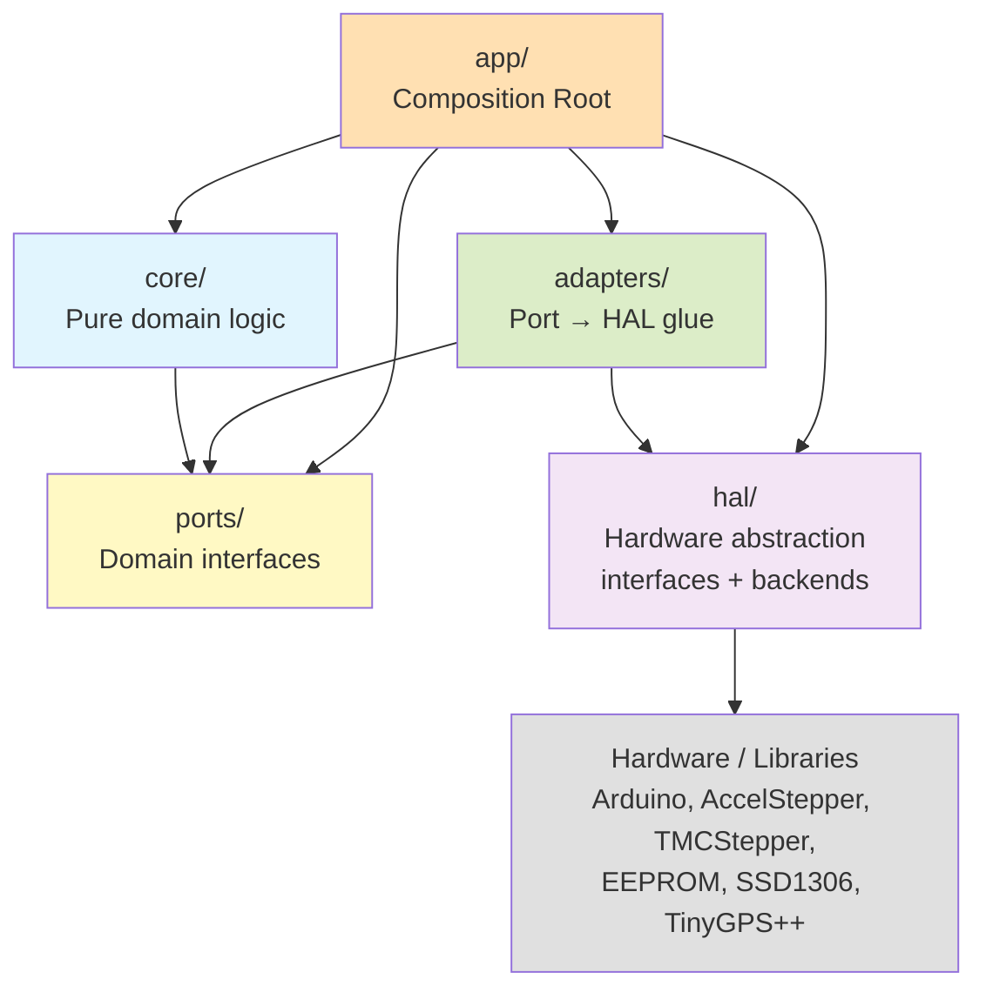

# Plan: Clean-Architecture Refactor of OpenAstroTracker-Firmware

## TL;DR
Refactor a ~5k-line `Mount` god-object firmware toward clean architecture for embedded:
a pure **Domain Core** (no Arduino, fully unit-testable) sitting behind **Port interfaces**,
with **Adapters** wrapping hardware (AccelStepper, TMC2209, EEPROM, displays, Wi-Fi, clock).
Approach: **hybrid** — extract pure logic into `core/` first, then test (invert the typical "test-first" order because `src/` root files transitively include `<Arduino.h>` via `inc/Globals.hpp` and are untestable in the `native` PIO env), then **strangler-fig** the hardware-coupled pieces (drivers, slewing loop, command executor) behind ports. Compile-time `#ifdef` axes/drivers migrate to **runtime polymorphism** so unsupported combinations no longer change the call graph. Goal endpoint: `src/core/` is buildable & 100% unit-tested on host; `src/adapters/` contains all Arduino/library coupling; `src/app/` wires them up per board.

---

## Architecture

### Goals

| # | Goal | Rationale |
|---|------|-----------|
| 1 | **Make domain logic host-testable** | The `native` PIO env can't compile `src/` root files (they transitively include `<Arduino.h>` via `inc/Globals.hpp`). Pure logic must live in `src/core/` with zero Arduino deps so tests run in milliseconds, not on hardware. |
| 2 | **Shrink the `Mount` god-object** | `Mount.cpp` is 4,361 LOC holding all domain behavior. End state: `Mount` is a thin facade (≤ 500 LOC) over focused controllers in `core/`. |
| 3 | **Eliminate `#ifdef` from domain code** | Feature flags for axes, driver types, and sensors currently produce 2^N untested build combinations. These become runtime polymorphism behind interfaces — the composition root makes one choice; `core/` never branches. |
| 4 | **Swap hardware without touching logic** | Changing stepper library, display type, or EEPROM backend must not require edits to `core/` or `ports/`. |
| 5 | **Coverage that means something** | Target: `core/` ≥ 85% line coverage with tests that verify behavior (not tautologies). |

### Requirements & Constraints

| Category | Constraint | Why |
|----------|-----------|-----|
| **Hardware** | Must build & run on all supported boards: AVR_MEGA2560, MKS_GEN_L_V1/V2/V21, ESP32_ESP32DEV, RP2040_JACKW01, RP2040_SKR_PICO (`oaeboardv1` is also a PIO env). The CI matrix builds **7** boards | Existing user base; CI matrix enforces this. |
| **Memory** | AVR_MEGA2560 has 256 KB flash, 8 KB SRAM | Flash overflow is caught at link time. Mitigation: keep vtable count ≤ ~12, mark adapters `final`, consider template-based static dispatch as escape hatch. |
| **C++ standard** | `core/` must stay **C++11-compatible** until the AVR spike proves otherwise: `etl::optional` is fine (header-only, C++11-safe), **`if constexpr` is not available** | Measured on the tree: only `esp32`, `oaeboardv1` and `native` set `-std=gnu++17`. The four AVR envs set **no** `-std`, so they inherit the Arduino core's **gnu++11** on **avr-gcc 7.3.0** — and they already compile all of `src/core/**`. Raising AVR's standard is an unproven spike (Phase 2a). |
| **Testability** | `core/` must never include `<Arduino.h>` or use `String`, `Serial`, `millis()`, `LOG()` | Enforced by CI grep check. `native` env only compiles `core/`, `ports/`, `adapters/`. |
| **Back-compat** | Meade LX200 serial protocol behavior is invariant | External interfaces (Stellarium, ASCOM) must not break. Internal C++ APIs may change freely. |
| **Shippable increments** | Every phase/step must be independently shippable — all boards green, all tests green | No flag days; thin overlays preserve old call-sites during transition. |
| **Tooling** | PlatformIO + Googletest + **hand-written port fakes** + gcovr | Googletest + gcovr are configured in `platformio.ini` and CI (`ci.yml`). ArduinoFake/FakeIt is **not required**: every port is a pure abstract interface and `core/` is Arduino-free, so plain fakes under `unit_tests/test_common/hal_fakes/` cover every test (Phase 0, item 5). |

### Layers & Dependencies

Dependencies point inward only. No layer may reference a layer above it.



| Layer | Directory | Depends on | Contains | Test strategy |
|-------|-----------|------------|----------|---------------|
| **core/** | `src/core/` | `ports/` only | Domain controllers (`SlewController`, `TrackingController`, …), algorithms (`SiderealClock`, `CoordinateMath`, …), `MeadeParser`, `MountState`, `EventBus`, `MountConfig` | Pure unit tests with hand-written fakes of the ports. No hardware, no Arduino. `native` env. |
| **ports/** | `src/ports/` | nothing | Domain interfaces: `IClock`, `ILogger`, `IPersistentStore`, `IStepperAxis`, `IMotorDriver`, `IDisplay`, `IHomingSensor`, `IEndSwitch`, `IGps`, `ITransport` | Pure abstract interfaces — no implementation to test. |
| **adapters/** | `src/adapters/` | `ports/` + `hal/` | Thin glue: `StepperAxis`, `EepromPersistentStore`, `SerialLogger`, `Tmc2209Driver`, `HallHomingSensor`, `SerialTransport`, `WifiTransport`, `MeadeCommandAdapter` | Integration tests: adapter → faked HAL port. |
| **hal/** | `src/hal/` | hardware libraries only | Interfaces (`IGpioPin`, `ISerialPort`, `IStepperMotor`, `ITmcDriver`, `ISystemClock`, `ITimerService`, …) + backends under `hal/arduino/` (generic Arduino, used by every platform), `hal/avr/` (the vendored timer-ISR engines behind `InterruptStepperMotor`), `hal/esp32/` and `hal/rp2040/`. | Not host-tested (wraps hardware). Verified by on-device smoke tests. |
| **app/** | `src/app/` | all layers | Composition root. Board-specific configuration comes from a header (e.g. `Configuration_local_oaeboardv1.hpp`, selected by the PIO environment) which populates a runtime `MountConfig` struct. Wires up the object graph. Replaces the legacy `.ino` entry point. | Verified by on-device smoke tests across the CI-matrix boards. |

**Why both `hal/` and `ports/`:**
- `hal/` describes *what the hardware can do* (pin toggles, UART bytes, timer ticks). One backend per platform.
- `ports/` describes *what the domain needs* (axis position, persistent value, "now"). Adapters compose one or more HAL services to satisfy a port — e.g. `StepperAxis` implements `IStepperAxis` over `IStepperMotor`, whose platform backend wraps the stepper library (`AccelStepper` on ESP32/RP2040, `InterruptStepper` on AVR).
- This split means a new stepper library requires a new HAL backend, not a port change. A new domain requirement (e.g. "axis acceleration profile") requires a port change, not a HAL change.

### Cross-cutting rules

| Rule | Enforcement |
|------|-------------|
| `core/` never includes `<Arduino.h>`, `String`, `Serial`, `millis()`, `LOG()`, or any board pin header | CI grep check (Phase 4+) |
| `core/` and `ports/` contain zero `#ifdef` for feature flags | CI grep check (Phase 4+) |
| Time = `IClock` port (backed by `hal::ISystemClock`); no direct `millis()` | Interface contract |
| Logging = `ILogger` port (backed by `hal::ISerialPort`); no direct `Serial.print()` | Interface contract |
| Configuration = runtime `MountConfig` struct populated once in `app/` from `Configuration*.hpp` macros | Single translation unit reads macros |
| Optional axes (AZ, ALT, Focus) = `etl::optional` or null-object pattern; no `#ifdef` branches | Composition root constructs or injects null |
| ISR-safety: `IStepperAxis::Snapshot()` returns an ISR-safe state snapshot; mutation methods are main-loop-only | Settled in Phase 2 before Phase 3 controller extraction |
| `Mount` becomes a thin facade (≤ 500 LOC) over `core/` controllers, retained for Meade back-compat, gradually deprecated | Shrinks each phase as controllers are extracted |

---

## Current State (after Meade parser migration + Phase 1 extraction)

### ✅ Completed: Meade parser migrated to `core/`

The Meade LX200 command parser has been fully extracted into `src/core/meade/` as a pure, host-testable, allocation-light parser with no side effects. The split is:

| Layer | Location | Status |
|-------|----------|--------|
| **Parser** (pure) | `src/core/meade/MeadeParser.*` + 12 family-specific `.cpp` files | ✅ Done — covered by 14 test files in `unit_tests/test_core/meade/`; `core/meade/` line coverage 87.0% |
| **Protocol spec** | `src/core/meade/MeadeProtocol.hpp` | ✅ Done — comprehensive protocol documentation |
| **Handler interfaces** | `src/core/meade/MeadeParser.hpp` (12 `IMeade*Handlers` interfaces + aggregate `IMeadeHandlers`) | ✅ Done — clean typed contracts |
| **Executor/Adapter** | `src/MeadeCommandProcessor.hpp/cpp` | ✅ Done — implements `IMeadeHandlers`, delegates to `Mount`/`LcdMenu` |

The parser directory (`src/core/meade/`) contains 17 files (12 family dispatchers + `MeadeParser.cpp/.hpp` + `MeadeParserHelpers.cpp/.hpp` + `MeadeProtocol.hpp`) covering all 12 command families (Get, Set, Quit, Distance, Init, SyncControl, Home, SlewRate, GPS, Focus, Movement, Extra). Each family has:
- A typed handler interface (e.g. `IMeadeGetHandlers`, `IMeadeMovementHandlers`)
- A `handleMeade*` entry point that parses suffixes, invokes handler callbacks, and serializes `MeadeResponse`
- Value types for coordinates (e.g. `RaCoordinate`, `DecCoordinate`)

The `MeadeCommandProcessor` adapter bridges the parser to the legacy `Mount` singleton, implementing all 127 handler overrides. It is the **only** file in `src/` root that references the core parser.

### Test coverage

14 test files in `unit_tests/test_core/meade/` provide comprehensive wire-byte coverage for every parser family using fake handler stubs. Line coverage of `core/meade/` is 87.0% (`MeadeParser.cpp` 43.1%, `MeadeParserExtra.cpp` 69.6%, most family dispatchers ≥ 95%). Tests verify:
- Exact wire-byte formatting (zero-padding, sign rules, terminators)
- Suffix classification and handler dispatch routing
- Edge cases (malformed input, overflow, unknown sub-commands)
- Parser-level validation (the `parseMeadeCommand` classifier)

### ✅ Completed: Phase 1 pure-logic extraction (modules + tests)

All seven Phase 1 modules exist under `src/core/`, plus `src/hal/EepromLayout.hpp`, and are covered by host tests — see the status markers on each Phase 1 step below. Pure arithmetic for `DayTime`, `Declination`, `Latitude`, `Longitude`, `RightAscension` and `Sidereal` is fully extracted, and the `src/` originals are now thin overlays that delegate to `core/`.

**Wiring is complete (Steps 4–7):**

1. ✅ `Mount::calculateRAandDECSteppers()` now builds a `core::SlewGeometry`, calls `core::calculateStepperPositions()`, and copies the result back. Rounding was reconciled to the legacy expressions (`long(-moveRA) * stepsPerSiderealHour`, product truncated on assignment) so the refactor is bit-for-bit identical; `SlewResult` now reports which candidate was selected (`SlewSolution`) plus the post-flip RA/DEC, so `Mount` keeps its existing `DEBUG_COORD_CALC` logs. Pinned by unit tests.
2. ✅ `Mount::getLocalDate()` now converts the elapsed day-ends into a whole-day count and calls `core::addDays()`; the inline month-length/leap-year loop is gone.
3. ✅ `Mount::RAString()`/`DECString()` call `core::formatRA()`/`core::formatDEC()`. `formatRA` gained a `bufSize` argument (it previously hard-coded `snprintf(..., 32, ...)` against `Mount`'s 24-byte `scratchBuffer`) and no longer forces `abs()`, matching the legacy `sprintf` output exactly.
4. ✅ `src/hal/EepromLayout.hpp` is now the single source of truth for magic markers, item flags, item addresses and `SteppingStorageNormalized`. It exposes them as `hal::eeprom::*` (a namespace rather than a struct, so unscoped enumerators can be brought into `EPROMStore.cpp` with one `using namespace` on pre-C++20 toolchains), `EEPROMStore`'s private aliases point at it, and `test_hal/test_eeprom_layout.cpp` pins the on-device layout on the host.

### Where it stands after Phase 6

All six phases have landed. The domain decisions live in `core/` (600 host tests, 92.5 % of its
lines exercised), the hardware coupling sits in `adapters/` and `hal/`, and the composition root is
still `src/b_setup.hpp` rather than `src/app/`. The Meade command layer holds no `Mount *` at all —
it is driven through six ports — and `Mount` no longer drives either display.

What is left is UI, and it is listed with its exit in
[`ARCHITECTURE.md`](ARCHITECTURE.md) §3 "What still sits outside this layering": the menu screens
(~170 `mount.*` call sites), the SSD1306 renderer's pull side, `EPROMStore`'s static facade, three
hardware helpers (`Gyro`, `HallSensorHoming`, `EndSwitches`) whose ports exist but have no adapter,
and the four composition-root/loop files that should move to `src/app/`. None of them is a design
question any more; each is a bounded piece of work with a bench session attached. **Phase 7 (below)
is the plan that finishes this list and deletes the legacy root.**

---

## Phased Plan (each phase shippable & green in CI)

### Phase 0 — Safety net & tooling (no behavior change) ✅ COMPLETE
*Foundation for everything else; must land first. Fully implemented — per-item status below.*

1. ~~Add FFF as header-only dep~~ — **Superseded and dropped.** No mocking framework is needed: the ports are pure abstract interfaces, so hand-written fakes (Phase 2a, `unit_tests/test_common/hal_fakes/`) cover every test.
2. ~~Add `native_core` PIO env~~ — **Superseded.** Only the `native` env is used. The existing `native` env already has strict warnings (`-Wall -Wextra -Werror -Wpedantic -Wshadow`). Note: `src/core/README.md` mentioned `native_core` and has been corrected.
3. ✅ gcovr-based **coverage reporting** in `native` env — **Done.** `scripts/test-coverage.py` appends `--coverage` to `LINKFLAGS`; `build_src_flags` carries the compile-side flag. Reports (HTML + markdown) are produced by `./scripts/test-coverage.sh`. **There is no `coverage` PlatformIO target** — `pio run -e native -t coverage` fails with "unknown target". Current: 90.2% lines, 98.2% functions, 79.6% branches (366 test cases).
4. ✅ CI workflow — **Done.** `.github/workflows/ci.yml` runs `./scripts/test-coverage.sh` (which runs `pio test -e native`, then gcovr) and publishes `coverage.md` to the step summary. Threshold gating deferred to a later phase.
5. ✅ **No Arduino API fakes needed** — **Resolved (was: ArduinoFake as `test_lib_deps`).** `unit_tests/test_common/ArduinoFake/` held only six `CMakeLists.txt` files (no headers, no sources) and was dead weight — **deleted**. Every port is a pure abstract interface and `core/` is Arduino-free, so host tests need plain hand-written fakes, not an Arduino-API mock. ArduinoFake/FakeIt is **not** a prerequisite for Phase 2. The only test-plumbing change left is a `test_adapters` entry in `test_filter` (Phase 2a, step 4).
6. ✅ Folder structure — **Done.** `src/ports/`, `src/hal/`, `src/adapters/`, `src/app/` all exist with descriptive README files (they now link to [`PLAN.md`](PLAN.md)).

**Verify:** `./scripts/test-coverage.sh` → 366 test cases, 0 failures; coverage report generates; the 7-board CI matrix builds green via `matrix_build.py`.

**Changes from original plan (per feedback):** FFF and FakeIt/ArduinoFake both dropped (hand-written port fakes instead); `native_core` env eliminated (use `native` only); coverage threshold gating deferred to a later phase. **No open items.**

### Phase 1 — Extract pure domain logic into `core/`, then test — ✅ COMPLETE
*The original plan called for testing before extraction. That doesn't work here: every `src/` root file includes `inc/Globals.hpp` → `<Arduino.h>`, and uses `String`/`LOG()`/Arduino APIs. The `native` PIO env only builds `core/`, `ports/`, `adapters/` — not `src/` root files. **New approach: extract pure subsets into `core/` first, then write exhaustive tests.** Each step is independently shippable. No behavior change.*

**Structure:** Data containers (`DayTime`, `Declination`, `Latitude`, `Longitude`, `RightAscension`) go under `src/core/types/`. Algorithm modules (`SiderealClock`, `CoordinateMath`, `CalendarMath`, `CoordinateFormatter`) live at `src/core/` root. EEPROM layout constants (`EepromLayout`) live in `src/hal/` — they describe a storage format, not domain behavior.

```
src/core/
├── meade/                        # ✅ extracted — parser + protocol
├── types/                        # ✅ extracted — pure data containers
│   ├── DayTime.hpp/.cpp
│   ├── Declination.hpp/.cpp
│   ├── Latitude.hpp/.cpp
│   ├── Longitude.hpp/.cpp
│   └── RightAscension.hpp/.cpp
├── SiderealClock.hpp/.cpp        # ✅ algorithm producing DayTime outputs
├── CoordinateMath.hpp/.cpp       # ✅ wired into Mount::calculateRAandDECSteppers
├── CalendarMath.hpp/.cpp         # ✅ wired into Mount::calculateLst + Mount::getLocalDate
└── CoordinateFormatter.hpp/.cpp  # ✅ wired into Mount::RAString/DECString
```

The `src/` originals become **thin overlays**: they `#include` the `core/` version and add only Arduino-dependent methods (`ParseFromMeade`, `ToString`; `Declination` and `Longitude` also override `formatString` for their wire formats). This preserves back-compat — no flag day. **Status:** all seven steps are extracted, wired and tested — the `src/` originals no longer hold their own copies of the extracted logic.

#### Step 1: DayTime — extract pure arithmetic subset ✅ DONE
*Parallel with Steps 5, 7.*

**What's pure** (uses only `long` math, no Arduino types): constructors, `getHours/getMinutes/getSeconds/getTotalHours/getTotalMinutes/getTotalSeconds`, `set`, `addHours/addMinutes/addSeconds`, `addTime/subtractTime`, `sign`, `checkHours`.

**What stays** (uses Arduino `String` or `LOG()`): `ParseFromMeade`, `ToString`, `formatString`.

**Plan:**
1. ✅ Create `src/core/types/DayTime.hpp/.cpp` — pure header with arithmetic only.
2. ✅ Keep original `src/DayTime.hpp/cpp` as overlay: `#include "core/types/DayTime.hpp"` + Arduino-dependent methods (`ParseFromMeade`, `ToString`).
3. ✅ Write `unit_tests/test_core/types/test_daytime.cpp` — construction, 24h wrap, negative hours, add/subtract across midnight.

#### Step 2: Declination, Latitude, Longitude, RightAscension — extract pure subsets ✅ DONE
*Depends on Step 1.*

All four inherit `DayTime`. Pure parts: `checkHours()` clamping, degree conversion, constructors. What stays: `ParseFromMeade(String const&)`, `ToString()`, `formatString()`.

**Plan:**
1. ✅ Create `src/core/types/Declination.hpp/.cpp`, `Latitude.hpp/.cpp`, `Longitude.hpp/.cpp`, `RightAscension.hpp/.cpp` — each inherits `core::DayTime`.
2. ✅ Old `src/Declination.hpp` etc. become: `#include "core/types/<Type>.hpp"` + `ParseFromMeade`/`ToString`/`formatString` overlay.
3. ✅ Write `test_declination.cpp`, `test_latitude.cpp`, `test_longitude.cpp`, `test_right_ascension.cpp` — clamping edges, hemisphere handling, 24h wrapping.

#### Step 3: Sidereal — extract pure math, leave GPS behind ✅ DONE
*Depends on Step 1.*

`Sidereal.cpp` is 130 lines. The GPS path (`calculateByGPS`) uses TinyGPS++. The pure math (`calculateByDateAndTime`, `calculateHa`, `calculateTheta`, `calculateDeltaJd`) uses only `double` + `DayTime`.

**Plan:**
1. ✅ Create `src/core/SiderealClock.hpp/.cpp` — pure primitives `calculateTheta`/`calculateDeltaJd`/`calculateHaDegrees`; the `calculateByDateAndTime`/`calculateHa` entry points remain in `src/Sidereal.cpp` and compose them.
2. ✅ Keep old `src/Sidereal.cpp` with `calculateByGPS` + thin wrappers delegating to `core::SiderealClock`.
3. ✅ Create `test_core/test_sidereal.cpp` — LST/HA from known dates (equinoxes, solstices), leap years.

#### Step 4: Mount — extract `calculateRAandDECSteppers` math ✅ DONE
*Depends on Steps 1-2.*

The ~200-line function computes stepper positions from RA/DEC targets. Core math is pure arithmetic on floats/longs (hemisphere, meridian flip, 3-solution selection).

**Plan:**
1. ✅ Create `src/core/CoordinateMath.hpp/.cpp` with plain structs (`SlewGeometry`, `SlewResult`) and free function `calculateStepperPositions()`. `SlewResult` returns the three candidate solutions inline rather than via the out-parameters the original plan described.
2. ✅ `Mount::calculateRAandDECSteppers()` fills a `SlewGeometry` and calls the free function. Rounding was reconciled to the legacy expressions — the candidate solutions truncate the hour delta to whole hours before scaling and the selected target scales the unrounded delta in float — so results are identical to the pre-refactor code. `SlewResult` also reports the selected candidate (`SlewSolution`) and the post-flip RA/DEC, letting `Mount` keep its `DEBUG_COORD_CALC` logs.
3. ✅ Write `test_core/test_coordinate_math.cpp` — covers both flip directions, meridian-flip boundaries, pole targets (including a flipped pole target), the reported solution, and the legacy rounding of the candidate solutions.

#### Step 5: Mount — extract calendar math ✅ DONE
*Parallel with Steps 1, 7.*

`Mount::getLocalDate()` handles year/month/day increment with month-length tables and leap-year logic. Pure integer math.

**Plan:**
1. ✅ Create `src/core/CalendarMath.hpp/.cpp` with `struct CalendarDate`, `addDays()` and `localToUtcDate()`.
2. ✅ `localToUtcDate()` is used by `Mount::calculateLst`, and `Mount::getLocalDate()` now folds the elapsed day-ends into a whole-day count and delegates to `core::addDays()` — the inline month-length/leap-year loop is gone.
3. ✅ Write `test_core/test_calendar.cpp` — month boundaries, leap years incl. century rules.

#### Step 6: Mount — extract coordinate formatting ✅ DONE
*Depends on Steps 1-2.*

`Mount::RAString()` and `Mount::DECString()` format RA as HH:MM:SS# and DEC as sDD*MM:SS#. Pure char-buffer manipulation.

**Plan:**
1. ✅ Create `src/core/CoordinateFormatter.hpp/.cpp` with `formatRA(char*, size_t, const core::DayTime&, const char*)` and `formatDEC(char*, const Declination&, const char*)`. `formatRA` takes the buffer capacity because it previously hard-coded `snprintf(..., 32, ...)` while `Mount::scratchBuffer` is only 24 bytes.
2. ✅ `Mount::RAString()`/`DECString()` call the formatter. `formatRA` no longer forces `abs()` on the hours, so output matches the legacy `sprintf` byte-for-byte (including a negative-hours edge case) and DEC still dispatches through the virtual `Declination::formatString`.
3. ✅ Write `test_core/test_coordinate_formatter.cpp` — exact wire-byte output, sign rules, zero-padding.

#### Step 7: EPROMStore — extract validation logic ✅ DONE
*Parallel with Steps 1, 5.*

`EPROMStore` uses Arduino EEPROM API directly. Data-validation logic (magic markers `0xCE`/`0xCF`, struct layouts) is separable.

**Plan:**
1. ✅ `src/hal/EepromLayout.hpp` holds the layout — magic markers, item flags, extended flags, item addresses and `SteppingStorageNormalized` — with no Arduino deps. It exposes them as `hal::eeprom` (a namespace rather than a struct, so the unscoped enumerators can be pulled into `EPROMStore.cpp` with one `using namespace` on pre-C++20 toolchains instead of being re-listed). `EEPROMStore`'s private `ItemFlag`/`ExtendedItemFlag`/`ItemAddress` are aliases of it, and `unit_tests/test_hal/test_eeprom_layout.cpp` pins every address, flag mask and the store size against the shipped V1.x layout.
2. Full `IPersistentStore` port + adapter comes in Phase 2.

**Verify:** `./scripts/test-coverage.sh` — all new tests pass (366 test cases); every board env builds green via the CI matrix (`python matrix_build.py -b <board>`; a bare `pio run -e <board>` needs an untracked `Configuration_local_*.hpp`); coverage shows ≥ 85% line coverage on new `core/` files (**met** — every Phase 1 module is ~100% except `core/meade/` at 87.0%); manual: mount slews to known coordinates on real hardware.

### Phase 2 — Introduce HAL, Ports & Adapters ✅ COMPLETE
*Define the HAL surface, define the domain ports, and start routing current call sites through them. Keep current behavior bit-for-bit. Split into three independently shippable sub-phases: **2a** contracts (no production change), **2b** adapters + `Mount` injection, **2c** call-site cleanup.*

**Prerequisites:** none blocking. ArduinoFake/FakeIt is **not** required (ports are pure interfaces; Phase 2a supplies hand-written fakes). The build-config work that makes 2a shippable — `test_adapters` in `test_filter`, per-board HAL source filters, the AVR C++-standard spike and the ETL dependency — is folded into 2a step 4.

**Calibration facts (measured on the current tree):** `Mount.cpp` is 4,361 LOC with **~134 public method declarations** and contains **274 `LOG()` sites (273 literal formats totalling 13,857 bytes, currently kept in PROGMEM via `F()`), 47 `EEPROMStore::` sites, 21 `millis()`, 19 `digitalWrite()`, 184 TMC-driver calls and 251 stepper-axis calls (on 236 call sites)**. `Mount::loop()` is 293 lines. These counts are the real size of 2b/2c: the work is mechanical but large. The global is defined in `src/b_setup.hpp` (`Mount mount(&lcdMenu);`); the only `extern Mount mount;` is in `src/testmenu.cpp`. Stepping has **three** concurrency models, not two (step 9).

#### 2a — Contracts (no production changes) ✅ COMPLETE

*Status: all four steps landed. `pio test -e native` runs 377 cases green (366 prior + 11 fake smoke tests); `ramps`, `mksgenlv21`, `esp32`, `oaeboardv1` and `rp2040_skr_pico` build green, and `mksgenlv1` was verified with a temporary local config (the CI matrix supplies one for the boards that have none in-tree). Nothing in `src/` root includes any new interface yet, so behaviour is untouched.*

1. ✅ Define **HAL interfaces** in `src/hal/`:
   - `IGpioPin`, `ISerialPort`, `ISpiBus`, `II2cBus`, `IEeprom`,
   - `IStepperMotor`, `ITmcDriver` (UART register IO),
   - `IOledPanel`, `ICharLcd`, `IButtonMatrix`,
   - `ITimerService` (periodic/one-shot callbacks), `ISystemClock` (`millis`/`micros`),
   - `IWifiStack`.
   - `IStepperMotor` is the **motion-engine** surface: `moveTo`, `move`, `setSpeed`, `setMaxSpeed`, `setAcceleration`, `run`, `runSpeed`, `currentPosition`, `setCurrentPosition`, `targetPosition`, `distanceToGo`, `isRunning`, `setPinsInverted`, plus microstep/enable config. It is **not** a bare step/dir pulse interface, and it is **not** a copy of `IStepperAxis`: `core/`/`ports/` never name a stepper library. See the *Stepper axis layering* decision.
   - Done: all 13 headers exist (one interface per file) and are Arduino-free. `ISerialPort` is deliberately *open-port* only — baud rate and pins are a backend constructor concern, so one `ArduinoSerialPort(Stream &)` covers `HardwareSerial`, `SerialUSB`, `SoftwareSerial` and the AVR `Serial`. `IGpioPin::writeAnalog` is named that way because `analogWrite` is a global Arduino symbol.
2. ✅ Implement HAL backends (headers stay Arduino-free; each backend directory compiles only for its platform):
   - `hal/arduino/` — generic Arduino implementation (`ArduinoGpioPin`, `ArduinoSerialPort`, `ArduinoEeprom`, `ArduinoSystemClock`, …).
   - `hal/avr/` — deferred here and **landed in Phase 4**: wrapping all seven engines would cost ~2.6 KB of flash each (measured), so only the runtime-optional AZ/ALT/Focus axes go through [`hal/avr/InterruptStepperMotor.hpp`](src/hal/avr/InterruptStepperMotor.hpp); `InterruptAccelStepper.h` and the TIMER1/3/4/5 vectors moved into the same directory, and `InterruptCallback` moved to `hal/`. See [`src/hal/README.md`](src/hal/README.md).
   - `hal/rp2040/` — RP2040-specific: the `add_repeating_timer_us` alarm ISR in [`src/InterruptCallback.cpp`](src/InterruptCallback.cpp) (`TimerInterrupt` is already `lib_ignore`d for those envs) plus `Rp2040TimerService`.
   - `hal/esp32/` — ESP32-specific: `Esp32TimerService`, `Esp32WifiStack`.
   - `hal/arduino/AccelStepperMotor` — one stepper engine wrapper (over `AccelStepper`) shared by ESP32 and RP2040, rather than a per-platform copy.
   - `unit_tests/test_common/hal_fakes/` — pure C++ fakes (in-memory EEPROM, virtual GPIO, controllable clock, fake serial). Test code only, **not** in `src/`.
   - Done: `hal/arduino/` has `ArduinoSystemClock`, `ArduinoGpioPin`, `ArduinoSerialPort`, `ArduinoEeprom` and `AccelStepperMotor`; `hal/esp32/` has `Esp32TimerService` (over `esp_timer`) and `Esp32WifiStack` (with `ITcpListener`/`ITcpConnection`/`IUdpSocket` wrappers); `hal/rp2040/` has `Rp2040TimerService` (over `add_repeating_timer_us`/`add_alarm_in_us`). `hal/arduino/AccelStepperMotor` is shared by ESP32 and RP2040 instead of being copied into both platform directories. `ISpiBus`/`II2cBus` are contracts only: nothing needs them until the display adapters arrive in Phase 3.
3. ✅ Define domain **ports** in `src/ports/`:
   - `IClock`, `ILogger`, `IPersistentStore`,
   - `IStepperAxis` — sized to the real call surface: `currentPosition`, `setCurrentPosition`, `targetPosition`, `distanceToGo`, `move`, `moveTo`, `runToNewPosition`, `runToPosition`, `run`, `runSpeed`, `stop`, `isRunning`, `setMaxSpeed`, `maxSpeed`, `setAcceleration`, `setSpeed`, `speed`, `setPinsInverted`, plus the ISR-safe `Snapshot()`. Keep the existing two-instances-per-axis split (RA slew + tracking, DEC slew + guide).
   - `IMotorDriver` — sized to the real call surface: `beginSerial`/`begin`, `microsteps`, `rms_current`, `toff`, `blank_time`, `vsense`, `semin`, `iholddelay`, `TPOWERDOWN`, `TCOOLTHRS`, `SGTHRS`, `en_spreadCycle`, `pdn_disable`, `mstep_reg_select`, `I_scale_analog`, `fclktrim`, `cs_actual`; null implementation for non-TMC.
   - `IHomingSensor`, `IEndSwitch`, `IDisplay`, `IInfoDisplay`, `ITransport`, `IGps`, `IGyro`.
   - Done: all 12 ports exist. `IStepperAxis` carries the settled threading contract in its header (only `snapshot()` is ISR-callable; everything else is main-loop-only; timers are shared, so axis ownership is granted by the coordinator). `ILogger` takes an opaque `LogFormat` built with `OAT_LOG_FORMAT()`, which expands to `PSTR()` on AVR and a plain pointer elsewhere — that is the only platform-specific line under `ports/`, and it exists to keep the 273 format literals out of SRAM. `IPersistentStore` is byte-addressed; the layout and value encoding stay with the EEPROM adapter.
4. ✅ Update **build configuration** — all of it belongs in 2a, because nothing references the new interfaces yet:
   - **`native` env:** compiles *all* of `src/adapters/` and none of `src/hal/`. With the stepper library confined to `hal/`, `StepperAxis` stays pure and needs no per-file exclusion; if a future adapter must include an Arduino header, add an exclusion rather than moving it into `hal/`. Add `test_adapters` to `test_filter` so adapter tests actually run (today only `test_core` + `test_hal` are filtered).
   - **Every embedded env needs platform source filters.** `[common_embedded]` uses `src_filter = +<*>` (minus `libs/`), so without exclusions the AVR build would try to compile `hal/esp32/` and `hal/rp2040/` the moment they exist. Add per-env `build_src_filter`: AVR (`ramps`, `mksgenlv1/v2/v21`) → `-<hal/esp32/> -<hal/rp2040/>`; `esp32` + `oaeboardv1` → `-<hal/avr/> -<hal/rp2040/>`; `rp2040_jackw01` + `rp2040_skr_pico` → `-<hal/avr/> -<hal/esp32/>`.
     - Done: the AVR and RP2040 halves are in place. The `-<hal/avr/>` exclusions were **not** added here, because 2b dropped the AVR backend (see step 2) so the directory did not exist yet. **Superseded in Phase 4:** when `hal/avr/` landed, `[env:esp32]` and `[common_rp2xxx]` gained the `-<hal/avr/>` exclusion beside the existing ones.
   - **AVR C++-standard spike.** The AVR envs set no `-std` and inherit **gnu++11** from the Arduino core on **avr-gcc 7.3.0**, yet they compile all of `src/core/**`. Until this spike proves otherwise, `core/` must stay C++11-compatible: keep `etl::optional` (header-only, C++11-safe) and **avoid `if constexpr`**. Try `-std=gnu++14`, then `gnu++17`, on `ramps`; record the outcome here.
     - **Outcome (measured):** both standards build and link on `ramps` with avr-gcc 7.3.0. A `-std=gnu++17` in `build_flags` reaches every `src/` TU without any `build_unflags`, leaving the Arduino core on its own gnu++11. Flash and RAM came out byte-identical to the gnu++11 build, so raising the standard costs nothing. (The vendored `InterruptStepper` library already builds itself with `-std=c++17`, so the AVR toolchain was in fact already mixing standards.)
     - **Decision: stay C++11.** The firmware still supports Arduino IDE builds, which compile AVR sketches with the core's default standard; using C++17 in `core/` would silently break that path. The spike proves C++17 is available if that constraint is ever dropped.
   - **ETL dependency.** `-D ETL_NO_STL` is already global (`[env]`), but ETL is in no `lib_deps` anywhere and nothing uses `etl::` yet. Add ETL to `[common].lib_deps` for boards and to `[env:native].test_lib_deps` (the `native` env has **no** `lib_deps` block) before Phase 4 relies on `etl::optional`.
     - Done: `etlcpp/Embedded Template Library @ 20.32.1` is in `[common]`, in `[common_rp2xxx]` (that section duplicates instead of extending `[common]`) and in `[env:native].test_lib_deps`. ETL already arrived transitively through `InterruptStepper`, whose manifest pins **exactly** `20.32.1`; declaring any wider range makes LDF install a second, conflicting copy (measurable as +108 B of AVR flash), so the pin matches that manifest. Same ETL version on every board.
   - Done: `[common_embedded]` now uses `build_src_filter` (the `src_filter` spelling is the deprecated alias) so each env can extend it, `test_adapters` is in `[env:native].test_filter`, and `unit_tests/test_adapters/test_hal_fakes.cpp` is the first suite in it.

**Verify (2a):** `pio test -e native` green; `matrix_build.py -b <board>` still links for all 7 CI boards after the HAL exclusions (nothing references the new interfaces yet).

**Verified:** `pio test -e native` → 377/377 passed (11 new). Board builds: `ramps` (AVR interrupt-stepper), `mksgenlv21` (AVR AccelStepper), `mksgenlv1` (AVR AccelStepper, temporary local config), `esp32`, `oaeboardv1`, `rp2040_skr_pico` all SUCCESS. On `ramps` the cost is **zero**: `168430` B flash and `7457` B RAM before and after (64.5% / 91.0%) — the unreferenced backends are fully dead-stripped.

#### 2b — Adapters + `Mount` injection ✅ COMPLETE

*Status: eight adapters exist and are host-tested where they can be; `Mount` takes its clock and scheduler through the constructor and creates its axes and drivers as adapters; `EEPROMStore` no longer touches the Arduino EEPROM API. `pio test -e native` runs 399 cases green (22 new), and `ramps`, `mksgenlv21`, `esp32`, `oaeboardv1`, `rp2040_skr_pico` build green.*

5. ✅ Provide **adapters** in `src/adapters/` that bind ports to HAL. Only adapters with no upward dependency on the legacy `Mount` (and no Phase 5 dependency) belong here:
   - ✅ `ArduinoClock` (port `IClock` ← hal `ISystemClock`), `ArduinoScheduler` (`IScheduler` ← Arduino `yield()`), `SerialLogger`, `EepromPersistentStore` (over `hal::IEeprom`).
     - **`SerialLogger` keeps flash residency**: it formats through `ports::LogFormat`, which on AVR is read with `vsnprintf_P`, so the 273 format literals never land in `.data`. It mirrors the legacy line shape (`[uptime]{delta}ms: message`), with a fixed 192-byte stack line buffer instead of the heap `String` the old `logv()` built.
     - **`EepromPersistentStore` is thin, and `EPROMStore` stays the format owner.** The plan said the layout logic would move into the adapter; it did not, deliberately: the ~685 lines of typed accessors are 50 `LOG()` sites deep, so moving them now would either drag Arduino logging into an adapter (making it untestable) or delete diagnostics. What did move is every platform `#if` — [`src/EPROMStore.cpp`](src/EPROMStore.cpp) no longer includes `<EEPROM.h>` or branches on `ESP32`/`RP2040`/`USE_DUMMY_EEPROM`; it reads and writes through the injected `ports::IPersistentStore`, and the composition root picks `hal::ArduinoEeprom` or `hal::InMemoryEeprom`. Revisit when `ILogger` is wired into the store in 2c.
   - ✅ `StepperAxis` — implements `IStepperAxis` over `hal::IStepperMotor`; pure C++, host-tested against a faked engine. One adapter covers every platform: the AVR difference (`run()`/`runSpeed()` are stubs; the ISR steps autonomously) lives in the engine, not in the adapter. There is deliberately no `AccelStepperAxis` and no `InterruptAccelStepperAxis`.
   - ✅ `Tmc2209Driver` (UART + software-serial variants over `TMC2209Stepper`), `NullMotorDriver`. `IMotorDriver` also exposes `testConnection()`/`VACTUAL()`/`shaft()`, which the UART self-test and `connectToDriver()` need. The adapter talks to the library directly rather than through `hal::ITmcDriver`: a HAL wrapper would have to re-export the same 20 registers and would still not be host-testable. Introduce `hal::ITmcDriver` when a second driver family appears.
   - ✅ `TinyGpsAdapter` — its only consumer today is the out-of-scope [`src/c72_menuHA_GPS.hpp`](src/c72_menuHA_GPS.hpp) plus a forward-declared `gpsAqcuisitionComplete()` in [`src/MeadeCommandProcessor.cpp`](src/MeadeCommandProcessor.cpp); the real consumer arrives in Phase 5. It is compile-verified only: the `native` env excludes it (and `Tmc2209Driver`/`ArduinoScheduler`) from `build_src_filter`.
   - **Deferred to Phase 3** (they call `Mount` today and would violate "adapters depend only on ports + HAL"): `HallHomingSensor` (33 `_pMount->` calls), `GpioEndSwitch` (18 `_pMount->` calls), `Ssd1306InfoDisplay` (23 `mount->` calls), `LcdMenuDisplay` (the menu screens call `mount.*` 192 times and instantiate LiquidCrystal/U8g2 inside [`src/LcdMenu.hpp`](src/LcdMenu.hpp)). Phase 3's `HomingController`/`EventBus` supplies the read model they need.
   - **Deferred to Phase 5, now done:** `SerialTransport` landed there and is the only transport class — the Wi-Fi path is `SerialTransport<128>`, not a second implementation, because the two must not drift. `IDisplay`/`IInfoDisplay` remain for Phase 6's display work.
6. ✅ Refactor `Mount` to **hold port pointers** injected at construction instead of owning concrete types. Composition happens in `app/` (currently `b_setup.hpp`).
   - ~~`Mount(LcdMenu *, ports::IClock *, ports::IScheduler *)`~~ — superseded by 2c's `MountDeps` (one aggregate: clock, scheduler, logger, settings, enable pins). 2b shipped the two-pointer constructor with the pointers declared first among the members so the initialiser order stayed warning-clean. `[`src/b_setup.hpp`](src/b_setup.hpp)` constructs `hal::ArduinoSystemClock`, `adapters::ArduinoClock` and `adapters::ArduinoScheduler` before the `mount` global and passes them in.
   - `_stepperRA/_stepperTRK/_stepperDEC/_stepperGUIDE` (+AZ/ALT/Focus) are `ports::IStepperAxis *` on every platform **except AVR**, where they stay concrete `StepperXxx *`. That is a measured decision, not an oversight: the engines are compile-time specialised per axis and each polymorphic wrapper costs a ~50-byte vtable in the 8 KB SRAM (7 engines = ~350 B). Measured on `ramps`, going through the port cost **+551 B RAM and +20 KB flash** (97.8% RAM, 184 B free — not shippable); with the concrete AVR path the cost is **+153 B RAM and +6.7 KB flash** for the remaining adapters. This is PLAN.md's *template-based static dispatch* escape hatch, and the `hal/avr/InterruptStepperMotor` wrapper was dropped because with it every AVR build would pay that vtable bill.
   - `_driverRA/_driverDEC/_driverAZ/_driverALT/_driverFocus` are `ports::IMotorDriver *` on every platform, including AVR (~56 B for the one `Tmc2209Driver` vtable). `connectToDriver()` and `testUART_vactual()` were re-typed accordingly.
   - The `new` sites in `configureRA/DEC/AZ/ALT/FocusStepper()` and `configure*driver()` remain the seam. `setupHoming()`/`setupEndSwitches()` are untouched (their adapters are Phase 3).
   - **Measured sizes** (`pio run -e <board>`): `ramps` 7457 → **7610 B RAM** (+153, 92.9%) and 168430 → **175158 B flash** (+6.7 KB, 67.1%); `esp32` 46008 B / 844981 B; `oaeboardv1` 22444 B / 370921 B; `rp2040_skr_pico` 11316 B / 128700 B. The AVR flash growth is the TMC register writers no longer being inlined through a vtable, and it fits with ~86 KB to spare.
7. ✅ **`Mount::delay()`** keeps its "keep the tracker running" semantics: it takes the deadline from `IClock` and yields through a new `ports::IScheduler` (backed by `adapters::ArduinoScheduler` → Arduino `yield()`), so it needs neither `millis()` nor `yield()`.

**Verify (2b):** adapter tests run against `hal_fakes`; all prior tests green; every board env builds; manual smoke: slew, park/unpark, guide pulses (same objects, same behaviour).

**Verified:** `pio test -e native` → 399/399 (22 new adapter tests). `ramps`, `mksgenlv21`, `esp32`, `oaeboardv1`, `rp2040_skr_pico` build green; `mksgenlv1` was verified in 2a with a temporary local config and shares the AVR-only code paths with `mksgenlv21`. **Not verified:** the on-hardware smoke test (slew/park/guide/home) — the stepper objects, driver calls and EEPROM path are the same ones as before, but that needs a mount.

#### 2c — Call-site cleanup ✅ COMPLETE

*Status: `Mount` reaches time, diagnostics, enable pins and persisted settings only through ports; `EPROMStore` logs through the same `ILogger`. `pio test -e native` runs 399 cases green, and `ramps`, `mksgenlv21`, `mksgenlv2`, `mksgenlv1` (temporary local config), `esp32`, `oaeboardv1`, `rp2040_skr_pico` and `rp2040_jackw01` (temporary local config) build green.*

8. ✅ Replace `millis()`, `digitalWrite()` and `EEPROMStore::` calls inside `Mount` with port calls. For `LOG()`: **the AVR RAM budget forbids a naive `_logger->log(level, "literal", ...)`** — the 273 format literals (13.9 KB) would move from PROGMEM into `.data` on an 8 KB-SRAM ATmega2560. Settle the `ILogger` contract first: it must preserve PROGMEM on AVR (opaque format type, adapter-side `F()` expansion, or a string table). Only then migrate the 274 call sites.
   - **The call-site shape is `OAT_LOG(logger, level, format, …)`**, added next to `LOG()` in [`src/Utility.hpp`](src/Utility.hpp). It expands to `(logger)->log((level), OAT_LOG_FORMAT(format), …)`, so the literal stays in flash through `PSTR()` on AVR, and it expands to nothing when `DEBUG_LEVEL == DEBUG_NONE` — the same compile-time elimination `LOG()` had, which matters because `DEBUG_LEVEL` defaults to `DEBUG_NONE` and shipping builds must not pay for 359 dead call sites. `SerialLogger` then applies the level mask at run time, exactly as `logv()` did.
   - 261 live sites in [`src/Mount.cpp`](src/Mount.cpp) migrated (274 `LOG(` matches; the other 13 are commented out and left alone). [`src/EPROMStore.cpp`](src/EPROMStore.cpp) migrated its 98 sites the same way, through a new `EEPROMStore::setLogger()`; it defaults to `adapters::NullLogger` so a missed wiring call costs a diagnostic, not a null dereference.
   - The format strings needed a real audit, because `logv()`'s hand-written `formatArg()` accepted things `printf` does not: `%l` meant "long" (82 in `Mount.cpp`, 29 in `EPROMStore.cpp`) and became `%ld`; `%x` printed `0x` plus four hex digits and became `0x%04X` (the two 32-bit sites became `0x%08lX` with an `unsigned long` cast); `%lms` / `%l steps` (four sites, where the `m` was a literal) became `%ldms` / `%ld steps`. Behaviour deltas in log text only: `%f` now prints printf's six decimals instead of `String(value, 4)`'s four, and `%02d` now pads instead of emitting `02d` and losing the argument.
   - `millis()` → `_deps.clock->now()` (19 sites; the 20th match is a comment). `EEPROMStore::` → `_deps.settings->` (47 sites). `digitalWrite(…_EN_PIN, …)` → `_deps.<axis>EnablePin->write(hal::PinLevel::…)` (19 sites).
   - **New `ports::IMountSettings` + `adapters::MountSettingsStore`.** The typed accessors and the on-device encoding stay in `EEPROMStore` — it is the single writer of that format and the menu screens, the Meade adapter and the composition root still read it — and the adapter is a header-only forwarder, so there is no duplicated encoding. This is the one adapter that names a legacy `src/` root class; revisit in Phase 5, when the remaining EEPROM consumers move.
   - **`MountDeps`** (in [`src/Mount.hpp`](src/Mount.hpp)) replaces the two constructor pointers with one aggregate: clock, scheduler, logger, settings, plus the driver enable pins this board compiles in. Placing the pins in `MountDeps` under their own `#if`s is what keeps the AVR cost at a pointer per compiled-in axis; the RA/DEC entries exist only when `UART_CONNECTION_TEST_TXRX == 1`, because that is the only code that drives them.
   - **AVR float printf.** `avr-libc` leaves `%f` out of `vfprintf` unless the float-aware variant is linked, so every migrated `%f` (121 in `Mount.cpp`, 27 in `EPROMStore.cpp`) would have printed `?`. A new `[avr_float_printf]` section in [`platformio.ini`](platformio.ini) adds `-Wl,-u,vfprintf -lprintf_flt -lm` to the four AVR envs (the mksgen envs override `build_flags`, so they name it explicitly). Measured cost: **+792 B of flash on `ramps`**.
   - `adapters::NullLogger` is also installed by the composition root when `DEBUG_LEVEL == DEBUG_NONE`, in place of `SerialLogger`: a sink that can never be called would otherwise cost a vtable, its object and a serial-port wrapper out of the 8 KB. Measured saving on `ramps`: 48 B RAM and 886 B flash.
   - **Two RP2040 details the migration would otherwise have changed.** The legacy `logv()` printed a whole line in one call and skipped `flush()` on `ARDUINO_ARCH_RP2040`, because the arduino-pico USB CDC path can wedge when small writes race the TinyUSB FIFO, and `flush()` can stall when no host is attached. `SerialLogger` now appends the newline to its line buffer and issues a single `write()`, and `hal::ArduinoSerialPort::flush()` carries the RP2040 no-op, so that policy lives in the HAL backend instead of in the log call site.
9. ✅ **ISR contract for `IStepperAxis`:** this phase MUST settle the threading model. There are three:
   - **AVR + `NEW_STEPPER_LIB`** (ramps, oae): `Mount::interruptLoop()` is **compiled out** ([`src/Mount.cpp`](src/Mount.cpp)); the vendored `InterruptStepper` ISR steps autonomously and `run()`/`runSpeed()` are stubs. `IStepperAxis` mutation is main-loop-only; reads must go through `Snapshot()`.
   - **ESP32**: `stepperControlTask` on core 0 calls `interruptLoop()` in a tight loop ([`src/b_setup.hpp`](src/b_setup.hpp)).
   - **RP2040 / AVR without `NEW_STEPPER_LIB`**: `InterruptCallback` invokes `interruptLoop()` from a hardware timer ISR (2 kHz AVR, 5 kHz RP2040).
   The contract must also cover `_mountStatus` (a `volatile int`, non-atomic on AVR) and must define timer arbitration: timers are shared, not per-axis (Timer3 = RA slew + track, Timer4 = DEC slew + guide, Timer1 = AZ, Timer5 = ALT *and* Focus). This contract is a prerequisite for Phase 3's `SlewController`.
   - 2a already wrote the axis half of the contract into [`src/ports/IStepperAxis.hpp`](src/ports/IStepperAxis.hpp): `snapshot()` is the only ISR-callable method, every mutation is main-loop-only, and timer ownership is granted by the coordinator rather than assumed. 2c added the `_mountStatus` half at its declaration in [`src/Mount.hpp`](src/Mount.hpp): reads are safe from any context (an aligned 16-bit load on AVR, 32-bit on ESP32/RP2040, so no tearing), read-modify-write is main-loop-only because it is not atomic on AVR, and the step generator reads the status without writing it.
   - **The one exception is recorded rather than fixed:** `interruptLoop()` calls `HallSensorHoming::processHomingProgress()`, which calls `stopSlewing()` / `moveStepperBy()` and therefore does mutate status and axis targets from the step-generator context. Phase 3's `HomingController` moves that decision back to the main loop and leaves the generator a request bit; until then the contract documents the exception so `SlewController` is not designed against a promise the firmware does not keep.
10. ✅ The feature `#if`s inside `interruptLoop()` stay as-is until Phase 4 — untouched.

**Verify (2c):** all Phase 1 tests green; new adapter tests green; every board env builds; **record flash and SRAM before/after on `ramps`** (the AVR budget is the binding constraint for the `ILogger` change); the manual smoke checklist from "Verification strategy" passes (slew, park, guide, home).

**Verified:** `pio test -e native` → **399/399**. Measured on `ramps` (`size` from `pio run`):

| `ramps` build | RAM before → after | Flash before → after |
|---|---|---|
| `DEBUG_NONE` (default, the shipping shape) | 7610 → **7749** B (92.9% → 94.6%) | 175158 → **182246** B (67.1% → 69.8%) |
| `DEBUG_ANY` (worst case: LCD keypad + AZ/ALT/Focus + TMC UART) | 7966 → **8169** B (97.2% → 99.7%) | 245732 → **254472** B (94.1% → 97.5%) |

The AVR growth is the settings port's vtable (86 B — 39 virtuals × 2 B), the logger objects and the `MountDeps` members; the flash growth is the hand-written `formatArg()` being replaced by `vsnprintf_P` plus the 792 B of float support. **The `DEBUG_ANY` configuration is now 23 B from the RAM ceiling**, so the next AVR addition of any size needs a measurement of that configuration, not of the default one. Other boards: `esp32` 46008 → 46032 B RAM / 844981 → 847721 B flash; `oaeboardv1` 22444 → 22820 / 370921 → 386077; `rp2040_skr_pico` 11316 → 11364 / 128700 → 130724. `mksgenlv1`/`mksgenlv2`/`rp2040_jackw01` need a local config that is not tracked, so they were verified with temporary ones. **Not verified:** the on-hardware smoke test (slew/park/guide/home) — same objects and same calls as before, but it needs a mount.

**Layering check (added during Phase 3):** [`scripts/check_architecture.py`](scripts/check_architecture.py) enforces the four §5 rules that ARCHITECTURE.md had always listed as "CI grep check" but which nothing ran: no Arduino header, no `String`/`Serial`/`millis()`/`micros()`/`LOG()`, no `hal/` or `adapters/` include, and no feature `#if` in `src/core/` or `src/ports/`. It strips comments first, so prose that names a banned symbol does not trip it, and it is proven to fail: a probe file with one of each violation reports four and exits 1. The `architecture` job in [`ci.yml`](.github/workflows/ci.yml) runs it before the build matrix.

**Doc sync:** ✅ [`ARCHITECTURE.md`](ARCHITECTURE.md) gained `IMountSettings` (§3 ports and §4 layout), `MountSettingsStore`/`NullLogger` (§3 adapters, §4 layout), the `[avr_float_printf]` rule in the §5 table, and a "what the composition root wires today" subsection (§6). `IGyro` was already in the §3 port list. [`src/ports/README.md`](src/ports/README.md) and [`src/adapters/README.md`](src/adapters/README.md) list the new port and adapters.

### Phase 3 — Decompose `Mount` into controllers
*Strangler-fig: move responsibilities out of `Mount` into `core/` controllers, one at a time. Mount becomes a facade.*

*Status: **all ten steps landed** (2 and 10 in part-by-design — see their entries). **Every controller on the list now exists, is tested, and is owned by `core::MountCoordinator`**, which also states the admission table and the tick order. `Mount` is down to the hardware side effects. `core/TrackingController` owns the tracking axis, the calibration factor, the derived rate and the tracker-stopped compensation; `core/GuidingController` owns the guide-pulse rates, the DEC limit refusal and the two pulse deadlines; `core/HomingController` owns the hall-sensor homing state machine; `core/FocusController` owns the focus mode, the selected rate and the one "stopped" transition the loop needs; `core/MountState` owns the status bitfield; `core/EventBus` carries the facts the mount publishes and `core/SlewController` owns the slew bookkeeping. `Mount` keeps the microstep switching, the `STATUS_*` bits, the blocking DEC stop, the sensor reads, the driver-enable pins and every other hardware side effect. `pio test -e native` runs 509 cases green (110 new); `ramps`, `mksgenlv21`, `esp32`, `oaeboardv1` and `rp2040_skr_pico` build green. Measured on `ramps`: 7749 → **6555 B** RAM and 182246 → 184832 B flash; the same board with `DEBUG_ANY` (LCD keypad + AZ/ALT/Focus + TMC UART) uses **6941 B** of the 8 KB SRAM, so the worst-case AVR shape has **1251 B spare**.

That headroom came from a RAM audit between steps 9 and 10 rather than from the refactor itself. The audit's finding: on AVR a plain string literal is linked into `.data`, i.e. into SRAM, so the menu screens, status strings and `sprintf` formats were spending ~1.2 KB of the 8 KB. Two rules now apply to new code: `F("…")` wherever a literal reaches `String`/`printMenu`, and `OAT_SNPRINTF(buf, size, "…", …)` (in [`src/Utility.hpp`](src/Utility.hpp)) wherever it reaches `printf`. Both were applied across [`src/c65_startup.hpp`](src/c65_startup.hpp), [`src/c72_menuHA.hpp`](src/c72_menuHA.hpp), [`src/c72_menuHA_GPS.hpp`](src/c72_menuHA_GPS.hpp), [`src/c725_menuHOME.hpp`](src/c725_menuHOME.hpp), [`src/c75_menuCTRL.hpp`](src/c75_menuCTRL.hpp), [`src/c76_menuCAL.hpp`](src/c76_menuCAL.hpp), [`src/c77_menuFOC.hpp`](src/c77_menuFOC.hpp), [`src/c78_menuINFO.hpp`](src/c78_menuINFO.hpp), [`src/Mount.cpp`](src/Mount.cpp), [`src/b_setup.hpp`](src/b_setup.hpp), [`src/MeadeCommandProcessor.cpp`](src/MeadeCommandProcessor.cpp), [`src/Utility.cpp`](src/Utility.cpp) and [`src/adapters/SerialLogger.cpp`](src/adapters/SerialLogger.cpp). The `sprintf` sites also gained a size argument, so an over-long line truncates instead of running past the buffer.

**Still in RAM, deliberately:** the POI name table (300 B — `F()` cannot be used in a static initializer, because `PSTR()` is a statement expression; it needs a PROGMEM blob plus offsets), the `formatString` templates in [`src/Mount.cpp`](src/Mount.cpp)/[`src/Declination.cpp`](src/Declination.cpp)/[`src/Latitude.cpp`](src/Latitude.cpp) (~140 B — they are arguments to the `core::` formatter API), `addItem()`'s short labels (they are stored as `const char *` by `LcdMenu`), `onProductName()` (a `const char *` interface), and the two `"northern"/"southern"` `%s` log arguments (a flash pointer cannot be printed with `%s`). Together those are under 500 B and each needs an interface change rather than a wrap. The AVR RAM ceiling is the binding constraint for every remaining step: new controllers must remove at least as much state from `Mount` as they add, and plain string literals in `src/` root cost RAM on AVR (`.rodata` is copied into `.data`) — two of them cost 14 B in step 4 until they were folded into `F()` formats.*

**Order note:** step 2 (`SlewController`) is deferred until steps 8 (`MountState`) and 9 (`EventBus`) exist. Its specified outputs are "stepper commands and state events", and the arrival/backlash/park sequence it would own currently *calls back* into `Mount` (`setHome()`, `startSlewing()`, driver microstep writes, display refresh). Extracting it first would trade one god-object for two half-owners; with a typed `MountState` and an event queue it becomes a state machine with typed outputs. Steps 3-7 are independent of it.

**Prerequisite:** Phase 2's ISR contract for `IStepperAxis` must be settled. The threading model for `SlewController::update()` (main loop vs ISR context) follows from that contract.

Recommended slice order (each is an independent step, parallelizable after Phase 2):
1. ✅ `core/TrackingController` — tracking speed, sidereal rate, tracker-stop compensation. Owns `IStepperAxis* trk`.
   - The axis is a **template parameter** (`TrackingController<Axis>`, defaulting to `ports::IStepperAxis`): AVR instantiates it with its concrete `StepperRaTrk`, so the controller owns the engine without a vtable. This is the measurement from 2b repeated — one wrapper per axis is affordable, but the same pattern for the other six engines is not.
   - The controller holds `calibration`, `speed`, `stepsPerDegree`, the (compile-time) microstep ratio and the sidereal day length; the composition root supplies the last two from `Configuration_adv.hpp` and `Configuration.hpp`. The rate expression keeps the original operand order and the original integer microstep division, so the computed value is bit-identical.
   - Tracker-stop compensation is split into `compensationSteps(now)` (pure, keeps value semantics and lets `Mount` log before the move) and `applyCompensation(steps)` (the `runToNewPosition` call plus clearing the request).
   - `detach()` restores what `initializeVariables()` used to do to `_compensateForTrackerOff`/`_trackerStoppedAt` when the mount drops its configuration.
   - Tests: `unit_tests/test_core/test_tracking_controller.cpp` (11 cases) over a new `fakes::FakeStepperAxis` in `unit_tests/test_common/hal_fakes/`.
2. 🟡 `core/SlewController` — **bookkeeping landed, sequencing deliberately not.** See the note below.
   - The controller owns what the arrival sequence consults: the requested intent (`Target`/`Home`/`Park`/`Manual`), the independent "heading to the park position" flag, the per-axis total-move figures the progress display divides by, the "an axis was moving last tick" latch, and the backlash-owed flag. Six loose members in `Mount` became one object with tests, and `setHome()`'s reset is expressed as `snapshot()`/`restore()` instead of a hand-rolled save of one bool.
   - **The arrival sequence itself stays in `Mount::loop()` on purpose.** It stops tracking, writes TMC microstep registers, calls `setHome()`, refreshes the display and can start a second move; i.e. it arbitrates between axes and subsystems. That is the coordinator's job (step 10), and extracting it here as a bag of booleans returned to the caller would be a fake refactor. Steps 2 and 10 therefore merge: the sequencing moves when `MountCoordinator` exists to own it.
   - One behaviour trap found while wiring this: `startSlewingToTarget` and `startSlewingToHome` share the same five-line tail, and a single scripted edit set the intent to `Target` in both, silently breaking the parking arrival path. The intent is now set once per function, before the shared tail.
3. ✅ `core/GuidingController` — guide-pulse direction/speed math + timed completion (uses `IClock`).
   - Pure policy plus two deadlines: `raPulse()`/`decPulse()` take the axis geometry (`stepsPerDegree`, the two microstep modes, the configured pulse multiplier) and return the value to set, so the controller stores no configuration and no copy of `Mount`'s geometry. `Mount` keeps `_stepsPerRADegree`/`_stepsPerDECDegree`, which the slew math needs anyway.
   - The microstep ratio is a **floating-point** division here (`1.0 * guide / slew`), unlike the tracking rate's integer one. That asymmetry is in the original code and is preserved, so the pulse rates are bit-identical.
   - `decPulse()` also answers "is this pulse legal?" — the DEC upper/lower limit refusal now lives with the rate that would violate it, instead of in a branch of `guidePulse()`.
   - `raExpired()`/`decExpired()` are wrap-safe (`(int32_t)(now - deadline) > 0`) and an unarmed pulse (deadline 0) never expires, so `Mount` no longer has to AND the deadline with a status bit to decide whether a pulse ended.
   - `stopGuiding()` clears the matching deadline next to the status bit it already cleared, keeping the two representations in step.
   - Tests: `unit_tests/test_core/test_guiding_controller.cpp` (13 cases). `fakes::FakeClock` gained `set()` so the wrap test could start near `UINT32_MAX`.
4. ✅ `core/HomingController` — hall-sensor state machine (the end-switch half is a separate slice, see below).
   - The state graph, the debounce counters and the arithmetic are a line-by-line port. `update()` takes one tick of observations (sensor level, axis running, axis position, time) and returns one action — `MoveBy`, `StopAxis`, `Succeeded`, `Failed` — so `HallSensorHoming` keeps every side effect and no decision needs a callback.
   - The two-tick hand-off through `WaitForStop` is preserved (the original waited one tick before acting on `nextState`), as is the "5 cycles of a stable edge" debounce.
   - `start()` now takes the initial sensor level, so it still chooses between "move off the sensor" and "search for it"; the home offset is read from the settings at start rather than at construction (same value, one member less).
   - **Not yet `ports::IHomingSensor`.** The shim still reads `digitalRead()` itself, and on ESP32/RP2040 the mount still calls `processHomingProgress()` from the step generator, so the decisions — and the moves they trigger — still run in that context. Moving the call to `Mount::loop()` is deliberately left for a session with hardware: the debounce is tick-counted, so its behaviour changes with the polling rate, and a slow main loop could let the carriage run past the sensor. The controller header records this.
   - End switches are **not** part of this step: `EndSwitch` is a per-tick poller with no state machine, so it needs `ports::IEndSwitch` plus the designed `GpioEndSwitch` adapter (2b), not a controller.
   - Diagnostics: the per-state prose logs became one line per state transition (`previous -> current`) plus the action's distance, with the sensor range logged on success. The status bits, slew-rate restore, tracking restart and failure re-slew to the start position are unchanged.
   - Tests: `unit_tests/test_core/test_homing_controller.cpp` (13 cases): move-off and search starts, the 2 s stop (including across a millisecond-counter wrap), the flapping-sensor debounce, both reverse-pass failures, a complete run to the sensor midpoint with offset, and the failure-path start position.
5. ✅ `core/ParkingController` — the park sequence as a phase machine (`NotParking` → `Homing` → `MovingToPosition` → `Parked`).
   - Parking is two legs: home first so the mount knows where it is, then move to the configured park position. That is why "is it parking?" and "is it on the second leg?" used to be two status bits plus an extra flag on the *slew* object, kept in step by hand at four sites.
   - The controller owns the phase and `Mount::applyParkingStatus()` renders `STATUS_PARKING`/`STATUS_PARKING_POS` from it in one place, so the bit view (which the Meade status string decodes) and the control view cannot disagree. `isParking()` now derives from the phase, not from the bits.
   - `headingToParkPosition` was removed from `SlewController` — it was never slew state. `SlewSnapshot` and the arrival facts followed.
   - **One deliberate behaviour change:** reaching the park position when the mount is already there used to publish `Parked` twice (once immediately, once on the next tick when the arrival block re-ran against the still-set second-leg flag). It now publishes once, because marking the mount parked clears the phase that identified the leg.
   - Tests: `unit_tests/test_core/test_parking_controller.cpp` (7 cases).
6. ✅ `core/FocusController` — focus motor. The axis is attached by `configureFocusStepper()`, so no `etl::optional` is needed: the whole member and its `#if` already live in `Mount`, which is what the composition root would have decided.
   - Owns the mode (`Idle`/`ToTarget`/`Continuous`), the selected rate, the derived rate speed and the "seen running" flag. `Mount` keeps the driver-enable pin, the microstep configuration, `_maxFocusSpeed` and every diagnostic line.
   - The dead `FocusMode::Continuous` branch in the step generator is **preserved, not fixed**: nothing ever selected it (continuous motion has always targeted `±300000` steps and used `run()`), so removing it would be an unverified behaviour change. The controller header and the branch both say so.
   - `update()` replaces the loop's `_focuserWasRunning` dance: it returns `Stopped` once, and only if the axis was actually observed running — a move cancelled before it started still does not power the driver down, matching the old flag.
   - `core::FocuserDirection` (unscoped, values `-1`/`+1`) is the public vocabulary; `Mount.hpp` re-exports it and its enumerators so the menu and Meade code are untouched.
   - This step **freed** 20 B of the AVR worst-case RAM: four loose members (mode enum, rate, rate speed, flag) became one small controller holding a pointer the mount already had.
   - Tests: `unit_tests/test_core/test_focus_controller.cpp` (12 cases).
7. ✅ `core/AzAltController` — the AZ/ALT bookkeeping, as `core::AzAltController`.
   - What the mount actually had to remember about these two optional axes was one thing: "a motor was moving the last time I looked", so the falling edge could power the drivers down and persist the positions. That was a bare `bool` written from three places and polled twice per tick, with the same `isRunning()` OR-ed twice around a blocking `disableAzAltMotors()`.
   - The controller turns it into `update(anyAxisRunning) -> {None, JustStopped}`, reports the edge exactly once, and is tested for the repeat and restart cases. `enableAzMotor()`/`enableAltMotor()` still pre-arm it, because a zero-length move would otherwise never produce a falling edge and the driver would stay energised.
   - The axes stay compile-time optional: making them runtime-present is the axis-presence half of Phase 4 step 1, which on AVR means routing all seven interrupt-stepper engines through `IStepperAxis` — the ~350 B of vtables that 2b measured and rejected. Not reversed here.
   - Tests: `unit_tests/test_core/test_azalt_controller.cpp` (5 cases).
8. ✅ `core/MountState` — single source of truth for the status bitfield, with a typed enum API.
   - `core::StatusBit` holds the fourteen masks with their historical values (two are masks rather than single bits, and `SlewingFree` deliberately aliases `Slewing`), and a unit test pins every value: the numbering is a wire format the Meade status string and the displays decode.
   - `MountState` stores a `volatile uint16_t` and exposes `reset`/`set`/`clear`/`test`/`value`/`isParked`. `isParked()` is "no bits set", which is what `STATUS_PARKED` always meant.
   - The `STATUS_*` macros remain (now defined from `StatusBit`) so every call site and `HallSensorHoming.cpp` keep compiling; the 30 reads in `Mount.cpp` became `_state.test(...)`, and `setStatus`/`setStatusFlag`/`clearStatusFlag` keep their `noInterrupts()`/`interrupts()` pairs.
   - The threading contract that used to be a comment above the field now lives in `MountState`, with the ISR-write exception still recorded.
   - **Not yet:** controllers do not hold a `MountState` reference. Nothing outside `Mount` mutates status today, so wiring that through is part of step 10 rather than a no-op file move.
   - On the 32-bit boards this shrinks the field from 4 B to 2 B (`esp32`/`oaeboardv1`/`rp2040_skr_pico` each −4 B of RAM); on AVR `uint16_t` is already `int`, so `ramps` is unchanged.
   - Tests: `unit_tests/test_core/test_mount_state.cpp` (9 cases).
9. ✅ `core/EventBus` — the mount publishes facts; a subscriber observes them at the tick boundary.
   - `core::MountEvent` is **two bytes** (`type` + `succeeded`) and carries no state snapshot: a queued snapshot is stale by delivery time, and on AVR every queue byte is SRAM. A subscriber that needs more reads the mount's read model, which is current.
   - `core::EventBus<Capacity>` is a heap-free ring: capacity must be a power of two so the index is a mask (the ATmega2560 has no divide instruction), overflow drops the **oldest** event, and one `core::IEventSink` subscribes at a time (the status display is the only consumer).
   - **Re-entrancy:** `dispatch()` snapshots the batch size, so an event a subscriber publishes while being called waits for the next tick. Without that, a subscriber publishing on every event would spin the dispatch loop forever and the publisher would be re-entered mid-update. There is a unit test for exactly that.
   - Published from `Mount`: tracking start/stop, slew started/arrived, parking started/parked, homing started/finished (with the outcome), guiding started/stopped, focus moving/stopped. `Mount::loop()` dispatches once, at the top.
   - **Deliberately not published:** `PositionChanged`. Positions change every tick and the displays already throttle their own redraws; an event per tick would flood a four-deep queue. The plan named it, and this is the measured reason it is left out until a consumer needs it.
   - **No sink is wired into a display yet** — the display adapters are the 2b-deferred, hardware-dependent slice. The bus is compiled, published to, and tested through a fake sink; the first real subscriber arrives with those adapters.
10. ✅ `core/MountCoordinator` — the controllers, the admission table and the tick order all live in one object now.
   - `core::MountRequests` states the arbitration table once, as a pure function over a five-flag snapshot (`core::MountActivityFacts`): parking refuses every move (including the go-to), every slew shape stops guiding first, a guide pulse needs tracking, and park is always accepted. `Mount` fills the snapshot from `MountState` at the call site rather than keeping a second copy, so the bitfield stays the single source of truth.
   - Seven tests pin the table cell by cell. Three call sites now consult it — `startSlewing()` (which used to open with `if (!isParking())`), `guidePulse()` (which used `if (!isSlewingTRK())`) and `startSlewingToTarget()`.
   - **The go-to-while-parking refusal is the plan's one sanctioned behaviour change** and is now in place: before it, `:MS#` could reprogram both axes underneath a park sequence that was still homing. The refusal is logged and silent to the caller, as `:MS#` already only acknowledges.
   - `MountRequest::Home` has a rule but no call site yet: `park()` calls `startSlewingToHome()` *before* it sets `STATUS_PARKING`, so wiring that guard now would refuse the park sequence itself. It gets wired when `park()` is reordered for the coordinator.
   - **Microstep switching is now a runtime decision** (`setRaMicrosteps`/`setDecMicrosteps`), which was the prerequisite recorded for moving the arrival sequence: 21 write sites across the slew, park, manual-slew and loop paths are now `#if`-free, and a board whose driver takes microsteps from pin strapping gets a no-op instead of a different code path. The rule that 1x is register value 0 lives once in `core::microstepRegisterValue` (with a test) instead of ten times as `x == 1 ? 0 : x`. All fifteen remaining `*_DRIVER_TYPE == DRIVER_TYPE_TMC2209_UART` occurrences in [`src/Mount.cpp`](src/Mount.cpp) are driver construction, `configure*driver()` or the UART self-test — none is in the loop or slew path. Verified by building `ramps` with UART/UART, A4988/A4988 and the mixed UART/A4988 shape.
   - **The loop and arrival paths are now hardware-`#if`-free** for everything a coordinator has to sequence: `updateInfoDisplay()`, `processHomingProgress()` and the new `pollEndSwitches()` are declared and defined unconditionally and compile to a no-op on a board without the peripheral. All three used to be wrapped at every call site. What remains inside `loop()` is axis presence (`AZ_/ALT_/FOCUS_STEPPER_TYPE`), which is Phase 4's runtime-configuration work, not a peripheral the arrival sequence has to branch on. Verified by building four peripheral combinations on `ramps` (info display on/off × hall sensors and end switches on/off).
   - **The arrival sequence is now a decision, not a procedure.** `core::SlewCompletion` turns what the mount observed at the end of a move into an ordered `CompletionPlan`; `Mount::loop()` executes it and owns every side effect. The ~150-line nested-`if` block is gone from `Mount.cpp`, and eleven tests pin the cells, including the three combinations that are deliberately *not* mutually exclusive because the original ran both (tracking restarted twice when homing outside a park, the DEC microstep reset running after a park leg, tracker compensation not gated by homing). One real trap this exposed: the "already at park position" test has to be made *after* the park targets are programmed — from pre-move distances it is always true — so it is `parkLegIsNoOp(post-move distances)` rather than a fact about the arrival.
   - **`core::MountCoordinator` now owns the controllers.** `Mount` holds one `_coordinator` and reaches everything through it: `state()`, `slew()`, `parking()`, `events()`, `tracking()`, `guiding()`, `focus()`, `azAlt()`. 166 member accesses went through the rename, so nothing outside the coordinator keeps its own copy of a controller any more. The coordinator is templated on the tracking axis only (`core::MountCoordinator<StepperRaTrk>` on AVR, `<ports::IStepperAxis>` elsewhere) because the AVR build still keeps its concrete interrupt-stepper engine; focus is always `ports::IStepperAxis` now that the optional axes are runtime-present.
   - `activityFacts()` and `admit()` **moved into** the coordinator: they are now derived from the controllers it owns instead of assembled by `Mount` from four accessors. Moving them caught one thing worth stating: `slewStatus()` reports no slew at all while parked or guiding, so the old fact build saw no tracking there either. Reading the raw `StatusBit::Tracking` bit would have admitted a guide pulse on a parked mount, which the firmware has never done — the coordinator reproduces the composed answer (`tracking = !parking && !guiding && bit`) and a test pins it.
   - Cost: **−398 B flash, 0 B SRAM** on `ramps` at `DEBUG_NONE` (161780 → 161382 B); `DEBUG_ANY` 226394 → 226270 B, SRAM unchanged at 6187 B. The coordinator is a container, so it adds no bytes of its own. Verified with 9 new tests (518 native), five board envs and the full `ramps` matrix (192 combinations).
   - **The tick order moved in too.** `MountCoordinator::tick(azAltRunning)` runs the controller half of a pass in the one order that is correct — deliver published facts, poll the AZ/ALT latch, poll the focuser, then the guide pulse (which, when one is in flight, is the whole tick) — and returns a `core::TickOutcome` saying what the hardware layer must still do (`azAltJustStopped`, `focusStopped`, `guiding`, `guidingRaExpired`, `guidingDecExpired`). `Mount::loop()` is now "ask the controllers, then do the pins". The other half of the ordering lives in `finishTick(raRunning, decRunning)`: `SlewController::wasRunning()` must be written *after* the arrival path has read it, and that is now stated in the coordinator instead of being the last statement of a 300-line function.
   - `arrivalFacts()` and `completionPlan()` assemble the six facts the arrival plan is decided from; `Mount::loop()` no longer fills them by hand in the middle of the block.
   - **A latent crash this exposed, now fixed:** `core::FocusController` dereferenced its axis in every method, while the loop reaches it on every pass — and since Phase 4 step 1 that path is unconditional. On a board with no focuser (`oaeboardv1`, `rp2040_skr_pico`) the second `loop()` iteration would have dereferenced null. The controller now treats a null axis as "no focuser" (`attached()`, idle reads, commands dropped), which is what `attach()`/`detach()` already implied, and costs +130 B of flash on `ramps` where the axis *is* present.
   - Cost of both: **+174 B flash, 0 B SRAM** on `ramps` at `DEBUG_NONE` (161382 → 161556 B); `DEBUG_ANY` 226270 → 226472 B, SRAM unchanged. 18 new tests (527 native), five board envs, full `ramps` matrix.
   - **Where the arrival sequence now stands.** The *decisions* are core (`core::SlewCompletion` returns an ordered `CompletionPlan`, eleven tests), and the *execution* deliberately stays in `Mount::loop()` — it writes microstep registers, calls `setHome()`, programs park targets and refreshes the display, which is exactly the "`Mount` remains the executor, it owns every side effect" split the plan asked for. Routing those writes through a `core/` actuator port would relocate ~150 lines and add a virtual call layer to the arrival path in exchange for testing a call order that the plan already pins; not taken.
   - **Ownership grants — reconciled, not built.** The plan's verify line names "axis-grant exclusivity … and deadline expiry" as a step-10 deliverable. Three mechanisms already cover that ground and each has a consumer: `core::MountRequests` (admission per request, seven tests), `core::ParkingController::isParking()` (the park owns both axes until it finishes), and `core::SlewController::intent()` (which slew is in flight, and what `setHome()` invalidates). A separate `AxisGrants` table with preemption and deadlines would have **no caller that is not one of those three**, and its only implementable effect today would be to duplicate their rules — a second source of truth for exclusion, which is the thing this phase exists to remove. Recorded as a deliberate omission; if a future subsystem needs to hold an axis (a second guide source, an autofocuser that must own DEC), the table gets built then, with that caller as its specification. The "Timer3/4/5 sharing" half of the same verify line is AVR hardware allocation in [`src/StepperConfiguration.hpp`](src/StepperConfiguration.hpp), not runtime arbitration.
   - **Step 10 is done in substance:** controllers owned in one place, admission and facts single-sourced, tick order stated once, arrival decisions core-side, execution where the side effects are. What it does *not* do is change any behaviour — every rule it now states was already implemented, except the sanctioned go-to-while-parking refusal recorded earlier. Arbitration **preserves current behaviour** (see Decisions) — last-wins requests, a slew stops guiding and suspends tracking, park stops everything before homing, guide pulses only while tracking, optional axes independent — plus one fix: a goto during parking is refused. Phase 5 wires `MeadeCommandAdapter` to it.

Each step: extract → add focused unit tests with faked ports → remove the original code from `Mount.cpp` → ship.

**Verify per step:** unit tests for the new controller; all prior tests still green; firmware behavior on hardware unchanged (manual smoke checklist). For step 10: host tests covering every cell of the admission table, axis-grant exclusivity (RA/DEC two-instances-per-axis and Timer3/4/5 sharing), and deadline expiry.

### Phase 4 — Compile-time flags → runtime polymorphism ✅ COMPLETE
*Eliminate `#ifdef` axes in `core/`, `ports/`, and most of `adapters/`. Feature flags survive only in the composition root and in HAL backend selection.*

1. ✅ Replace `AZ_STEPPER_TYPE`, `ALT_STEPPER_TYPE`, `FOCUS_STEPPER_TYPE` checks: composition root either constructs the controller and injects it, or injects a **null-object** controller. `core/` code calls unconditionally.
   - `_stepperAZ`, `_stepperALT` and `_stepperFocus` are `ports::IStepperAxis*` on **every** board, null when the axis is not in the build, and `_focus` is a plain `core::FocusController<ports::IStepperAxis>` everywhere. `Mount` reads `kHasAzStepper` / `kHasAltStepper` / `kHasFocusStepper` (the compile-time half) next to the null test, exactly as step 3 does for the peripherals, so the branch — and the whole driver — still folds away on a board without the axis.
   - `hal/avr/InterruptStepperMotor<Engine>` wraps the optional AVR engines so that a pointer can hold them. RA, DEC, TRK and GUIDE keep their concrete engines: they are always present, so an interface would only cost flash. On AVR the step generator is the engine's own ISR, so no virtual call reaches the stepping path.
   - The remaining `#if` for these three axes is creation and configuration only (`configure*Stepper`, `configure*Driver`, the per-board engine aliases) plus the hardware-info string. Creation needs the engine type, which only exists when the axis does.
   - `MountDeps::azEnablePin`/`altEnablePin`/`focusEnablePin` became unconditional (default `nullptr`) for the same reason as step 3's peripheral pointers, and `Configuration_adv.hpp` now ends with inert defaults (`AZIMUTH_STEPS_PER_REV 0`, `AZ_ALWAYS_ON 0`, …) for the tuning macros that a board without the axis never defines but the unconditional code still names.
   - Cost: **+7516 B flash, +0 B SRAM** on `ramps` at `DEBUG_NONE` (161780 B, 62.0 %); `DEBUG_ANY` 226394 B (86.7 %) with 2005 B of SRAM spare. Only affordable because AVR display support is temporarily compiled out — see the Decisions entry.
   - Verified: `pio test -e native` 509/509; `ramps`, `mksgenlv21`, `esp32`, `oaeboardv1`, `rp2040_skr_pico` build green; the full `ramps` matrix (192 flag combinations, including no-optional-axis shapes) links.
2. ✅ Replace `*_DRIVER_TYPE` checks with selection of the right `IMotorDriver` implementation at composition time (`Tmc2209Driver` vs `NullMotorDriver`).
   - `_driverRA`/`_driverDEC`/`_driverAZ`/`_driverALT`/`_driverFocus` are always set. A board whose driver has no registers behind it holds a shared `adapters::NullMotorDriver`, so `setRaMicrosteps()`/`setDecMicrosteps()` lost their duplicate no-op halves and every driver call site is unguarded.
   - Cost: **+58 B SRAM, −22 B flash** on `ramps` (a pointer per driver is 2 B on AVR; the merged setters give the flash back).
   - **Superseded measurement.** Making `_driverRA`/`_driverDEC`/`_driverAZ`/`_driverALT`/`_driverFocus` unconditional pointers that default to a shared `adapters::NullMotorDriver`, so `setRaMicrosteps()`/`setDecMicrosteps()` lose their duplicate no-op halves, costs **+58 B SRAM and +120 B flash** on `ramps` in the `DEBUG_ANY` shape (6187 → 6245 B SRAM) and removes six `#if` lines. Nothing calls the port *unconditionally* today — the microstep writes already sit behind the two setters — so the trade is pure cost until the coordinator or a `core/` controller owns the driver. Reverted, to be redone with the coordinator when the removal pays for itself.
3. ✅ `USE_HALL_SENSOR_*_AUTOHOME`, `USE_*_END_SWITCH` → presence of a non-null port implementation.
   - `_raHoming`/`_decHoming`/`_raEndSwitch`/`_decEndSwitch` are declared and initialised on every board, and `EndSwitches` is no longer a conditionally-compiled class.
   - Readers use `kHasX && ptr != nullptr`: the null test is what the call site reads, and the `kHasX` constant is the compile-time half that lets the compiler drop the branch — and therefore the whole driver, +2.4 KB of AVR flash — on a board without the part. Without that constant the always-compiled `EndSwitch` methods cost 800 B of flash on `ramps` and ~3 KB in the `DEBUG_ANY` shape, for a null check that is always false.
   - The compile-time decision now survives only where the part is *created* (`setupEndSwitches()`, `findHomeByHallSensor()`) and in the hardware-info string that reports the build's capabilities.
   - Cost: 8 B of SRAM on AVR (four pointers that only existed when the feature was on). Verified by building `ramps` with all four combinations of hall sensors and end switches.
4. ✅ Truly board-specific code (interrupt registers, board pins) lives **only inside the relevant `hal/<platform>/` backend**; `core/`, `ports/`, and `adapters/` become `#ifdef`-free.
   - `hal/avr/` now holds the ISR table ([`TimerIsrVectors.cpp`](src/hal/avr/TimerIsrVectors.cpp), extracted from the bottom of `Core.cpp`, which is the translation unit that pulls in the whole app), the vendored [`InterruptAccelStepper.h`](src/hal/avr/InterruptAccelStepper.h), and [`InterruptStepperMotor.hpp`](src/hal/avr/InterruptStepperMotor.hpp). [`InterruptCallback`](src/hal/InterruptCallback.cpp) — the pre-`NEW_STEPPER_LIB` timer abstraction with one branch per platform — moved to `hal/` too: it is backend selection in one file, which is what that layer is for. `[env:esp32]` and `[common_rp2xxx]` exclude `hal/avr/` in `build_src_filter` beside the existing exclusions.
   - **`StepperConfiguration.hpp` deliberately stays in `src/`**: it is not AVR-only. Its `config::<Axis>::DRIVER_SPR_*`/`SPR_*` values are logged by `b_setup.hpp` on every `NEW_STEPPER_LIB` board, and only the engine `using` aliases inside it are AVR-specific (already guarded).
   - Cost: **−1208 B flash, 0 B SRAM** on `ramps` — `Core.cpp` no longer pulls the stepper headers into the translation unit that links the whole app, so LTO stops instantiating what it was not using. `ramps` is now **162632 B (62.3 %)** with 97 KB free.
   - **This is the highest-risk change in the branch that no test can cover**: the ISR bodies are character-identical, but a host test cannot execute a vector. [`HARDWARE_TESTS.md`](HARDWARE_TESTS.md) §9.8 is the check, and it says so.
   - **`core/` and `ports/` are `#ifdef`-free and enforced.** [`scripts/check_architecture.py`](scripts/check_architecture.py) fails the build on any `#include <Arduino.h>`, `String`, `Serial`, `millis()`/`micros()`, `LOG()`, `hal/` or `adapters/` include, or a feature `#if` (`AZ_/ALT_/FOCUS_STEPPER_TYPE`, `*_DRIVER_TYPE`, `DISPLAY_TYPE`, `INFO_DISPLAY_TYPE`, `USE_HALL_SENSOR*`, `USE_*_END_SWITCH`, `USE_GPS`, `USE_GYRO_LEVEL`, `WIFI_ENABLED`) inside those two directories. That is the plan's "CI grep check" verify item, and it has been in CI since the Phase 3 architecture job.
   - **Platform branches inside `Mount.cpp` are down to two**, from twelve: the ten copies of `#if defined(ARDUINO_ARCH_RP2040)` around the TMC2209 `toff` value are now `adapters::kTmc2209Toff` in [`src/adapters/Tmc2209Driver.hpp`](src/adapters/Tmc2209Driver.hpp), where the driver's tuning belongs. The two that remain are the platform name in the hardware-info string and the info-display refresh rate (display code, deferred with the display adapters).
   - **What is left under `ports/`+`adapters/` is platform capability, not a feature flag** — three sites, each load-bearing: [`ports/LogFormat.hpp`](src/ports/LogFormat.hpp) (`PSTR` vs a plain pointer, the one platform branch in `ports/` and the reason 273 AVR log format literals stay out of SRAM), and [`adapters/SerialLogger.cpp`](src/adapters/SerialLogger.cpp) (`snprintf_P`/`vsnprintf_P` on AVR) plus [`adapters/Tmc2209Driver.cpp`](src/adapters/Tmc2209Driver.cpp) (`SW_CAPABLE_PLATFORM`, a *library* capability of TMCStepper). Routing these through a HAL would mean a flash-string port and a printf backend: a virtual call on every log line and every `%f`, to move three `#if`s that select a backend rather than a feature. Recorded as a deliberate stop.
   - **Done, and the verification is stated rather than implied:** the vectors now live in [`src/hal/avr/TimerIsrVectors.cpp`](src/hal/avr/TimerIsrVectors.cpp) and `InterruptAccelStepper.h` beside them. No host test can execute a vector, so [`HARDWARE_TESTS.md`](HARDWARE_TESTS.md) §9.8 is the check and says so.
5. ✅ Add a `MountConfig` builder in `app/` that reads the `Configuration*.hpp` macros and produces a runtime config object.
   - [`core::MountConfig`](src/core/MountConfig.hpp) holds the four microstep rates, the steps-per-degree defaults and the derived `trackingMicrostepRatio()`; [`app::buildMountConfig()`](src/app/MountConfigBuilder.hpp) is the only place the macros are read. `Mount` takes it in the constructor, keeps a copy, and all 40 microstep call sites plus both defaults read it. `app/` holds code for the first time.
   - Cost: **+1484 B flash, +16 B SRAM** on `ramps`, all of it the constants that stop folding: `currentPosition() * slew / track` becomes a runtime multiply and 32-bit divide, and `String(literal)` becomes `String(runtime int)`. Three tests pin the ratio (32 for 256/8, 1 for a strap-only board, no divide by zero).
   - Worst-case AVR shape after Phase 4: `DEBUG_ANY` at **227680 B (87.2 %)** of 261120, SRAM 6301 / 8192 (1891 B spare).
   - **Superseded measurement and reasoning.** The shape that fits the codebase: a POD `core::MountConfig` (C++11-safe, so no default member initializers — AVR compiles this tree as gnu++11) holding the microstep rates (`raSlew/raTrack/decSlew/decGuide`), the steps-per-degree defaults, and a derived `trackingMicrostepRatio()`; plus `app::buildMountConfig()`, the one place the macros are read. Deliberately excluded: everything the EEPROM owns after first boot (live steps-per-degree, backlash steps, move rate) — that is runtime state, and this is only the starting point it is initialized from.
   - **Measured on `ramps`, and rejected on cost:** the minimal plumbing (ctor takes the config, `Mount` keeps a 16-byte copy, defaults and the tracking ratio read from it) costs **+676 B flash and +16 B SRAM** before it changes a single behaviour. Converting the 42 microstep call sites to read the config as well costs **another ~1.4 KB flash** — the constants stop folding: `currentPosition() * RA_SLEW_MICROSTEPPING / RA_TRACKING_MICROSTEPPING` becomes a runtime multiply and a 32-bit divide, and `String(literal)` becomes `String(runtime int)`. Both reverts restored the exact baseline (161556 B / 5800 B), so the attribution is clean.
   - **Why not worth it today:** the only consumer is `Mount` itself, and it gains nothing it does not already have as macros — this is readiness for *runtime* board configuration, which no board needs yet. It is the same call as step 2's driver ports (+58 B, rejected), at ten times the price. Revisit when a real requirement exists (a board that must pick microsteps at boot, or the Phase 5 `MountConfig`-per-mount story), and then land it together with that consumer rather than ahead of it.

**Verify:** `core/` and `ports/` contain zero `#ifdef` for features (CI grep check); all board-env builds in the CI matrix still pass (toolchain enforces flash limits).

**On-hardware suite:** [`HARDWARE_TESTS.md`](HARDWARE_TESTS.md) lists the manual tests this refactor needs before it merges — per-subsystem cases, each naming the work it guards, plus the deliberate behaviour changes to confirm and a sign-off table. Nothing in this branch has been run against real hardware yet; that suite is the gate, not a follow-up.

### Phase 5 — Meade execution layer cleanup ✅ COMPLETE
*The parser is already in `core/`. This phase finishes the Meade slice by refining the executor and transport layers.*

**Status:** every step below is landed. Two things are deliberately not claimed: the adapter is still
excluded from `native`, so the port conversions and the wire bytes they produce are verified by the
board builds and by [`HARDWARE_TESTS.md`](HARDWARE_TESTS.md) §9 (rows 9.1–9.14) rather than by a host
test; and `setManualSlewMode()` keeps its blocking wait for the reason step 6 records. No command
defers a reply yet, so `PendingReplies` is exercised by tests and idle on the wire.

**Prerequisite (met):** Phase 3 had to be substantially complete. The `MeadeCommandProcessor` held a `Mount*` raw pointer and called Mount methods directly, and could only be re-wired to port-based interfaces once Phase 3's controllers exposed those ports.

1. ✅ `MeadeCommandProcessor` (current adapter) is already in `src/` root implementing `IMeadeHandlers` → moved to `adapters/MeadeCommandAdapter` (`git mv`, class renamed).
   - The class is now [`adapters/MeadeCommandAdapter`](src/adapters/MeadeCommandAdapter.hpp), and the twelve references across `c_buttons`, `f_serial`, `WifiControl`, `b_setup`, `testmenu`, `a_inits` and one `core/types/Declination.hpp` comment were updated with it. Its own includes went `../`-relative, since it moved a level down.
   - `[env:native]` excludes it from `build_src_filter` like the other three Arduino-dependent adapters: it reads `String` and drives the legacy `Mount`, so the board builds are its compile check and `native` stays honest about what it covers.
   - Cost: **−34 B flash, +1 B SRAM** on `ramps` (161556 → 161522 B, 5800 → 5801 B — an alignment byte). No behaviour change; 527 native tests, five board envs and the full `ramps` matrix unchanged.
   - What it does **not** do: the class still holds `Mount *` and still formats wire bytes inline. Steps 2–5 are the substance — transports, the `PendingReply` table, and dispatch through `MountCoordinator` — and they need the coordinator to expose request methods, which it does not yet.
2. ✅ Introduce transport adapters to feed bytes to `core/meade/MeadeParser`; parsed commands dispatch to the adapter.
   - **The framing moved out of the loop and into a tested class.** [`core/meade/CommandAssembler`](src/core/meade/CommandAssembler.hpp) owns the LX200 rules (ACK probe, `#` terminator, control bytes, over-long commands) and [`adapters/SerialTransport`](src/adapters/SerialTransport.hpp) implements the already-existing [`ports::ITransport`](src/ports/ITransport.hpp) over any `hal::ISerialPort`. [`src/f_serial.hpp`](src/f_serial.hpp) is now "pump commands → dispatch → write the reply"; the ACK reply's conditional suppression (when the debug log shares the wire) became a constructor flag instead of an `#if` inside the loop.
   - **One deliberate behaviour change, and it is a fix:** an over-long command is now discarded **up to its terminator**. The old loop reset its index at the overflow and then dispatched whatever tail arrived before the `#`, so a command that was too long could execute as a shorter valid one.
   - Cost on `ramps`: **+856 B flash, +61 B SRAM** (the two vtables, the 20-byte command buffer that used to be a `static` in the loop, and `Print::write(buf, len)` in place of `Print(const char*)`). Verified with 16 new tests (543 native), five board envs.
   - **The Wi-Fi TCP path uses the same adapter rather than a second class.** `SerialTransport` is templated on its command capacity (20 for the serial loop, 128 for Wi-Fi, which is what `_maxCapacity` was), so the Wi-Fi path is `SerialTransport<128>` over a `hal::ArduinoSerialPort` wrapped around the `WiFiClient` member. That deleted `String _currCmd`, `clearCmd()`, the per-byte dispatch and the hand-rolled ACK peek from [`src/WifiControl.cpp`](src/WifiControl.cpp) — and with them the only heap-growing command buffer in the receive path. The two transports now cannot drift, which was the point.
   - Two behaviour notes: the handshake `0x06` now always answers and drops the partial command on **both** transports (the Wi-Fi path used to ignore it mid-command and append it to the string); and a peer disconnecting calls `reset()`, so half a command from a dropped TCP connection can never complete against the next one. The UDP discovery side is unchanged: it answers a whole datagram, not a stream, so framing does not apply.
3. ✅ Remove `Mount* _mount` raw pointer from `MeadeCommandAdapter` — dispatch through `core/MountCoordinator` (`request*` + `state()`) and the port-based controller interfaces from Phase 2/3 (not the god-object).
   - **Fifth slice: `_mount` is gone.** All 38 remaining calls moved to five ports, and the class no longer has a `Mount *` member at all: [`ports::IMountReadModel`](src/ports/IMountReadModel.hpp) (current/target RA and DEC, derived HA/LST, stepper calculation, RA limit, guiding, the four status strings, the command counter), [`ports::IMountSiteTime`](src/ports/IMountSiteTime.hpp) (latitude, longitude, clock, HA/LST setters), [`ports::IMountEvents`](src/ports/IMountEvents.hpp) (subscribe/unsubscribe, so deferred replies do not need the mount), plus `syncPosition`/`setHome`/`setTrackingStepperPos`/`startDriftAlignment` on `IMountMotion`, `setAZALTHome` on `IMountOptionalAxes`, and `setManualSlewMode`/`clearConfiguration` on `IMountConfiguration`. The composition root passes them as one `MeadeCommandPorts` value ([`src/adapters/MeadeCommandAdapter.hpp`](src/adapters/MeadeCommandAdapter.hpp)), six pointers wired from the one `mount` object in `b_setup`.
   - **The overlay cleanup this step was blocked on, done the second way the plan listed** — "have the port take/return `core::` types and make the conversion explicit at the call sites": `currentRA`/`currentDEC` now return `core::DayTime`/`core::Declination` and `latitude`/`longitude` return `core::Latitude`/`core::Longitude`; the target accessors keep covariant reference returns, which is legal and cost nothing. Five call sites outside the adapter needed a `DayTime(...)`/`Declination(...)` wrap, and the overlay `Declination` gained the same `ctor(const core::X &)` convenience `DayTime` and `Latitude` already had. The four status readouts return `const char *` backed by a mount-owned `mutable String _readoutScratch` instead of an Arduino `String`, because a port cannot hand out a `String`; two external callers wrapped the result in `String(...)` and one dropped `.c_str()`.
   - Cost on `ramps` beyond step 5's baseline: **+3992 B flash (163850 → 167842 B, 64.3 %), +166 B SRAM (6056 → 6222 B)** — the five extra interface pointers, the scratch `String` (12 B plus its heap), three more vtable slots and the inlining the interfaces cost. 584 native tests; `ramps`, `mksgenlv21`, `oaeboardv1`, `esp32` and `rp2040_skr_pico` build.
   - **Not verified on hardware, and that is the one thing this slice owes.** `HARDWARE_TESTS.md` §9 is still the gate: `:CM#`/`:CS#` (sync), `:St#`/`:SH#` (LST/HA), the target setters, `:D#` and the `:XG` read-backs all now cross a port and a `core::` conversion. The conversions are type-checked and the wire formats are unchanged, but the adapter is still excluded from `native`, so no host test covers the bytes.
   - **Fourth slice: homing joins the motion port.** `findHomeByHallSensor` moved onto `IMountMotion` (2 calls), so `_mount` is down to **38 of 122**. Like the level-calibration angles it is virtual with a default rather than pure — `Mount` declares it only when the build has a hall sensor, so a board without one must be a working "not found", not an abstract class (that is exactly how esp32/oaeboardv1 failed to build on the first attempt). Cost: +148 B flash, +2 B SRAM.
   - **Third slice landed: the optional axes.** [`ports::IMountOptionalAxes`](src/ports/IMountOptionalAxes.hpp) carries the focuser (move-by, position, rate, continuous, stop, running) and AZ/ALT (move-by, home, positions) — one port because Phase 4 made all three runtime-present, so every entry point is a no-op on a board without the hardware instead of absent code. **12 more calls**; `_mount` is down to **47**. Cost: only **+618 B flash, +20 B SRAM**, because the interface chain means no second vtable and these methods are small.
   - **Site and time are blocked on the overlay types, and that is a real decision to make, not a missing port.** `Mount` and the command layer speak the Arduino-aware overlays `Latitude`/`Longitude`/`DayTime` ([`src/Latitude.hpp`](src/Latitude.hpp) and friends), which *derive from* `core::Latitude` etc. A port that speaks `core::` types cannot be overridden by a method taking the overlay (`invalid covariant return type`), and switching `Mount`'s signatures to `core::` would slice the overlay away at every caller. The fix is a separate cleanup: either move the overlays' Arduino-only bits into free functions over the `core::` values, or have the port take/return `core::` types and make the conversion explicit at the few call sites. Until then those 11 calls stay on `_mount`.
   - **Second slice landed: the adjustable configuration.** [`ports::IMountConfiguration`](src/ports/IMountConfiguration.hpp) carries steps-per-degree, slew speed, the speed calibration, the two level-calibration angles, the DEC soft limits, the homing offsets and the RA backlash figure — the values an operator calibrates and a host reads back. **31 more calls** moved; `_mount` is down to **59** of the original 122.
   - Cost of the second port: **+1826 B flash, +36 B SRAM** on `ramps` beyond the motion slice. Two design points this forced: `IMountConfiguration` **extends** `IMountMotion` instead of standing beside it (one vtable pointer in `Mount` instead of two — worth 46 B of SRAM and 160 B of flash on AVR, hence one interface hierarchy for "what the command layer needs"); and the four level-calibration methods are virtual with a no-op default, because `Mount` only declares them under `USE_GYRO_LEVEL`, so a board without the gyro would otherwise be an abstract class — the null-object shape again, with no `#if` in a port header. [`ports::IMountMotion`](src/ports/IMountMotion.hpp) declares the ten motion calls the command layer makes (`startSlewing`, `stopSlewing` ×2, `startSlewingToTarget/Home`, `park`, `guidePulse`, `moveStepperBy`, `isSlewingRAorDEC/TRK`); `Mount` implements it and is now `final`, and the adapter holds `_motion` beside `_mount`. **30 of the 122 calls** go through the port; `_mount` is down to 91.
   - Cost of the first port on `Mount`: **+1026 B flash, +30 B SRAM** on `ramps` (163658 / 5966 B, 62.7 %). Most of it is not the vtable (24 B) but the inlining the compiler can no longer do across the interface — `final` clawed back 374 B of it. Further ports add ~2 B per vtable slot; the inlining cost is paid once per migrated call site, which is why the groups are being moved one at a time with a measurement each.
   - `direction` stays the `int` bitmask (`EAST`, `WEST`, `TRACKING`, `ALL_DIRECTIONS`) that lives in `Mount.hpp`: it is already the command layer's vocabulary, and a parallel enum would put two vocabularies in flight. Typing it is a separate cleanup.
   - **Remaining surface: 91 calls** — settings (latitude/longitude/time/limits/steps-per-degree/backlash/homing offsets → `ports::IMountSettings`, which already exists), read model (status string, hardware info, calibration, `isGuiding`), focus, AZ/ALT, drift alignment, `delay`/`waitUntil*`, and the configuration/calculation entry points.
   - **Measured surface before touching it: 122 call sites across 74 distinct `Mount` methods.** That number is the reason this step has not been started rather than attempted: it is not a wiring change, it is the inverse of Phase 3.
   - **A facade is not the answer.** The obvious move — a 74-method `IMountCommands` with `Mount` as its only implementer — would replace a direct dependency with a vtable of the same width, cost ~150 B of flash on AVR, and still not make the adapter host-testable (it reads `String` and `Arduino.h`, so `[env:native]` excludes it either way). It would look like progress and buy none.
   - **The honest shape is three surfaces, not one**, and each needs the coordinator to grow something it does not have yet:
     * *Motion* (25 of the 122 calls: `startSlewing*`, `stopSlewing`, `park`, `guidePulse`, `startSlewingToTarget/Home`) → coordinator `request*` methods. `MountRequests` already arbitrates every one of these, so the rules exist; what is missing is the coordinator owning the *effect* (which needs the axes, drivers and `setHome()`, i.e. an actuator seam like the one the arrival sequence deliberately did not get).
     * *Read model* (`currentRA/DEC`, `getStatusString`, `getMountHardwareInfo`, limits, calibration, `isSlewing*`, `isGuiding`) → `MountCoordinator::state()` plus the controllers' read methods, which mostly exist already.
     * *Settings* (latitude, longitude, time, limits, steps-per-degree, homing offsets, backlash) → `ports::IMountSettings`, which already exists and is already implemented by `adapters::MountSettingsStore`.
   - **Why it waited:** the adapter is the one file where a mistake is invisible to the whole suite (excluded from `native`) and shows up as a hostile host driver on a dark night. It is exactly what [`HARDWARE_TESTS.md`](HARDWARE_TESTS.md) §9 exists to catch, and that section is now the outstanding item — the slice was done ahead of the bench session because the hardware arrived only after the plan was finished, not because the risk went away.
4. ✅ Split `IMeadeHandlers` into three shapes: **immediate** (read `MountState`), **request/ack** (`coordinator.request*()`), **deferred** (return a correlation id instead of bytes). `MeadeResponse` gains an explicit "deferred, no inline output" outcome and `dispatchMeadeCommand` reports it. `:MS#`/`:MA#` stay request/ack — they already acknowledge immediately and the host polls `:D#`.
   - **The deferred outcome exists as of this slice.** `core::meade::MeadeResponse` gained `defer()` / `deferred()` / `clearDeferral()`, and `MeadeCommandAdapter::processCommand()` reports "no inline output, a reply is still owed" instead of returning bytes. The distinction has to be explicit because an empty reply is a legitimate answer on this protocol (`:Q#` sends nothing), so "no bytes" and "no bytes yet" cannot both be spelled as `""`. The response object is reused between commands, hence `clearDeferral()` at the top of a dispatch — a stale flag would silently swallow the next reply. One test pins the semantics.
   - **Nothing defers in the shipped build, deliberately:** step 5 built the table, but `:gT#` (the only candidate) kept the bounded-probe answer for the reason recorded there.
   - Cost: **−848 B flash, 0 B SRAM** on `ramps` (166184 → 165336 B) — the early return in `processCommand()` let the compiler drop a copy path.
   - **All 115 callbacks are classified, family by family, in [`src/core/meade/MeadeParser.hpp`](src/core/meade/MeadeParser.hpp)** above `IMeadeHandlers`: *immediate* (`G` reads, `XG`/`XL` read-backs, `D`, `M` queries), *request/ack* (`S`, `MS`/`MA`, `Q`, `h`, `R`, `C`, `I`, the `X` writes) and *deferred* (`gT` is the only command that wants it, and it answers "not yet" instead for the reason step 6 records). The classification is a property of the command, not of the implementation, so recording it once at the interface is what keeps twelve families from drifting apart.
   - **The adapter enforces the shapes structurally.** An immediate handler has no way to block, a request/ack handler returns only its acknowledgement, and a deferred one must take a `PendingReplies` slot — `deferReply()` sets the adapter's own `_deferredThisCommand` because a handler cannot reach the `MeadeResponse`, and `processCommand()` reports "no bytes yet" when either flag is set. A handler that returned `""` without a slot would look to the host like a command with no reply at all, which is why the flag is not optional.
5. ✅ Add the `PendingReply` table to `MeadeCommandAdapter` — fixed capacity 4, `{correlation, ITransport *out, completesOn, ReplyKind, deadlineMs}`.
   - **The table is pure and lives in `core/`.** [`core/meade/PendingReplies`](src/core/meade/PendingReplies.hpp) is a heap-free array of four entries with `add` / `takeCompleted` / `takeExpired` / `take` / `clearFor`, plus 17 host tests: correlation ids that never return 0 and survive 70,000 allocations, a full table that refuses rather than overwrites, oldest-first completion when two entries wait on the same event, and a deadline that still expires across the `millis()` wrap. It never reads the clock; the caller passes `nowMs`, which is what makes expiry testable.
   - **Matching is by event, not by correlation.** `MountEvent` is two bytes and carries no id, so the entry stores the `MountEventType` that finishes it — `SlewArrived`, `Parked`, `FocusStopped`, `HomingFinished`. `ReplyKind` is the *shape* of the answer (`Silent` or `SuccessFlag`), and the adapter formats the bytes: the table stays wire-agnostic.
   - **`EventBus` grew a second sink, which is the prerequisite nobody wrote down.** It held one `IEventSink *`, so the adapter subscribing would have silently displaced the status display Phase 6 step 2 wants — and the loss would look like "the display stopped updating", not like a bug in the bus. It is now `EventBus<Capacity, Sinks = 2>` with per-sink `subscribe`/`unsubscribe`, a duplicate subscribe is a no-op, and four tests cover it. `Mount::clearEventSink()` takes the sink it is clearing.
   - **The requesting transport is stored per entry**, so a reply started on Wi-Fi can never be written to the serial port that issued the next command; `transportGone()` drops a peer's entries when the TCP connection closes, because those answers are undeliverable rather than wrong. The egress half already existed as `ITransport::writeResponse()`.
   - **Deadlines are swept from the main loop** (`MeadeCommandAdapter::tick()`, called from `serialLoop()` next to `mount.loop()`): expiry writes the protocol's failure reply (`0`) and never leaves a host waiting.
   - Cost: **−1644 B flash, +14 B SRAM** on `ramps` (165494 → 163850 B, 6042 → 6056 B). The table costs four entries in SRAM only when a reply is outstanding; the flash went down because the early return in `processCommand()` lets the compiler drop a copy path.
   - **What it does not do:** no handler defers, so the deferred path is exercised by tests and reachable by code but idle in the shipped build. That is step 6's decision, recorded there.
6. ✅ Replace the blocking handlers with requests / state machines (one deliberate exception, last bullet):
   - ✅ Drift alignment is a `core::DriftAlignmentController` phase machine ([`src/core/DriftAlignmentController.hpp`](src/core/DriftAlignmentController.hpp), 8 tests): `Stopping → PauseEast → PassEast → GapEast → PauseWest → PassWest → PauseReset → GapReset → ResumeTracking → Idle`, ticking from `Mount::loop()` and owned by the coordinator beside the other controllers. The handler and the CAL menu now only *start* it; the three `delay(1500)` calls, both `waitUntilStopped()` calls and both `runToPosition()` blocks are gone, so the mount answers `:D#` throughout instead of being silent for ~90 s. A pass counts as finished only after the axis has been *seen* moving, so issuing a move and asking on the same tick cannot skip it — same latch as `AzControl`/`FocusController`.
   - Cost: **+94 B flash, +18 B SRAM** on `ramps`. `SUPPORT_DRIFT_ALIGNMENT` needs a display, and no tracked local config has one, so this path is **not built by CI**: it was compile-verified by temporarily giving `oaeboardv1` a joystick display and the flag, then reverting. Worth doing again on any change to that code.
   - **Superseded design sketch, kept because it is what the code follows:** `MeadeCommandAdapter::onDriftAlignment` currently blocks the mount for `3 × 1.5 s + 3 × duration` — 90 s at the default rate, the longest unresponsive window in the firmware. It needs a `core::DriftAlignmentController` phase machine in the style of `core::HomingController` (plan → `DriftAction::None/StopAxes/MoveEast/MoveWest/ResetGap/ResumeTracking` → `Mount` executes), driven from `Mount::loop()`:
     `Idle → Stopping (until all axes report stopped) → PauseEast (1.5 s via IClock) → PassEast (RA move of 5.3 arcmin at `numSteps/duration`, waited non-blocking on `isRunning()`) → PauseWest → PassWest → PauseReset → ResetGap (the 20-step gearing take-up) → ResumeTracking → Idle`. The three `delay(1500)` calls and both `waitUntilStopped()`/`runToPosition()` blocks disappear; the handler only starts the sequence and returns. No deferred reply is needed for the wire protocol — `:XDnnn#` sends nothing back today — so this does **not** have to wait for step 5's `PendingReply` table.
   - `setManualSlewMode()` keeps its two `waitUntilStopped()` calls for now **on purpose**: the entry path changes the RA microstep rate, which must not happen under a moving axis, and the plan's "apply when the axis grant arrives" answer needs the ownership grants that step 10 deliberately did not build. Changing it without that is a behaviour change nobody can verify off-hardware.
   - ✅ `:Q#` `onStopAll()` — issues the stop and returns; `:D#` answers from `MountState`. `waitUntilAllStopped()` is gone: an abort used to block for as long as the slowest ramp with the main loop inside the wait, so a host that sent `:Q#` and then polled `:D#` could not get an answer until the mount had already stopped.
   - drift alignment — `core/DriftAlignmentController` state machine + deferred reply (drop `waitUntilStopped()` and the 3× `delay(1500)`).
   - ✅ `:gT#` GPS — the 120-second spin is gone. The handler now treats the requested timeout as a budget for **one call**, capped at 250 ms, and answers `0` when no fix is ready; the host retries, which is what `MeadeProtocol.hpp` documents for `:gTnnn#`. Deliberately *not* a deferred reply: that needs step 5's `PendingReply` table, and this removes the same hazard with a fraction of the machinery. Compile-verified on `ramps` and `mksgenlv21` (the two local configs with `USE_GPS 1`).
   - **`setManualSlewMode()` keeps both `waitUntilStopped()` calls, and the step is complete with that one item open.** The entry path changes the RA microstep rate, which must not happen under a moving axis, so the wait is load-bearing rather than incidental; deferring the switch to "when the axes report stopped" changes what a host sees, because a command sent immediately after `:XSM#` would run in the old mode. The plan's own answer — apply it when the axis *grant* arrives — needs the ownership grants that step 10 deliberately did not build. Recorded as open rather than done blind.
7. ✅ `Mount::delay()` stops re-entering `loop()` — it is a bounded `IClock` wait plus `IScheduler::yield()`. Every caller is a menu screen, i.e. already inside a tick, so the old version ran the arrival sequence and the coordinator's tick from inside a handler — which is how a menu calibration could interleave with a slew arriving. Menu screens keep their blocking calls (menu refactor is explicitly out of scope); they only need motion to continue, which the ISR / ESP32 task already provides. Cost: **−12 B flash**.
8. ✅ Integration tests for the pipeline, with the one substitution the test harness forces.
   - [`unit_tests/test_adapters/test_meade_pipeline.cpp`](unit_tests/test_adapters/test_meade_pipeline.cpp) drives the **real** `SerialTransport` (framing, ACK, overflow, reply write) into the **real** parser and handler dispatch, and asserts the bytes a host would see: a whole command, a command split across three reads, two commands in one burst, control bytes around a command, an over-long command discarded up to its terminator, and the `0x06` handshake answered by the transport with the parser never invoked. Two more cases run the deferred path end to end — no inline bytes, then the answer on the event, and the failure answer on the deadline — and two check that a deferral stored for one transport never reaches another, and that a disconnected peer owes nothing.
   - **The adapter itself is still not host-buildable** (it reads `String` and `Arduino.h`, so `native` excludes it), so the pipeline test reproduces its three-line contract rather than instantiating it: dispatch into a response, consult the deferral flag, publish unless deferred. The rest of the adapter is covered by the board builds and by `HARDWARE_TESTS.md` §9.
   - [`unit_tests/test_common/meade_fakes/StubMeadeHandlers.hpp`](unit_tests/test_common/meade_fakes/StubMeadeHandlers.hpp) is a generated, complete no-op `IMeadeHandlers` (115 callbacks, recording the last one that fired) — every family test so far had to implement its own subset, and a whole-pipeline test cannot.

**Verify:** Meade test suite green (14 family files + `test_command_assembler` + `test_pending_replies` + `test_meade_pipeline`); Stellarium/ASCOM round-trip smoke test (manual) recorded as a regression checklist; coverage of `core/meade/` ≥ 80% (already achieved — 87.0%); grep check that the adapter contains no `waitUntil*`, `Mount::delay(`, or `while (millis(`, **with one recorded exception**: `:gTnnn#` still polls the GPS serial port inside a 250 ms budget. It cannot become deferred without a GPS tick in the main loop, because the GPS is pumped by the menu screen — recorded in [`ARCHITECTURE.md`](ARCHITECTURE.md) §6 and unverifiable without the hardware.

### Phase 6 — Cleanup & documentation ✅ COMPLETE (bench items outstanding)
1. ✅ Mount facade slimmed. It is not removed, because its remaining callers are the menu screens — the plan's own §6 note says deleting it is a UI rewrite, not a cleanup. What left the class here:
   - **`checkRALimit()`** split into [`core::RaTrackingLimit`](src/core/RaTrackingLimit.hpp) (the hour-circle folding, the hemisphere flip, the limit test — 9 tests) and the one side effect it owns (stop tracking). Mount gathers five numbers and logs the outcome.
   - **`getStepperProgress()`** split into [`core::SlewProgressReport`](src/core/SlewProgressReport.hpp) (which axes count as moving, the epsilon, the rounding — 7 tests). Mount gathers the two totals and the two distances.
   - **The LCD slew progress view** left entirely ([`src/LcdSlewStatus.cpp`](src/LcdSlewStatus.cpp)): 90 lines of string building and cursor placement that lived inside `Mount::loop()`'s arrival path. The loop paints it now, gated on an axis running and throttled to `DISPLAY_UPDATE_TIME`.
   - **The status panel** left entirely: `Mount::setupInfoDisplay`, `getInfoDisplay`, `updateInfoDisplay`, the `InfoDisplayRender *` member and the three call sites are gone (step 2).
   - One behaviour note on the LCD view: the frame the arrival path used to paint immediately now arrives on the loop's 200 ms schedule. Same bytes, up to 200 ms later — [`HARDWARE_TESTS.md`](HARDWARE_TESTS.md) §11.11.
2. ✅ Display paths are off the mount. [`adapters::InfoDisplayPanel`](src/adapters/InfoDisplayPanel.hpp) owns the panel: it subscribes to `core::EventBus` (a transition marks the frame dirty) and is ticked by the main loop next to `serviceInfoDisplay()`. The composition root creates the SSD1306 and passes it in; `Mount` no longer knows a display exists. The refresh policy moved with it, unchanged, because it is a measured workaround rather than a preference: 30 Hz idle, 5 Hz (15 Hz on RP2040) for one slewing axis, no periodic frames while both slew — an I2C frame is long enough to starve the serial ring buffer, which is what produced ASCOM driver timeouts — and one frame at the start of a guide pulse, which is what the early-return in the old loop produced.
   - `InfoDisplayRender::renderScreen(void *)` became `renderScreen(Mount &)`: the only unchecked cast in the display path is gone.
   - `[env:native]` excludes `InfoDisplayPanel.cpp` with the other Arduino-dependent adapters, so the panel is compile-verified by the board builds (`oaeboardv1`, `esp32`, `rp2040_skr_pico` with an info display in the matrix).
   - **What is deliberately not claimed:** the panel still *reads* `Mount` to render (the SSD1306 drawing code pulls 15 accessors). The inversion Phase 6 asked for is on the call direction — `Mount` no longer drives the display — and the pull side becomes `ports::IInfoDisplay`'s snapshot when the display itself is rewritten, which is listed as remaining debt in [`ARCHITECTURE.md`](ARCHITECTURE.md) §3.
3. ✅ Architecture doc finished.
   - §3's port catalog now lists every port that exists (including the six mount ports) and the adapter row lists the twelve adapters that are actually built, not the four that were planned in 2a and never written. The HAL row gained `InterruptCallback` and `WarningGuard`. The layout tree marks the unbuilt adapters `(not built)` instead of a phase number.
   - New **"What still sits outside this layering"** table: menus, the SSD1306 renderer, `EPROMStore`, `Gyro`/`HallSensorHoming`/`EndSwitches`, and the four composition-root/loop files, each with what would finish it. This is the honest version of "the architecture is done": the command, motion and controller paths are, the UI is not.
   - §8 is now a **"where does it go"** guide: one row per kind of change (Meade command, domain decision, hardware capability, adapter, persisted setting, optional axis, display element, board) with the folder and the test that belongs with it, and the two invariants (a library name stays in `hal/`, a wire format stays in `core/meade/`).
   - The `Mount` vs `MountCoordinator` tables were corrected: the command layer reads the coordinator through ports, the panel is a subscriber, and the facade's remaining reason to exist is stated without a phase number that has already passed.
4. ✅ Coverage gate is real, not just a report. [`scripts/test-coverage.sh`](scripts/test-coverage.sh) now runs a second gcovr pass filtered to `src/core/` with `--fail-under-line 85`; CI calls the script, so a change that adds an untested domain decision fails the build instead of quietly lowering a number. Current: **92.5 % of `core/` lines, 89.1 % of `core/meade/`**, 600 native tests.

**Verify:** Architecture doc reviewed; CI gates final; full board matrix green; smoke-tested on at least one real mount.
- Architecture doc: rewritten as above, and the remaining-debt table is the review checklist for the next pass.
- CI gates: tests, the `core/` line gate, the architecture check, and the seven-board matrix.
- Full board matrix: green — all **488** combinations across `ramps`, `esp32`, `rp2040_skr_pico`, `rp2040_jackw01` and `mksgenlv1`/`v2`, run after the Phase 6 changes (the matrix exercises `DEBUG_NONE`/`DEBUG_ANY`, every display and info-display type, and the optional axes).
- **Smoke test on a real mount: not done.** The hardware arrives after this phase; [`HARDWARE_TESTS.md`](HARDWARE_TESTS.md) §9.15/§9.16 are the two new checks it owes (panel framing, LCD progress) and §11.11 the one behaviour note to confirm.

---

### Phase 7 — Retire the legacy root: `app/` composes, `Mount` is deleted

*Status: **in progress** — steps 1 and 2 have landed; steps 3 and 4 remain and are gated on bench
sessions because every remaining call site is a UI screen or a peripheral. This phase closes the two
gaps left after Phase 6: the composition root still lived in `src/b_setup.hpp` (with `a_inits.hpp`,
`f_serial.hpp`, `c_buttons.hpp` beside it), AVR constructed its engines inside `Mount` instead of
through `hal/avr/`, and the `Mount` facade is still the object every UI screen talks to. Each step is
independently shippable; the `Mount` deletion is the last one because it is gated on every remaining
`mount.*` call site migrating first.*

**Landed so far:**

- ✅ `src/StepperConfiguration.hpp` moved to `hal/avr/`; `hal/avr/InterruptStepperFactory.hpp` builds every AVR engine behind `IStepperMotor`. `Mount` now holds `ports::IStepperAxis *` for all axes on all platforms and `MountCoordinator<ports::IStepperAxis>` unconditionally.
- ✅ `src/Core.cpp` → `src/app/main.cpp`.
- ✅ `app/BoardWiring.hpp/.cpp` own the object graph in one translation unit (clock, scheduler, logger, EEPROM + settings store, enable pins, menu singletons, `mount`, the panel, Wi-Fi). `setup()` moved to `app/main.cpp`; `b_setup.hpp` is a 25-line compatibility shim.
- ✅ `a_inits.hpp`'s mutable globals are `extern` declarations defined by the composition root, so the header is multi-TU safe.
- ✅ `src/f_serial.hpp` → `src/app/SerialPump.hpp`.

1. 🟡 **`src/app/` becomes the real composition root.**
   - ✅ `app/main.cpp` + `app/BoardWiring.hpp/.cpp` replace `b_setup.hpp`'s wiring: the clock, scheduler, logger, EEPROM backend, settings store, enable pins, the coordinator and its controllers, the six mount ports, the transports, and the display. The axes and drivers are still created by `Mount::configure*`, because the UI reads them through `mount`.
   - 🟡 `a_inits.hpp` globals are `app`-owned with defined lifetime (done); `f_serial.hpp`'s pump moved to `app/SerialPump.hpp` (done); **`c_buttons.hpp` is still the UI loop** and becomes an adapter over `hal::IButtonMatrix` when the menu screens migrate (step 3.4).
   - The `.ino` sketch stays a comment file: `setup()`/`loop()` are defined in `app/main.cpp`, which PlatformIO and the Arduino IDE both compile from `src/`.
   - 🟡 `build_src_filter` picks up `app/` on every board — true by construction (`+<*>`), and proven by the board builds.

2. ✅ **AVR goes through `hal/avr/` like the other platforms.**
   - ✅ `src/StepperConfiguration.hpp` moved to `hal/avr/`; engine construction and selection moved out of `Mount.cpp` into [`hal/avr/InterruptStepperFactory.hpp`](src/hal/avr/InterruptStepperFactory.hpp), so nothing above `hal/` names an AVR engine.
   - ✅ Every axis goes through `hal::IStepperMotor` on AVR, not just the optional three. Measured on `ramps`: 6419 B RAM (78.4 %), 173450 B flash (66.4 %) — the wrapper cost the earlier decision avoided, now accepted.
   - ✅ `-<hal/avr/>` exclusions on ESP32/RP2040 were already in place from Phase 4.

3. **Migrate the remaining `Mount` consumers, then delete `Mount`.** In dependency order, so each step leaves a green build:
   1. **SSD1306 renderer** — write the `Ssd1306InfoDisplay` adapter (`IInfoDisplay` ← `hal::IOledPanel`) and render from the snapshot struct; delete the `InfoDisplayRender::renderScreen(Mount &)` pull side.
   2. **`EPROMStore` facade** — point the menu screens and the Meade adapter at `ports::IMountSettings` (plus the raw store where needed) and delete the static facade.
   3. **Peripheral helpers** — write `HallHomingSensor`, `GpioEndSwitch` and the `IGyro` adapter over `hal::II2cBus`/`hal::IGpioPin`; delete `Gyro`, `HallSensorHoming`, `EndSwitches`.
   4. **Menu screens** — rewrite `c70…c78`, `LcdMenu`, `LcdButtons`, `LcdSlewStatus` and `testmenu` against `MountCoordinator` requests + `MountState` reads + `ports::IDisplay`/`IInfoDisplay`. This is the big one: ~200 `mount.*` call sites, one screen per bench session.
   - When the last `mount.*` call site is gone, delete `Mount.hpp`/`Mount.cpp` and the now-unused legacy `src/` overlays (`DayTime`, `Declination`, `Latitude`, `Longitude`, `RightAscension`, `Sidereal`, `EPROMStore`, `Gyro`, `HallSensorHoming`, `EndSwitches`, `SSD1306_128x64_Display`, `LcdMenu`, `LcdButtons`, `LcdSlewStatus`, `WifiControl`).
   - `MeadeCommandAdapter` drops its `../Mount.hpp`, `../LcdMenu.hpp`, `../Gyro.hpp`, `../WifiControl.hpp` includes as each consumer migrates; it stays `Mount *`-free (already true at the type level).

4. **Delete the sketch shims.**
   - `inc/Globals.hpp`/`Globals.cpp` shrink to what `hal/` and `adapters/` actually need (or move into `app/`); `macros/` and `libs/` stay for the macros and vendored libraries.
   - The `src/` root is then only what the layer directories need; nothing routes through it.

**Verify:** each step — `pio test -e native` green; `scripts/check_architecture.py` clean; coverage gate ≥ 85 % on `core/`; the seven-board CI matrix green; and the hardware smoke checklist (slew, park, guide, home, LX200 round-trip) on at least one real mount per UI screen migrated. The final step's acceptance test is `src/Mount.*` not existing and no `Mount` class left anywhere in `src/`.

---

## Relevant files

### Already migrated to `core/`
- [`src/core/meade/`](src/core/meade/) — 17 files: parser, 12 family dispatchers, helpers, protocol spec, typed handler interfaces
- [`unit_tests/test_core/meade/`](unit_tests/test_core/meade/) — 14 test files covering all parser families with fake handler stubs

### Phase 1 targets — ✅ modules, tests and wiring done
- [`src/DayTime.cpp`](src/DayTime.cpp), [`src/DayTime.hpp`](src/DayTime.hpp) — pure arithmetic in `core/types/DayTime` (Step 1, wired)
- [`src/Declination.cpp`](src/Declination.cpp), [`src/Latitude.cpp`](src/Latitude.cpp), [`src/Longitude.cpp`](src/Longitude.cpp), [`src/RightAscension.cpp`](src/RightAscension.cpp) — pure subsets in `core/types/` (Step 2, wired)
- [`src/Sidereal.cpp`](src/Sidereal.cpp) — pure math in `core/SiderealClock` (Step 3, wired)
- [`src/Mount.cpp`](src/Mount.cpp) — `calculateRAandDECSteppers` → `core/CoordinateMath` (Step 4, wired), `getLocalDate` → `core/CalendarMath::addDays` (Step 5, wired), `RAString`/`DECString` → `core/CoordinateFormatter` (Step 6, wired)
- [`src/EPROMStore.cpp`](src/EPROMStore.cpp) / [`src/EPROMStore.hpp`](src/EPROMStore.hpp) — layout constants sourced from `hal/EepromLayout.hpp` (Step 7, wired)

### New files created in Phase 1
- `src/core/types/DayTime.hpp`, `src/core/types/DayTime.cpp`
- `src/core/types/Declination.hpp`, `src/core/types/Declination.cpp`
- `src/core/types/Latitude.hpp`, `src/core/types/Latitude.cpp`
- `src/core/types/Longitude.hpp`, `src/core/types/Longitude.cpp`
- `src/core/types/RightAscension.hpp`, `src/core/types/RightAscension.cpp`
- `src/core/SiderealClock.hpp`, `src/core/SiderealClock.cpp`
- `src/core/CoordinateMath.hpp`, `src/core/CoordinateMath.cpp`
- `src/core/CalendarMath.hpp`, `src/core/CalendarMath.cpp`
- `src/core/CoordinateFormatter.hpp`, `src/core/CoordinateFormatter.cpp`
- `src/hal/EepromLayout.hpp` (definition of the on-device EEPROM layout, used by `EPROMStore`)
- `unit_tests/test_core/types/test_daytime.cpp`, `test_declination.cpp`, `test_latitude.cpp`, `test_longitude.cpp`, `test_right_ascension.cpp`
- `unit_tests/test_core/test_sidereal.cpp`, `test_coordinate_math.cpp`, `test_calendar.cpp`, `test_coordinate_formatter.cpp`
- `unit_tests/test_core/test_main.cpp` (googletest main)
- `unit_tests/test_hal/test_main.cpp` (googletest main) and `unit_tests/test_hal/test_eeprom_layout.cpp` (9 EEPROM layout tests)

### Phase 2 targets
- [`src/Gyro.cpp`](src/Gyro.cpp) — behind a new `IGyro` port (MPU6050 access goes through `hal::II2cBus`).
  - Done: the `IGyro` contract landed in 2a. **The implementation did not** — `src/Gyro.cpp` still drives `Wire`/MPU-6050 directly and still logs through `LOG()`, and nothing consumes the port. It moves with the other hardware-coupled adapters once a controller needs tilt/roll.
- [`src/Core.cpp`](src/Core.cpp) is back to being a list of includes; the board-specific timer/ISR code it used to end with is now [`src/hal/avr/TimerIsrVectors.cpp`](src/hal/avr/TimerIsrVectors.cpp), [`src/hal/InterruptCallback.cpp`](src/hal/InterruptCallback.cpp) and [`src/hal/avr/InterruptAccelStepper.h`](src/hal/avr/InterruptAccelStepper.h).
  - Done for RP2040 (`hal/rp2040/Rp2040TimerService`). **Not moved for AVR**: there is no AVR HAL backend (2a step 2, 2b step 6), so the timer/ISR vectors stay in `src/` and are deferred to Phase 4's timer-arbitration work.
- [`src/a_inits.hpp`](src/a_inits.hpp), [`src/b_setup.hpp`](src/b_setup.hpp), [`src/f_serial.hpp`](src/f_serial.hpp) — wiring code gradually migrates into `src/app/`.
  - Not started: `src/app/` still holds only a README and [`src/b_setup.hpp`](src/b_setup.hpp) is the composition root (it builds `MountDeps` and the EEPROM/logger/clock graph).
- Deferred to Phase 3 (they still call `Mount` directly): [`src/HallSensorHoming.cpp`](src/HallSensorHoming.cpp), [`src/EndSwitches.cpp`](src/EndSwitches.cpp), [`src/SSD1306_128x64_Display.cpp`](src/SSD1306_128x64_Display.cpp), [`src/LcdMenu.cpp`](src/LcdMenu.cpp), [`src/LcdButtons.cpp`](src/LcdButtons.cpp). [`src/WifiControl.cpp`](src/WifiControl.cpp) was deferred to Phase 5 and is done: its TCP path is `SerialTransport<128>` over a `hal::ArduinoSerialPort` around the `WiFiClient`, so it shares framing and the reply write with the serial loop.

### New files created in Phase 2
- `src/hal/`: the 13 interfaces + `EepromLayout.hpp`, `InMemoryEeprom.hpp`, `WarningGuard.hpp`, and the `arduino/`, `esp32/`, `rp2040/` backends
- `src/ports/`: the 13 ports, `LogFormat.hpp`, and `IMountSettings.hpp` (2c)
- `src/adapters/`: `ArduinoClock`, `ArduinoScheduler`, `SerialLogger`, `NullLogger` (2c), `EepromPersistentStore`, `MountSettingsStore` (2c), `StepperAxis`, `Tmc2209Driver`, `NullMotorDriver`, `TinyGpsAdapter`
- `unit_tests/test_common/hal_fakes/` and `unit_tests/test_adapters/`

### Phase 5 targets — ✅ done
- [`src/adapters/MeadeCommandAdapter.cpp`](src/adapters/MeadeCommandAdapter.cpp), [`src/adapters/MeadeCommandAdapter.hpp`](src/adapters/MeadeCommandAdapter.hpp) — moved here in step 1 (was `src/MeadeCommandProcessor`); now holds no `Mount *` at all, only the six ports in `MeadeCommandPorts`, the deferred-reply table and the transport it was last asked from.
- [`src/f_serial.hpp`](src/f_serial.hpp) — became the `SerialTransport` pump: framing, the ACK probe and the reply write live in the adapter, and the loop only moves commands to the command layer and ticks the reply deadlines.
- [`src/core/meade/PendingReplies.hpp`](src/core/meade/PendingReplies.hpp) — new in step 5: the heap-free table of replies still owed to a host.
- [`src/ports/IMountReadModel.hpp`](src/ports/IMountReadModel.hpp), [`src/ports/IMountSiteTime.hpp`](src/ports/IMountSiteTime.hpp), [`src/ports/IMountEvents.hpp`](src/ports/IMountEvents.hpp) — new in step 3's fifth slice: the read model, the site/clock and the event stream the command layer needs, so it needs nothing else of `Mount`.

### Infrastructure
- [`platformio.ini`](platformio.ini) — `native` env with coverage flags (`build_src_flags` + `LINKFLAGS`), coverage extra script, `test_filter = test_core` + `test_hal` (catches `test_core/meade/` too; `test_hal` holds the EEPROM layout tests). Phase 2a adds `test_adapters` to `test_filter`, per-board `build_src_filter` HAL exclusions, ETL to `[common].lib_deps` + `[env:native].test_lib_deps`, and the AVR `-std` spike.
- [`.github/workflows/ci.yml`](.github/workflows/ci.yml) — runs `./scripts/test-coverage.sh` + publishes `coverage.md` to the step summary; builds 7 boards (ramps, mksgenlv1/v2/v21, esp32, rp2040_jackw01, rp2040_skr_pico).
- [`unit_tests/test_common/`](unit_tests/test_common/) — expand with hand-written port fakes (`hal_fakes/`) for Phase 2+; no ArduinoFake/FakeIt. The empty `test_common/ArduinoFake/` CMake stub tree has been deleted.
- [`unit_tests/test_embedded/`](unit_tests/test_embedded/) — a stale Unity test (`main.cpp` + `test_sidereal.h`) that no `test_filter` or `test_ignore` path runs. Decide to delete or revive it; it currently contributes nothing to the suite.
- [`Configuration.hpp`](Configuration.hpp), [`Configuration_adv.hpp`](Configuration_adv.hpp) — read once by `MountConfig` builder in Phase 4.

---

## Verification strategy

Automated:
1. `./scripts/test-coverage.sh` — full host test suite, runs every PR (399 test cases). `test_filter` = `test_core` + `test_hal` + `test_adapters` (covers `test_core/meade/` and `test_core/types/`).
2. Every board env in `platformio.ini` (CI matrix: 7 boards) builds green every phase via `matrix_build.py`, which supplies the generated configuration. A bare `pio run -e <board>` additionally needs the developer's untracked `Configuration_local_*.hpp`.
3. Coverage gate via gcovr in CI — ratchets up phase by phase; `core/` final target ≥ 85%.
4. CI grep check: `core/` contains zero `#include <Arduino.h>` or `#ifdef <FEATURE_FLAG>` (after Phase 4).

Manual smoke checklist (per shippable phase end):
1. Mount slews to known coordinates within tolerance on real hardware (one volunteer-owned board).
2. Park / unpark cycle.
3. Guide pulses in all four directions produce expected micro-moves.
4. Stellarium/ASCOM LX200 round-trip (date, time, RA/DEC, sync) succeeds.
5. Hall-sensor auto-home succeeds (on a board so equipped).

---

## Decisions

- **Test stack:** **Googletest** + **hand-written port fakes** for host-side unit tests. The `native` PIO env uses `test_framework = googletest`. No Unity, no GoogleMock, **no FakeIt/ArduinoFake**. Rationale: every port is a pure abstract interface, `core/` is Arduino-free, and the plan never host-tests `src/` overlays, so an Arduino-API mocking framework adds a dependency without covering anything. ArduinoFake/FakeIt was dropped in Phase 0 (item 5), and its CMake-only stub tree under `unit_tests/test_common/ArduinoFake/` has been deleted.
- **Migration style:** **Hybrid** — extract pure logic first (Phase 1), then strangler-fig hardware-coupled layers (Phase 2–5).
- **Config flags:** Migrate to **runtime polymorphism behind interfaces**; composition root reads the `Configuration*.hpp` macros once. `core/` becomes `#ifdef`-free for features.
- **Optional axes:** Use `etl::optional` (from Embedded Template Library) — not `std::optional`. The firmware builds with `-D ETL_NO_STL` on AVR targets. `core/` uses `etl::optional` for consistency across all build targets. **Open:** `-D ETL_NO_STL` is already global via `[env]`, but ETL is not a `lib_deps` entry anywhere (`src/libs/` holds only `MappedDict` and `TimerInterrupt`) and nothing uses `etl::` yet — add ETL to `[common].lib_deps` and `[env:native].test_lib_deps` in Phase 2a before Phase 4 relies on it.
- **Mount global migration:** `Mount` is currently a global variable (defined as `Mount mount(&lcdMenu);` in `src/b_setup.hpp`; the only `extern Mount mount;` is in `src/testmenu.cpp`). Call sites that use `mount.xxx()` will be migrated using the thin-overlay pattern: existing code delegates through the global during transition; when a module becomes a proper adapter (Phase 2+), it receives injected references instead. No flag day needed.
- **Stepper axis layering:** `AccelStepperAxis` is neither a `core/` class nor a library-wrapping adapter. `IStepperAxis` (step-level contract) is implemented by one pure `adapters/StepperAxis` over `hal::IStepperMotor`; the motion engine lives in HAL — `hal/arduino/AccelStepperMotor` (`AccelStepper`, shared by ESP32 and RP2040) and `hal/avr/InterruptStepperMotor` (the vendored timer-ISR engines). AVR uses `hal/avr/` like every other platform, not a special no-backend path; the wrapper cost is accepted as negligible now that the optional axes already go through it (Phase 4) and the headless-AVR decision freed the flash. Rationale: `core/` may not include `<Arduino.h>`; library names belong in `hal/`; adapters stay host-testable and library-free; and the libraries are retained, not replaced (out of scope). A domain-side motion planner would be a separate `core/` concept, not this class.
- **AVR builds are headless by design — decided, not temporary.** An ATmega2560 build with a display sat at 94.9 % of flash (247848 / 261120 B) before any Phase 4 work, which is what blocked the phase. Dropping `DISPLAY_TYPE` + `INFO_DISPLAY_TYPE` on those boards frees **28.2 KB `DEBUG_NONE` / 32.6 KB `DEBUG_ANY`** of flash and 0.9 KB of SRAM; with that room Phase 4 finished at **163840 B (62.7 %)** on `ramps` with 97 KB to spare. The override lives in [`Configuration.hpp`](Configuration.hpp) and changes only the computed value, so restoring a board's display is one deletion away — and needs the flash found elsewhere first (GPS −8.5 KB, gyro −7.8 KB, both measured). ESP32 and RP2040 keep their displays.
- **Runtime-optional AVR axes — landed once flash was freed (Phase 4 step 1).** *Superseded measurement:* the table below was taken before AVR display support was dropped. With that out of the way the wrapped axes fit, so **all boards now hold AZ/ALT/Focus as `ports::IStepperAxis*`, null when absent**, and `Mount` branches on `kHasAzStepper` / `kHasAltStepper` / `kHasFocusStepper` at the call site instead of on `#if`. `hal/avr/InterruptStepperMotor<Engine>` is the adapter that makes the AVR engines fit behind the interface; RA, DEC, TRK and GUIDE keep their concrete engines, and on AVR the step generator is still the engine's own ISR, so no virtual call reaches the stepping path. The `#if` that remains is creation and configuration only (`configure*Stepper`, `configure*Driver`, the type aliases), plus the hardware-report string that names the axis set at compile time.

  Cost, measured on `ramps` with `DISPLAY_TYPE` already forced to `NONE`: **+7516 B flash / +0 B RAM** at `DEBUG_NONE` (154264 → 161780 B, 62.0 % of 261120) and **+11162 B flash** at `DEBUG_ANY` (215232 → 226394 B, 86.7 %; SRAM 6187 / 8192 B, 2005 B spare). The full `ramps` matrix (192 flag combinations, including the builds with no optional axis at all) links green.

  *Original measurement and why it was rejected at the time:* Making AZ/ALT/Focus runtime-present on the ATmega2560 means wrapping the three optional `InterruptStepper` engines in an `IStepperAxis` adapter, because a null pointer needs a type that exists on every board. Measured on `ramps` with the widest configuration (`DEBUG_ANY`: LCD keypad + AZ/ALT/Focus + TMC UART + hall homing):

  | shape | RAM | flash | verdict |
  |---|---|---|---|
  | shipped (concrete AVR engines) | 6947 B | 252962 B | 8.1 KB flash spare |
  | all seven engines wrapped (engine → `IStepperMotor` → `StepperAxis`) | 7345 B | 269614 B | **103.3 %, does not link** |
  | optional three wrapped (two-layer) | 7146 B | 262900 B | **100.7 %, does not link** |
  | optional three wrapped (single-layer `adapters::InterruptStepperAxis`) | 7088 B | 260998 B | links, **122 B spare** |

  The cost is the vtable barrier: once an engine sits behind an interface its methods are emitted out of line, ~2.6 KB of flash per engine even with the two adapter layers collapsed into one. 122 B of headroom is not a shippable margin, so **AVR keeps AZ/ALT/Focus compile-time**; ESP32 and RP2040 already hold them through `ports::IStepperAxis*` and are unaffected. The coordinator therefore sequences those three axes behind a compile-time branch on AVR. Revisit only after flash is freed for another reason (the 2.8 KB of AVR *ramp tables* are SRAM, not flash, so they do not help).

- **ISR threading model:** Deferred to Phase 2. The `IStepperAxis` interface contract (which methods are ISR-safe, `Snapshot()` semantics) will be settled before Phase 3 begins extracting controllers. Without this contract, `SlewController`'s threading model is undefined.
- **Back-compat:** Meade serial protocol behavior is invariant (external interface); internal C++ APIs may change freely.
- **Coordination model:** `core/MountCoordinator` is the single arbiter. Controllers never call each other's mutating methods; they read `MountState`, publish facts on `EventBus`, and request work through the coordinator. Events are facts, never requests, and dispatch is deferred to the tick boundary (no re-entrancy).
- **Arbitration policy:** **Preserve current behaviour**, with one deliberate fix. Requests are last-wins and each cancels only what it conflicts with: a slew retargets an in-flight slew and stops guiding (`startSlewingToTarget` → `stopGuiding()`), a manual slew is refused while parking (`isParking()` gate in `startSlewing()`), park stops everything before homing (`stopGuiding()` + `stopSlewing(ALL_DIRECTIONS | TRACKING)`), guide pulses are ignored unless tracking (`guidePulse()`). The fix: a goto during parking is refused instead of retargeting the axes while `STATUS_PARKING` suppresses `isSlewingDECorRA()`. The coordinator makes these rules explicit, single-sourced and host-tested.
- **Command completion:** Three handler shapes — **immediate**, **request/ack**, **deferred reply**. `:MS#` and friends already acknowledge immediately and are polled via `:D#`; that stays. Deferred replies use a fixed-capacity `PendingReply` table in the adapter with an `IClock` deadline, so no handler blocks.
- **Out of scope:** UI menu screens (`c*_menu*.hpp`) refactor; new features; supporting new boards; replacing AccelStepper/TMCStepper libraries; switching build system.
- **Extract-before-test:** All `src/` root files include `inc/Globals.hpp` → `<Arduino.h>` and are untestable in the `native` PIO env (which only builds `core/`, `ports/`, `adapters/`). Pure logic is extracted into `core/` first, then tested — inverted from the typical test-first order. Only already-pure code (`core/meade/`, `MappedDict`) gets tests before extraction.


## Further Considerations

1. **C++ standard.** Measured: only `esp32`, `oaeboardv1` and `native` pass `-std=gnu++17`; the four AVR envs pass no `-std` and inherit **gnu++11** from the Arduino core, on **avr-gcc 7.3.0** — and they already compile all of `src/core/**`. So `core/` must stay C++11-compatible until a spike proves AVR accepts more: `etl::optional` is fine (header-only, C++11-safe), **`if constexpr` is not available**. Phase 2a step 4 includes the spike (`-std=gnu++14`, then `gnu++17`, on `ramps`) and records the outcome; if it fails, `core/` stays C++11 and optional axes use `etl::optional` plus explicit branches.
2. **Binary size on AVR_MEGA2560.** Polymorphism + extra indirection costs flash on AVR. The toolchain errors if flash is exceeded, so no explicit budget is needed. *Mitigation:* keep vtables small (≤ ~12 ports), mark adapters `final`, allow link-time devirtualization. If flash still overflows, accept template-based static dispatch for the hot path (`SlewController<RaAxis, DecAxis>`) — adds complexity but keeps AVR shipping.
3. **Characterization / golden-master tests.** A future task: capture known-good (RA,DEC → stepper position) pairs from real hardware for the `calculateRAandDECSteppers` math. This would serve as regression tests for the meridian-flip solution selector — the highest-risk coordinate math in the system. Not part of Phase 1; left as a follow-up task after extraction is complete and the pure math is independently testable on native.
4. **MeadeCommandProcessor singleton.** `MeadeCommandProcessor::instance()` is a true singleton (unlike `Mount`, which is a global). It's accessed from `f_serial.hpp`, `WifiControl.cpp`, `c_buttons.hpp`, and `testmenu.cpp`. Phase 5 moves it to `src/adapters/MeadeCommandAdapter`; the singleton pattern should be eliminated there in favor of a non-owning reference from the composition root.
